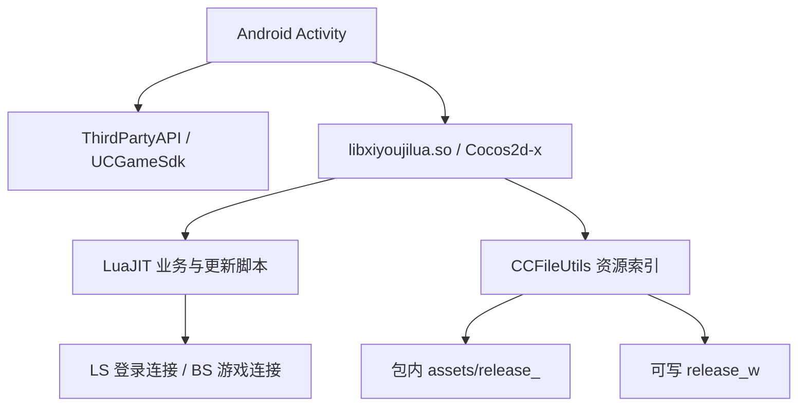
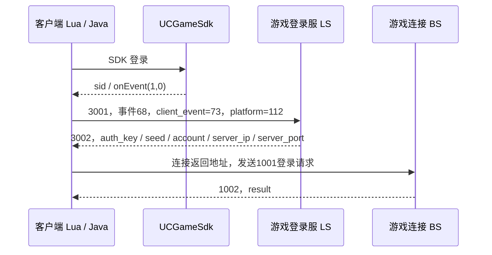

# 《金箍棒》3.87 Android 客户端静态分析报告

分析日期：2026-10-23（Asia/Shanghai）  
分析对象：工作区 `jgbol3.87/` 解压目录。  
检查范围：资源完整性、登录流程、配置表、协议定义、热更新模块。

## 分析结论

包内资源索引可以恢复，全部索引引用均有对应文件；配置表和 LuaJIT 字节码可以静态解析，网络消息定义与更新入口已定位。这些材料能够支持后续客户端与服务端交互逻辑研究，但尚不足以证明客户端可以离线完整游玩，也不能据此恢复原服务器的业务实现。

| 检查项 | 结果 | 证据边界 |
|---|---|---|
| 资源完整性 | 索引版本 **1205**；8,314 条逻辑引用覆盖 7,739 个物理资源；7,807 个签名清单条目摘要匹配 | 确认包内基线；设备已下载资源与远端更新包未取证 |
| 登录流程 | Java 接入 **UCGameSdk**；渠道标识 **112** 对应 Lua **wdj_a2**，使用 `sid` 登录参数 | 已恢复静态调用链；SDK、登录服和游戏连接可用性未验证 |
| 配置表 | **361 张 CSV、30,309 条表头外记录**；全部解码并导出 | 15 张表存在列数不齐；客户端配置不等于完整服务端配置 |
| 协议定义 | **269 条消息/结构定义**，其中客户端业务组 `gscl_msg` 199 条 | 外层封包、动态子事件和业务状态机尚未全部恢复 |
| 热更新模块 | Lua 更新管理、ZIP 下载校验、解压与可写索引维护均已定位；native 内部版本 **111** | 默认走普通更新分支；运行时最终资源版本未知 |

附件：[协议定义表](协议定义表.md)、[配置表目录](配置表目录.md)、[结构化汇总](evidence/summary.json)。

后续专项分析：[从渠道登录到主场景](登录到主场景静态分析.md)。该补充以当前 360 移植包为对象，继续追踪 1017 角色数据、主界面、新手引导和重连，并区分本报告原始 UC 样本的渠道参数。

## 样本、方法与证据说明

本次分析直接读取指定目录中的 Manifest、DEX、native 库和资源，进行摘要核对、二进制 XML 解析、Java/ARM Thumb 反汇编、LuaJIT 数据结构解析、CSV 读取和图片格式校验。未启动游戏、执行客户端 Lua、调用 ADB 或访问游戏服务与更新地址。用户图片用于确定五项检查范围，不作为客户端实现的证据。

未提供对应原始发行 APK。本次临时将解压目录封装为检查用 ZIP/APK，以便 `aapt`、`apksigner` 读取；其 CRC 和目录一致性检查仅针对该临时容器，不证明原始 APK 压缩文件的传输完整性。保留的 `META-INF` 文件可用于校验当前目录内的签名覆盖内容。

“已确认”表示有样本内容或本次校验支持；“静态推断”表示由调用和分支推导、未经运行验证；缺少材料或未完成逆向的内容明确标为未确认。报告中的 `lua/...`、`csv_config/...` 是索引逻辑路径，实际资源位于 `assets/release_/*.data`。附件中的 `Lxxxx` 为字节码保留的原始源码行号，反汇编文本并非原作者源码。

| 项目 | 样本信息 |
|---|---|
| 应用名、包名 | 金箍棒；`com.sygame.jingubang.uc` |
| Android 版本 | `versionName=3.87`，`versionCode=87` |
| 主 Activity | `com.sygame.jingubang.uc.xiyoujilua` |
| Android SDK 声明 | `minSdkVersion=8`，`targetSdkVersion=10` |
| 主游戏 ABI | `armeabi`，32 位 ARM ELF little-endian |
| 主程序与附加库 | `classes.dex`、`lib/armeabi/libxiyoujilua.so`、`lib/armeabi/libpocketsphinx_jni.so` |
| 引擎与脚本 | Cocos2d-x / `CCLuaEngine`；native 含 `LuaJIT 2.0.1` 标识；脚本为 LuaJIT dump v1 |
| Lua 文件与函数原型 | 323 个文件；10,705 个函数原型，包含顶层 chunk |
| native 内部版本 | `LuaInterface::getCppVersion()` 返回 111 |

渠道 SDK 附带的其他架构组件不代表主游戏库支持相同 ABI。Android 应用版本、native 内部版本和资源索引版本是三个独立标识。



证据：[Manifest](evidence/manifest.txt)、[应用标识](evidence/badging.txt)、[Java 反汇编](evidence/client_java.dexdump.txt)、[native 符号](evidence/native_symbols.txt)、[内部版本指令](evidence/native_cpp_version.asm)。

### 样本指纹

| 文件 | SHA-256 |
|---|---|
| `AndroidManifest.xml` | `6586532bfee8d8cd92f754334b8fef2829e8bbdcb968965244b15c1dc272852b` |
| `classes.dex` | `20ff1e3b7487095a51e8672f63b9d15d5341c00f4e5b5be94f3cca349ec8a9e2` |
| `resources.arsc` | `1aeb288162eeda24b359814cfe700c04edf11e33ee9443dbf19265db77d3997b` |
| `lib/armeabi/libxiyoujilua.so` | `1ea4ed769527deae3ee79c60d2c749c6f4834b9c321f012d5784318d3112fe86` |
| `assets/release_/index.txt` | `d5a30af29ac2f79e578fa61f908cc542face3038ede3dc73ddc4577927dfe847` |

## 一、资源完整性

### 1. 文件与签名核对

`META-INF/MANIFEST.MF` 中 7,807 个文件均存在，SHA-1 摘要全部匹配。临时检查容器包含 7,810 个非目录条目，ZIP CRC 检查无错误，条目内容与样本目录逐字节一致。`apksigner verify` 通过 v1/JAR 签名验证；该检查容器未检出 v2/v3/v4 签名，无法据此判断未提供的原始 APK 是否曾含 APK 签名块。

证书 DN 为 `CN=9Game, OU=UC, O=UC, L=GuangZhou, ST=GuangDong Province, C=CN`，证书 SHA-256 为 `c74bcef49a25da9fcfef5a6f721a58f62f19deef39ad1b9ce15be32e21445fe8`。这些结果确认当前签名与内容的一致性；证书名称本身不独立证明发行方身份。

另对 `assets/ucgamesdk/` 中 11 个内嵌 APK（含 10 个 modules 模块及 `lib/ucsdk.apk`）执行 ZIP CRC 检查，均通过。该项不包含这些模块的运行兼容性或远端依赖验证。

证据：[逐文件摘要](evidence/signed_entries.json)、[签名验证](evidence/apk_signature.txt)、[SDK 内嵌包检查](evidence/sdk_archive_validation.json)。

### 2. 索引格式

`assets/release_/index.txt` 的版本行为 `ver====1205====`，主体使用自定义 Base64；解码后的文本按 GB18030 读取，再导出为 UTF-8。索引含 `v2/ling/g_attr6 - 副本.png` 等非 ASCII 路径，不能直接假设解码结果全为 UTF-8。

```text
字母表：yfglmnovwxapzdechijkqrstbuHOMICDJPQRSTUVWXYZABKEFGLN39+0126-4785
填充符：_
记录：逻辑路径====物理文件名====索引声明大小
```

关键映射：

| 逻辑路径 | 物理文件 | 索引大小 | 实际大小 |
|---|---|---:|---:|
| `lua/common/msg_def.lua` | `6dc7effc05688bb493fa72368df65d46.data` | 73815 | 53154 |
| `lua/mg_update.lua` | `91c18d74512755e09145fdf82fd2bfd1.data` | 7244 | 4763 |
| `lua/net/network.lua` | `0f4278bbdf1babdbf72cd1dfe0390931.data` | 102805 | 73499 |

`index_1205.txt` 与 `index.txt` 完全相同。`.data` 是资源命名方式，不能将所有文件一概认定为加密数据。

证据：[索引明文](evidence/resource_index.decoded.txt)、[Base64 解码指令](evidence/base64_decode.asm)、[索引解析指令](evidence/index_parser.asm)。

### 3. 覆盖率与可解析性

`release_` 共 7,741 个文件，总计 156,521,838 字节（约 149.27 MiB）。其中 7,739 个不同物理资源被索引引用，其余两个为索引本身。8,314 条逻辑引用全部可以定位；多个逻辑名称共享物理文件属于索引实际映射，不能视为缺失。

| 逻辑扩展名 | 引用数 |
|---|---:|
| `.plist` | 151 |
| `.png` | 6,485 |
| `.ccbi` | 263 |
| `.jpg` | 685 |
| `.csv` | 361 |
| `.lua` | 323 |
| `.mp3` | 39 |
| `.fnt` | 2 |
| `.shader` | 5 |
| **合计** | **8,314** |

索引声明大小与实际大小有 6,788 条引用不一致，集中于 6,465 条 PNG 和全部 323 条 Lua 引用；其余 1,526 条大小匹配。这 1,526 条的文件内容 MD5 也与物理文件名匹配。图像优化、脚本编译等索引后构建步骤可能造成这种现象，但本次没有原始流水线材料证明原因。当前文件已经通过签名清单摘要检查，单凭索引大小或文件名 MD5 不匹配，不能判定资源损坏。

去重后 6,601 个图片文件均通过格式识别及 `Pillow.verify()`，其中 PNG 6,177 个、JPEG 424 个。323 个 LuaJIT chunk 均完整解析到文件末尾，原型边界和子函数栈检查通过。图片格式检查不等于完整像素解码、场景渲染或运行验证。

**本项确认包内索引基线的文件存在性、签名内容一致性，以及已检查格式的可解析性。** 尚未确认运行时拼接的所有资源路径、全部关卡表现、远端追加资源及设备 `release_w` 的完整性。

证据：[资源清单](evidence/resource_inventory.json)、[图片校验](evidence/image_validation.json)、[脚本目录](evidence/script_inventory.json)。

## 二、登录流程

### 1. 渠道与凭据来源

Java `com.syyx.sdkproxy.ThirdPartyAPI` 声明 `ThirdPartyFlag=112`；初始化调用 `UCGameSdk.defaultSdk().initSdk(...)`、注册 SDK 事件接收器，登录使用 `UCGameSdk.login(Activity, SDKParams)`。`ThirdPartyAPI$1.onLoginSucc(String sid)` 将回调字符串存入 `mToken`，再调用 `ThirdPartyCallback.onEvent(1, 0)`。

Lua `common/common_def.lua` 的 `platform_type.wdj_a2=112`。`event_mgr.lua` 原始行 2286–2287 将这一渠道的事件交给 `loginUI.requestLoginWDJA2`；该函数在登录成功后通过 `thirdPartyPlatformGetToken()` 取回凭据，保存至 `g_third_param.token`，调用 `login_ls_thirdPlatform()`。`network.lua` 原始行 528–529 随后选择 `send_third_login_req_wdj_a2`。

因此本样本应准确描述为：**UC SDK 实现，Lua 使用 wdj_a2（112）渠道分支**。包名中的 `uc` 不能单独决定游戏层登录参数；脚本另有 `uc_a=13` 分支，但当前固定渠道标识不选取它。

证据：[Java 桥接](evidence/client_java.dexdump.txt)、[平台常量](evidence/lua_named/lua/common/common_def.lua.txt)、[事件派发](evidence/lua_named/lua/event_mgr.lua.txt)、[登录 UI](evidence/lua_named/lua/ui/loginUI.lua.txt)、[渠道判断](evidence/lua_named/lua/config/third_party_config.lua.txt)。

### 2. 游戏登录请求与连接顺序

`send_third_login_req_wdj_a2` 位于 `network.lua` 原始行 2236–2272，字段构造如下：

| 层次 / 字段 | 静态可见值或来源 |
|---|---|
| 外层消息 | `lscl_msg_id.msg_common_event=3001` |
| 外层 `id` | `common_event_type.login_request=68` |
| 内层 `client_event` | `client_common_event.wdj_new_login=73` |
| 内层 `platform` | `platform_type.wdj_a2=112` |
| 内层 `version` | `tonumber(main_server_get_ver())`，资源版本查询结果 |
| 内层 `select_area` | `getLoginServerId()` |
| 内层 `sid` | `g_third_param.token`，发送前调用 `checkSDKToken` |
| 内层 `feature` | `getLoginFeatures()` |
| 外层 `data` | 对内层参数调用 `table.tostring` 得到的文本 |

UI 同时读取账号 ID 和名称，但此请求构造函数只将 token 映射为 `sid`，没有将 `account_id`、`account_name` 写入该内层参数表。`data` 是 Lua 表序列化文本，不能直接按 JSON 假设其格式。



这是静态恢复的预期链路，并不表示本次成功完成了交互。`msg_login_rsp_3002`（原始行 2277–2340）包含返回值检查、失败提示和 `connect_to_bs()` 调用；`send_login_req_1001_bs`（2346–2391）使用 `auth_key`、`seed`、账号和 `hash_account`，已进入游戏后的重连另用 `1016` 与 `random_key`。`BS` 保留代码命名，其服务端准确职责未由本次材料证明。

### 3. 地址来源与未确认项

登录 UI 从所选分区的 `server_infos` 读取登录地址；更新模块维护 `update_w/server_list.txt`。后续游戏连接地址来自消息 3002。因此资源 HTTP 地址、登录服地址和游戏连接地址应分开处理。

本次没有核验 SDK 在线认证、服务器列表现状、服务器是否接受凭据、实际网络往返或完整角色进入流程。其他渠道及普通账号登录代码的存在，也不说明当前包可以直接切换认证方式。

证据：[网络逻辑](evidence/lua_named/lua/net/network.lua.txt)、[登录参数校验](evidence/lua_named/lua/net/login_format.lua.txt)、[更新管理](evidence/lua_named/lua/update/update_mgr.lua.txt)。

## 三、配置表

### 1. 提取结果与内容

361 张 CSV 均完成解码和 CSV 解析，总计 30,309 条表头外记录；其中 351 张可按 UTF-8/UTF-8 BOM 解码，10 张使用 GB18030。行数包含可能的空记录，编码标签表示本次实际解码方式。

UTF-8 阅读副本保留 `csv_config/` 下的相对目录层级，避免 `elite/` 与 `undergo_ordeal/` 等目录中的同名文件相互覆盖。副本仅统一文本编码及换行，不对原字段做业务修正。

| 表（相对 csv_config） | 数据行 | 内容线索 |
|---|---:|---|
| `cortege/cortege_base_0.csv` | 417 | 伙伴类型、基础属性及资源 |
| `cross_server/camp_control.csv` | 7 | 跨服阵营控制参数 |
| `elite/elite_tollgate_config.csv` | 67 | 精英关卡 |
| `role_init_values.csv` | 71 | 角色初始字段、类型和值 |
| `role_level_config.csv` | 99 | 等级、升级经验和伙伴参数 |
| `skill_base.csv` | 64 | 技能公式标识、品质和作用字段 |
| `specter_boss_config.csv` | 81 | Boss 层数、伙伴编成及奖励 |
| `tollgate_config.csv` | 597 | 关卡关系、消耗和奖励 |
| `undergo_ordeal/tollgate_config.csv` | 81 | 历练关卡 |

完整目录及链接见 [配置表目录](配置表目录.md)；列名、解码方式、异常记录号与前两条记录见 [配置清单](evidence/config_inventory.json)。

### 2. 需要保留的格式细节

部分字段包含 `|`、`/` 分隔的复合值，例如奖励条目、伙伴编成或参数列表，外层 CSV 解析成功不意味着这些字段的业务结构已经完全解释。空值、字符串数字、公式编号、枚举和缺省值也应结合实际加载与使用代码判断，不能统一强转为数值。

15 张表的部分记录列数与表头不一致：

| 表 | 列数异常记录数 |
|---|---:|
| `answer_rule.csv` | 4 |
| `cortege/cortege_name_0.csv` | 1 |
| `cross_server/camp_control.csv` | 7 |
| `cross_server/camp_level.csv` | 74 |
| `elite/elite_tollgate_name.csv` | 5 |
| `ext_star_config.csv` | 2 |
| `get_lingqi_method.csv` | 9 |
| `item_name.csv` | 11 |
| `newbie_content7.csv` | 2 |
| `rune.csv` | 4 |
| `skill_ext_base.csv` | 1 |
| `skill_ext_name.csv` | 3 |
| `specter_boss_config.csv` | 80 |
| `undergo_ordeal/elite_tollgate_name.csv` | 1 |
| `undergo_ordeal/tollgate_name.csv` | 1 |

异常记录号按 CSV 解析记录计数（表头为第 1 条），不是含多行引号字段时的物理文本行号。导出保留原内容，没有自动补列、删列或推断缺失值。这些现象可能来自空记录、备注或不规则源数据，具体影响需对照游戏读取逻辑。

### 3. 配置恢复边界

目前可确认表的可读性、列名和内容可提取。尚未逐项校验全部主键引用、奖励概率、技能公式、服务端覆盖值和结算规则。客户端显示与预测所需的数值不一定包含服务器权威计算所需的所有数据。

## 四、协议定义

### 1. 来源与覆盖

从 `lua/common/msg_def.lua` 的 LuaJIT 常量和表构造指令恢复消息定义。工具只做离线解析与受限常量传播，不执行 Lua。共恢复 269 条消息/结构定义：

| 定义组 | 条数 |
|---|---:|
| `common_def` | 43 |
| `gscl_msg` | 199 |
| `lscl_msg` | 2 |
| `gsls_msg` | 10 |
| `gsdba_msg` | 2 |
| `lsdba_msg` | 2 |
| `lsdti_msg` | 2 |
| `gsdti_msg` | 3 |
| `wsdba_msg` | 2 |
| `gsbs_msg` | 4 |
| **合计** | **269** |

`common_id` 有 58 个 ID 常量，而 `common_def` 有 43 个字段定义，二者统计口径不同。`csdba_msg_id` 声明 3701、3702，但没有对应 `csdba_msg` 字段表，不能将其计为已恢复布局。客户端携带服务间协议定义，不代表对应服务实现已经存在或恢复。

### 2. 关键消息

下表字段不展开 `base` 继承，完整原文见 [协议定义表](协议定义表.md)。

| ID | 名称 | 字段定义 |
|---:|---|---|
| 100 | `msg_base` | `type=W,size=I,connection_id=I` |
| 1000 | `msg_heartbeat` | `type=B` |
| 3001 | `msg_common_event` | `id=B,data=s` |
| 3002 | `msg_login_rsp` | `auth_key=I,seed=I,server_port=I,account=S[33],server_ip=s` |
| 1001 | `msg_login_req` | `hash_account=I,auth_key=I,seed=I,client_ip=S[16],account=S[33]` |
| 1002 | `msg_login_rsp` | `result=B` |
| 1016 | `msg_reconnect` | `hash_account=I,random_key=I,account=S[33]` |
| 1026 | `msg_fight_request` | `serial_num=I,fight_type=B,des_value=I,des_type=B,des_id=d` |
| 1027 | `msg_fight_result` | `serial_num=I,fight_id=I,fight_type=B,guide_stage=B,final_result=B,fight_round=B,fight_result=$105{255}` |
| 2998 | `msg_common_event` | `serial_num=I,id=B,data=s` |

3001 的定义是通用事件载体，具体登录行为取决于事件 ID 和 `data` 内容。2998 同样承载动态业务事件；269 条结构的提取不代表所有子事件参数和响应处理都已穷尽。

### 3. 字段记号与 native 支撑

已定位 `FieldValue::FieldValue`、`LuaInterface::SizeOf`、`LuaInterface::get_msg_buffer`、`CurlSocket::send2Server` 与 `decodePackage`。这是自定义字段描述与二进制序列化体系。

| 记号 | 当前证据支持的解释 |
|---|---|
| `B`、`b`、`l` | 固定部分每元素计 1 字节；精确转换语义仍需读写实现核对 |
| `W`、`w` | 每元素计 2 字节 |
| `I`、`i`、`f` | 每元素计 4 字节；`type_def` 明确 uint/int 对应 I/i |
| `d` | 每元素计 8 字节；`type_def.objguid=d`，不能按字母直接认定为浮点数 |
| `S[n]`、`N[n]` | 固定字节区域，实际填充及截断规则待核对 |
| `s` | 动态字符串；长度、终止与字符编码待完整核对 |
| `$105{255}` | 引用结构 105 的集合描述，带数量限制；准确线格式待核对 |

`SizeOf(FieldValue*)` 位于 `0x101ddc`；`get_msg_buffer` 位于 `0x101ea4`，长度初始化为 10，与 `type=W,size=I,connection_id=I` 的逻辑基础头一致。`CurlSocket` 仍有额外打包/解包逻辑，不能将这个 10 字节直接视为全部传输层包头。

尚未完整确认端序、包长字段口径、动态长度编码、压缩触发条件及全部校验分支。本次没有编造可直接互通的网络编码器。

证据：[native 协议指令](evidence/native_protocol.asm)、[原始 Lua 定义](evidence/lua_named/lua/common/msg_def.lua.txt)、[协议常量 JSON](evidence/protocol_tables.json)。

### 4. 原始定义异常

`type_attach_data` 重复声明 `stone1_level`；`type_pp_http_response` 中 `user_name=S[32,uid=d` 缺少预期闭括号。导出保留样本原文。是否为未使用分支、原定义错误，以及 native 解析器如何处理，尚未确认；不能据此认定全部通信失败，也不应擅自修正后当作原协议。

## 五、热更新模块

### 1. 入口与脚本位置

更新方案以 Lua 脚本、配置和资源文件的更新为核心。脚本在包内以索引映射的 `.data` 文件存放，由 LuaJIT 加载；本次已定位以下模块：

| 逻辑路径 | 包内物理文件 |
|---|---|
| `lua/config/config.lua` | `assets/release_/5d48128d9343254655dfce1597383608.data` |
| `lua/mg_update.lua` | `assets/release_/91c18d74512755e09145fdf82fd2bfd1.data` |
| `lua/update/ms_jumper.lua` | `assets/release_/9c78c7e5bb94cc64143866f8cdb1c1dd.data` |
| `lua/update/updateUI.lua` | `assets/release_/a751b0ff949d6ee266094505e47511da.data` |
| `lua/update/update_mgr.lua` | `assets/release_/771ef5cb7d6e7c013cbb305c6fcad41c.data` |

`mg_update.lua` 提供启动/初始化入口；`update_mgr.lua` 管理版本查询、清单、下载、MD5 校验、解压和索引维护；`updateUI.lua` 处理更新界面与服务器信息；`ms_jumper.lua` 负责相关模块切换。未将这套机制认定为 Unity/C# 程序集热更。

### 2. 路径与文件流

| 位置 | 用途 |
|---|---|
| APK `assets/release_/` | 包内基线索引和资源 |
| 可写根目录下 `release_w/` | 更新 ZIP 解压目标及可写资源索引 |
| 可写根目录下 `update_w/` | 更新清单、服务器列表与下载 ZIP |
| `index.txt` / `index_<版本>.txt` | 当前索引及版本副本 |
| `server_list.txt` | 分区与登录入口信息 |
| `update_list.txt` | 更新 ZIP 等清单信息 |

目录由运行时可写根路径拼接，不能仅凭静态字符串固定为某一 Android 绝对路径。native 自定义 `CCFileUtils::getFileData` 和索引解析参与资源定位；Lua 管理可写索引复制与 APK 索引恢复。

静态流程为：读取本地资源版本 → 获取服务器列表/更新清单 → 比较资源与 C++ 版本 → 选择更新 ZIP → 下载至 `update_w` → 校验 → 解压至 `release_w` → 清理下载文件并维护索引。包含下载失败、镜像切换、重新下载和索引恢复分支；本次没有运行验证其全部故障恢复情形。

### 3. 当前默认更新分支

`common/utils.lua:isLuaC()`（原始行 1169–1175）按 `getCppVersion()>500` 判断。样本 native 返回 **111**，因此该判断为假。在包内默认正式环境、初始镜像索引下，静态推得优先入口如下：

| 用途 | 根地址 |
|---|---|
| 服务器列表 | `http://jgbupdate02.shangyoo.com/update/jgb/` |
| 更新清单 | `http://jgbupdate02.shangyoo.com/update/jgb/` |
| ZIP 更新资源 | `http://jgbupdate02.shangyoo.com/jgb/update/updatefile/` |

普通分支的备用主机包括 `jgbupdate04.shangyoo.com`、`123.103.22.250`、`113.105.245.176`。脚本还包含测试环境、`ios64` 和 HTTPS 等分支，但不能把出现过的全部 URL 都作为当前默认入口。最终请求受清单、环境开关、镜像索引及后续热更新影响；上述地址均未访问、未验证在线可用性。

### 4. 校验逻辑与完整性边界

`update_mgr.lua` 原始行 547–559 对 ZIP 调用 `check_md5`，随后存在检查 MD5 文本前六字符是否为 `AAAAAA` 的分支；满足时把校验结果置为成功。因此现有逻辑不能描述为所有更新包无条件执行强制 MD5 校验。该结论来自指令分支，本次没有构造或投递更新包。

包内资源版本 **1205** 已确认；设备可写目录是否已有不同版本、远端 ZIP 是否完整、更新是否成功覆盖协议/配置，均未确认。需要对应设备的 `release_w`、`update_w` 快照及其有效索引，才能对“当前运行资源”作完整性结论。

证据：[更新入口](evidence/lua_named/lua/mg_update.lua.txt)、[更新管理](evidence/lua_named/lua/update/update_mgr.lua.txt)、[URL 选择](evidence/lua_named/lua/config/config.lua.txt)、[isLuaC 条件](evidence/lua_named/lua/common/utils.lua.txt)、[native 资源读取](evidence/native_resource_loader.asm)。

## 附件与复核

| 文件或目录 | 内容 |
|---|---|
| [协议定义表.md](协议定义表.md) | 269 条结构字段与缺失布局说明 |
| [配置表目录.md](配置表目录.md) | 361 张表的路径、行数、编码、异常记录统计与阅读副本链接 |
| `configs/` | 保留相对目录的 UTF-8 CSV 副本 |
| `evidence/resource_inventory.json` | 全部逻辑路径、物理文件、大小和摘要 |
| `evidence/lua_named/` | 323 个按逻辑路径组织的 LuaJIT 指令文本 |
| `evidence/client_java.dexdump.txt` | 客户端、渠道桥接与相关 Cocos Java 指令 |
| `evidence/native_*.asm` | 本次重点核对的 native 指令 |
| [tools/luajit_static.py](tools/luajit_static.py) | 离线 LuaJIT dump v1 解析与受限常量传播 |
| [tools/analyze_client.py](tools/analyze_client.py) | 索引、配置、协议、签名覆盖和临时检查容器核对 |

在工作区根目录复核核心提取：

```sh
python3 analysis/tools/analyze_client.py
# 也可输出到独立目录
python3 analysis/tools/analyze_client.py --output /private/tmp/jgbol387-review
```

工具使用 Python 标准库和工作区已有 Android SDK/JDK；不执行客户端代码。图片格式检查另使用 Pillow，DEX/native 指令证据由 `dexdump -d` 与 `objdump -d -C --triple=thumbv7` 提取，结果已保存在附件。核心提取命令不会自动重做这些独立检查或重写本报告的人工判读。

LuaJIT 解析格式参考官方源码：[dump 格式定义](https://raw.githubusercontent.com/LuaJIT/LuaJIT/v2.0/src/lj_bcdump.h)、[指令定义](https://raw.githubusercontent.com/LuaJIT/LuaJIT/v2.0/src/lj_bc.h)、[字节码读取实现](https://raw.githubusercontent.com/LuaJIT/LuaJIT/v2.0/src/lj_bcread.c)。这些资料用于解释文件结构；游戏业务结论均以本地 3.87 样本为依据。
