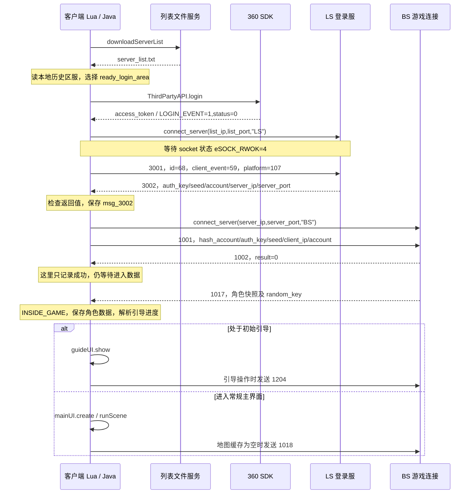

# 金箍棒 3.87：从渠道登录到主场景的静态分析

分析日期：2026-10-23（Asia/Shanghai）。本报告延续[客户端静态分析报告](客户端静态分析报告.md)，以用户提供的 `IMG_3405.PNG` 为流程对照，分析当前 `game.json` 指向的 `build/jgbol3.87-360-list.apk`，同时注明原始 UC 版差异。

## 1. 核心结果

**当前客户端的主链路是：列表与选区 → SDK 登录 → 连接 LS → 3001 渠道认证请求 → 3002 返回凭据和 BS 地址 → 连接 BS → 1001 登录 → 1002 结果 → 1017 角色快照 → 新手引导或主界面。**

图片中的接口名称不能直接套用于这个客户端。本次在当前 APK 全部 323 个 LuaJIT chunk 的字符串常量中搜索，没有发现 `player.Login`、`player.GetUserList`、`player.CreateUser`、`user.UserLogin`、`user.GetUserInfo`、`LoginOk` 或独立的 `getHash` 常量。下文对照的是职责，不宣称存在同名 RPC。

本次新增确认：

1. 最近登录区服从本地 `CCUserDefault` 读取，已定位三个历史区服槽位；没有找到独立的 `getLastServerList` 远端调用。
2. 当前 360 分支的认证参数是 **`platform=107`、`client_event=59`、`access_token`**；原始 UC 分支是 `112 / 73 / sid`。
3. `3002` 的成功路径不依赖 `result` 字段，而是检查地址、端口及 `auth_key`；失败时 `auth_key` 还承担错误码用途。
4. `hash_account` 在本地计算，与 LS 下发的 `auth_key`、`seed` 是不同数据。已向下定位到 native 的 Jenkins 哈希函数。
5. **`1002.result=0` 只在该处理函数中记录成功日志；实际初始化角色数据和进入界面的入口是 `1017`。**
6. `1017` 定义含 **307 个字段**。进入界面还涉及新手引导、地图请求及其他初始化，不是一个 `LoginOk=true` 就能完成。

这些是静态实现结论；本次没有启动客户端、调用 ADB、输入账号、请求远端接口或验证区服在线状态。

## 2. 样本与验证边界

| 项目 | 本次核对结果 |
|---|---|
| 当前 APK | `build/jgbol3.87-360-list.apk` |
| 当前 APK SHA-256 | `de41eb0cb4155704c950428a1eaa2465c5046fe45160e415a10878993aee1155` |
| 原始游戏内容 | `jgbol3.87/assets/release_`；索引版本 `1205` |
| Lua 对比 | 323 个 chunk 均重新静态解析；322 个与原版逐字节相同 |
| 唯一 Lua 差异 | `lua/update/update_mgr.lua`；与项目已有服务器列表补丁的输出完全一致 |
| native 库 | 与原始 3.87 逐字节相同；SHA-256 `1ea4ed769527deae3ee79c60d2c749c6f4834b9c321f012d5784318d3112fe86` |
| Java 360 桥接证据 | 项目既有 `.runtime/channel360/decoded/smali/com/syyx/sdkproxy/` 构建材料，相关文件另存到本报告证据目录 |
| 运行时覆盖资源 | 未读取设备 `release_w`；实际运行可能使用包外更新资源 |

报告中的 `Lxxx` 是字节码保留的**原始源码行号**，不是反汇编文本的物理行号。反汇编是静态证据，不是恢复出的原作者源码。未找到某名称只说明本次检索范围内没有该常量，不排除其他命名或动态构造。

机器校验结果：[verification.json](evidence/login_flow/verification.json)。关键函数摘录：[lua_excerpts.txt](evidence/login_flow/lua_excerpts.txt)。

## 3. 与图片逐项对应

| 图片步骤 | 本客户端对应实现 | 判断 |
|---|---|---|
| SDK login | `onTouchLoginMobile → thirdPartyPlatformLogin → ThirdPartyAPI.login`；360 回调进入 `requestLoginP360_na` | 已定位；正常入口在列表与选区之后 |
| getServerList | `update_mgr.downloadServerList` 下载；`loginUI.readServerListFile` 读取 | 已定位；静态文件下载与本地解析 |
| getLastServerList | `setting` 从 `CCUserDefault` 读取 `last_area_1/2/3` | 已定位本地历史；未发现同名网络请求 |
| 选服 | `ready_login_area`、`getLoginServerInfo`、`getLoginIPPort` | 已定位；区服 ID 与列表下标不能混为一谈 |
| getHash，拿 host/port/hash | 连接 LS 后发送 `3001`，收 `3002` 的 `server_ip/server_port/auth_key/seed/account`；另在本地算 `hash_account` | 职责近似，实际拆成两部分 |
| Connect(host,port) | 先 `connect_server(...,"LS")`，后 `connect_server(...,"BS")` | 两阶段连接 |
| player.Login | BS 上的 `1001 msg_login_req` / `1002 msg_login_rsp` | 职责近似，无同名调用 |
| player.GetUserList | 有 `type_enum_role` 结构定义，但未找到接入本链路的角色枚举请求与处理器 | 不能据此补出角色列表步骤 |
| [player.CreateUser] | 未恢复独立创建角色请求；新手命名、初始伙伴等走 `1204 msg_new_role_guide` | 与图片不对应；服务端初始角色创建时机未知 |
| user.UserLogin | 未发现独立角色登录阶段；当前链路由 `1001/1002` 后接 `1017` | 不应假设另有一次 UserLogin |
| user.GetUserInfo | 收到 `1017 msg_inside_game` 后保存角色数据 | 职责近似；本链路没有先发同名请求 |
| LoginOk | `inside_game_1017` 设置状态、保存角色快照并调用 UI | 实际是多项状态变更 |
| 主场景 | `mainUI.show → create → runScene`；可能先分流到新手引导 | 已定位入口，未验证完整渲染 |

## 4. 实际时序与状态机



图中 `1002 → 1017` 表示静态恢复的预期协议阶段，不是本次抓包证明的时序。`1002` 处理器没有主动发“获取角色信息”请求，`1017` 由注册的消息处理器接收。

`network.lua` 中可见的首次连接状态为：

```text
INIT
  → CONNECTING_LS
  → LS_CONNECT_OK       （LS socket 达到 eSOCK_RWOK=4，发送认证请求）
  → CONNECTING_BS       （3002 通过检查）
  → BS_CONNECT_OK       （BS socket 达到 eSOCK_RWOK=4，发送1001）
  → INSIDE_GAME         （处理1017）
```

`eSOCK_CONNECTED=3` 与 `eSOCK_RWOK=4` 是不同常量；Lua 发送上述登录请求的条件是后者。状态判断见 `network.lua L429–560`，进入状态见 `L2404`。不能把 TCP 连接建立、SDK 成功、BS 登录成功和主界面出现视为同一个成功点。

## 5. 服务器列表与最近登录区服

`update_mgr.downloadServerList` 位于 `L158–190`；当前补丁仅固定该函数的列表目录为 `p360_a/`。`loginUI.readServerListFile`（`L635–657`）读取可写目录下 `/update_w/server_list.txt`，通过 `loadstring_config_new` 取得配置表，再保存 `server_infos` 及 `version/cpp_version/name`。本次仅静态读取调用，未执行下载内容。

`getLoginServerInfo`（`loginUI.lua L76–120`）处理旧式选区值，并按记录的 `id` 与 `ready_login_area` 匹配；`getLoginIPPort`（`L124–138`）返回所选记录的登录地址。这里得到的是 **LS 地址**，后续 **BS 地址**来自 `3002`。

`setting.lua L44–47` 从 `CCUserDefault` 读 `last_area_1`、`last_area_2`、`last_area_3`。`saveLastMobileLoginInfo`（`L132–162`）把当前选区插到历史首位并去重，保存角色名称、ID、服务器 ID 等信息。它由首次 `inside_game_1017` 路径在 `network.lua L2515` 调用。因此历史区服具有本地设备状态性质，不能当作服务端返回的账号角色列表。

项目已有[列表快照](server_lists/server_list.json)记载 258 条记录、列表版本 1263，以及此前抓取时服务器给出的 2018 年最后修改时间。本次未重新联网确认；该文件中的区服状态不是当前在线性证据。列表版本 1263、包内资源索引版本 1205、native 内部版本 111 和应用版本 3.87 是不同标识。

## 6. SDK 到 LS：当前 360 与原始 UC 的差别

360 桥接链为：

```text
loginUI.onTouchLoginMobile                    L599–631
  → main_server.thirdPartyPlatformLogin()
  → ThirdPartyAPI.login() → UI线程 Runnable
  → Matrix.invokeActivity(..., mLoginCallback)
  → 回调解析并保存 mAccessToken / TP值表["access_token"]
  → ThirdPartyCallback.onEvent(1, 0)
  → event_mgr 按渠道107派发                    L2222–2223
  → loginUI.requestLoginP360_na                L1381–1414
  → main_server.getTPValue("access_token")
  → network.g_third_param.access_token
  → login_ls_thirdPlatform                    L178–199
```

`requestLoginP360_na` 要求成功事件与状态，恢复导演调度，读取 token；长度为零时回到登录界面。随后先连接 LS，网络 tick 检查连接可用后才调用 `send_third_login_req_p360_na`。

| `3001.data` 内层字段 | 当前 360 分支 | 原始 UC / wdj_a2 分支 |
|---|---|---|
| `client_event` | `59`，`p360_na_account_login` | `73`，`wdj_new_login` |
| `platform` | `107`，`p360_na` | `112`，`wdj_a2` |
| `version` | `tonumber(main_server_get_ver())` | 相同调用 |
| `select_area` | `getLoginServerId()` | 相同调用 |
| 凭据 | `access_token=g_third_param.access_token` | `sid=g_third_param.token` |
| `account_id` / `account_name` | 显式写入空字符串 | 该构造函数没有写入这两个字段 |
| `feature` | `getLoginFeatures()` | 相同调用 |

两者的外层均为 `lscl_msg_id.msg_common_event=3001`、`id=common_event_type.login_request=68`。`data` 是 `table.tostring` 的输出，**不是已经证实的 JSON 格式**。`getLoginFeatures`（`L710–717`）将 `mac`、`app_id`、广告渠道分别交给 `codeForUrl`，再以 `&` 拼接。

`checkSDKToken`（`network.lua L2593–2604`）容易误读：token 为 `nil` 或长度不大于零时返回 **true**，非空时返回 **false**；调用方在 true 时提示并退出。它没有验证 token 的签名、有效期或远端接受情况。

证据：`network.lua L1246–1278 / L2236–2272`；[360 主桥接](evidence/login_flow/ThirdPartyAPI.smali)、[SDK 回调](evidence/login_flow/ThirdPartyAPI$1.smali)、[SDK 登录 Runnable](evidence/login_flow/ThirdPartyAPI$3.smali)。原始 UC 的 `sid` 来源见[原报告](客户端静态分析报告.md)。

## 7. LS 返回与 BS 登录字段

### 7.1 `3002 msg_login_rsp`

结构定义为：

```text
auth_key=I, seed=I, server_port=I, account=S[33], server_ip=s
```

`msg_login_rsp_3002`（`network.lua L2277–2340`）进入成功分支的条件可整理为以下伪代码，前提是解码后的字段类型满足协议：

```lua
server_ip 有值
and auth_key >= 1000
and #server_ip > 0
and server_port > 100
```

成功时保存 `g_self.msg_3002=msg`，把 `msg.account` 写入 `g_ls.username`，调用 `connect_to_bs()`。失败路径使用 `login_code_%d` 格式化 `auth_key` 查询提示，并按注册、绑定或普通失败分支返回登录界面或 `kick()`。这条消息没有独立 `result` 字段，也没有直接返回 `hash_account`。

### 7.2 `1001 msg_login_req`

| 字段 | 类型记号 | 来源 |
|---|---|---|
| `hash_account` | `I` | `main_server.get_hash_account(account .. "@@" .. ready_login_area .. suffix)` |
| `auth_key` | `I` | `3002.auth_key` |
| `seed` | `I` | `3002.seed` |
| `client_ip` | `S[16]` | 本函数固定字面量 `172.0.0.168` |
| `account` | `S[33]` | `g_ls.username`，成功处理 3002 后来自 `3002.account` |

`suffix` 默认为空；只有渠道号等于 `8` 时追加 `@@8`，当前 107 不走该分支。`client_ip` 的固定字符串是请求字段，不是此时实际连接的服务器地址，也不代表设备的真实网卡地址。

### 7.3 本地 `hash_account` 与认证票据的区别

本次新增 native 反汇编定位：

```text
LuaInterface::getHashAccount          0x00100d38
  → calculateHashAccount             0x000ffaf0
  → Kernal_Helper_String2Id           0x000ffaa8
  → ArkCommon::hash::jenkins::hash    0x000ff8f8
```

`String2Id` 调用 `StringAdjust`，该函数可见 ASCII 大写转小写、反斜杠转正斜杠处理；传入 Jenkins 函数的第三参数为 `0`。上层 `calculateHashAccount` 还有逐字节查表处理，本次没有完全解析该表及全部边界行为，因此未提供可声称逐字节兼容的哈希重实现。

可确认 `hash_account` 是本地字符串派生值，不能等同于 SDK token 或服务端发放的 `auth_key`。返回的 `seed` 在 Lua 这一层原样放入 `1001`；仅凭字段名，不能宣称它就是加密密钥。

证据：[native_hash.asm](evidence/login_flow/native_hash.asm)、`network.lua L2346–2391`。

## 8. 角色数据、新手流程与主界面

`event_mgr.msg_login_rsp_1002`（`L288–298`）在 `result == login_code.success == 0` 时仅记录日志；失败时停止等待、显示错误并 `kick()`。这一处理器不发角色枚举、不选择角色，也不调用 `mainUI.show`。

`event_mgr.inside_game_1017`（`L300–312`）将消息交给 `network.inside_game_1017`。首次进入路径的关键动作如下：

| 源码位置 | 动作 |
|---|---|
| `network.lua L2404–2416` | 设为 `INSIDE_GAME`，清重连计时，保存 `random_key`，按 `server_time` 校时，清等待业务完成标记 |
| `L2466–2470` | 重置返回序列号，置 `g_has_inside_game=true`，令 `mainUI.g_playerInfo=msg`，记录首次进入状态 |
| `L2477–2488` | 触发好友列表、消息初始化、计时等工作 |
| `L2489` | 调用 `guideUI.getGuideState()` |
| `L2515` | 保存最近登录区服和角色信息 |
| `L2521` | 调用 `mainUI.show()` |
| `mainUI.lua L207–215` | 若需要引导且当前引导阶段不大于 `playMoive`，先显示引导并返回 |
| `mainUI.lua L223–241` | 常规路径设置当前场景、预载 CSV、创建主界面、`runScene`，再调用地图与基础数据初始化 |

`1017` 含 `role_id/role_name/level`、货币、体力、伙伴计数、`guide_progress`、`random_key`、服务器时间及大量玩法状态，总计 307 个字段。完整定义见[协议定义表](协议定义表.md)，本次提取副本见 `verification.json` 的 `messages`。

`guide_progress` 按位解析；`getGuideState` 查找未完成阶段并更新 UI 引导状态。命名操作使用 `1204 msg_new_role_guide`：

```text
serial_num=I, stage=B, head_type=I, name=s
```

`guideUI.lua L2477–2506` 构造 `stage=modify_name=1`、输入名称和头像；`L1320–1338` 构造 `stage=pick_cortege_one=2` 的初始伙伴请求。二者都不能直接解释为图片中的独立 `player.CreateUser`。客户端在 `1017` 已收到 `role_id`，但角色记录由服务端何时创建、如何持久化，没有客户端证据可以完整回答。

两个易混淆点已排除：

- `type_enum_role` 只在 `common/msg_def.lua` 的结构注册中出现，没有找到被登录流程消费的枚举消息；不能仅凭它推导多角色选择界面。
- `callbackCreateUserReply` 来自 `systemSetUI.replyGm` 的 `replies/create_user_reply?problem_id=...&content=...`，属于客服问题回复，和游戏角色创建无关。

`mainUI.show` 的地图缓存为空时，`mapUI.getMapData` 会发 `1018 msg_query_map_list`。因此“处理完 1017 并尝试切换界面”和“地图、背包、伙伴及玩法数据全部可用”仍是不同完成条件。

## 9. 重连是另一条分支

`send_login_req_1001_bs` 虽然函数名含 `1001`，实际按 `g_has_inside_game` 分流：首次进入发 `1001`；已经进入过游戏时发 `1016 msg_reconnect`，字段为：

```text
hash_account=I, random_key=I, account=S[33]
```

`random_key` 在 `1017` 保存，也会由 `2999 msg_keep_alive` 更新。`2996 msg_reconnect_notify` 的处理器设置 `INSIDE_GAME`、清重连计时、置进入标志并调用 `tryRetranReq()`；该处理器未读取 `ret` 字段进行分支。再次收到 `1017` 时，已有进入标志的路径更新角色快照、刷新界面数据并尝试重传，不重复完整首次初始化。

本次确认以上分支与字段来源，未恢复所有断线重试、退避和重传序列规则。不能将首次登录用的 `auth_key/seed` 与重连使用的 `random_key` 互换。

## 10. 恢复这条流程仍缺什么

| 层次 | 当前已有证据 | 尚未解决的具体问题 |
|---|---|---|
| 列表与选区 | 文件格式、地址来源、本地历史与区服映射 | 列表中地址的当前在线性 |
| 渠道认证 | 360 / UC 的 SDK 桥接、凭据字段、事件号 | SDK 实际签发、LS 验证及旧渠道兼容性 |
| LS → BS | 3001、3002、1001、1002 的结构和调用条件 | 服务端票据生成、账号映射与验证实现 |
| 线协议 | 结构表、native `CurlSocket` 解析线索 | 外层长度与头部的完整语义、文本序列化细节、完整压缩/编解码链 |
| 角色进入 | 1017 全字段定义、角色初始化与 UI 入口 | 服务端初始角色构造、字段默认值与一致性约束 |
| 新手与后续数据 | 1204 操作、1018 地图请求、主界面初始化入口 | 伴随推送、背包/伙伴/任务初始化及可持续运行的业务响应 |
| 重连 | 1016、2996、2999 和再次 1017 的客户端处理 | 请求序列、重传确认及持久会话行为 |

包内同时含 `gsls_msg` 的 `3103 msg_prelogin`、`3104 msg_prelogin_ret`、`3105 msg_create_role_ok` 等定义，可作为后续服务端职责分析的线索。**这些是客户端携带的服务间结构，不能当成客户端应发送的登录步骤，也不能证明服务端实现已恢复。**

若继续静态分析，最直接的工作顺序是：完整追踪 `main_server_send_msg_server → native 发送/接收` 的线格式；还原 `table.tostring` 的精确文本编码；整理首次 `1017` 后所有数据依赖及引导阶段响应。当前结果已经确定从哪个处理器进入主界面，但尚不是可直接实现完整替代服务端的协议规格。

## 11. 复核与产物

运行以下命令仅解析本地文件并更新本报告证据目录，不执行游戏 Lua、不联网：

```sh
python3 analysis/tools/analyze_login_flow.py
```

脚本依赖本项目原始资源、当前 APK、既有 Lua 反汇编与 360 smali 构建材料，以及本机 `xcrun llvm-objdump`。本次核对了 323 个 Lua chunk、当前 APK 与基线的差异、报告涉及的常量、307 字段的 1017 定义，以及关键 Lua 摘录与原始字节码重新生成结果的一致性。

- [复核脚本](tools/analyze_login_flow.py)
- [结构化字段、常量、摘要和名称搜索结果](evidence/login_flow/verification.json)
- [关键 Lua 函数摘录](evidence/login_flow/lua_excerpts.txt)
- [本地账号哈希 native 调用链](evidence/login_flow/native_hash.asm)
- [完整 Lua 反汇编目录](evidence/lua_named/lua)

本次只增加分析工具、证据和文档索引；未修改 APK、游戏资源、启动配置或模拟器状态。
