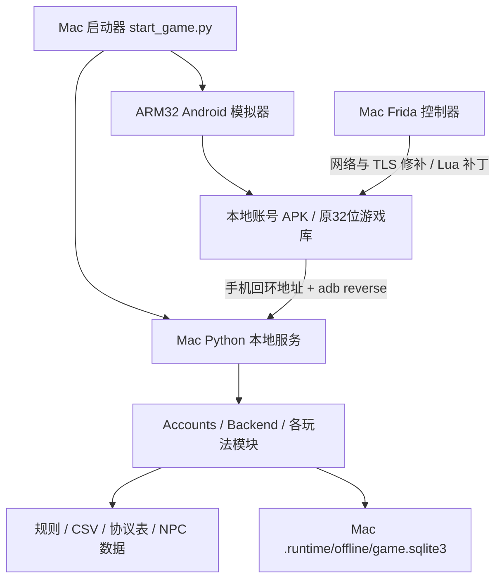
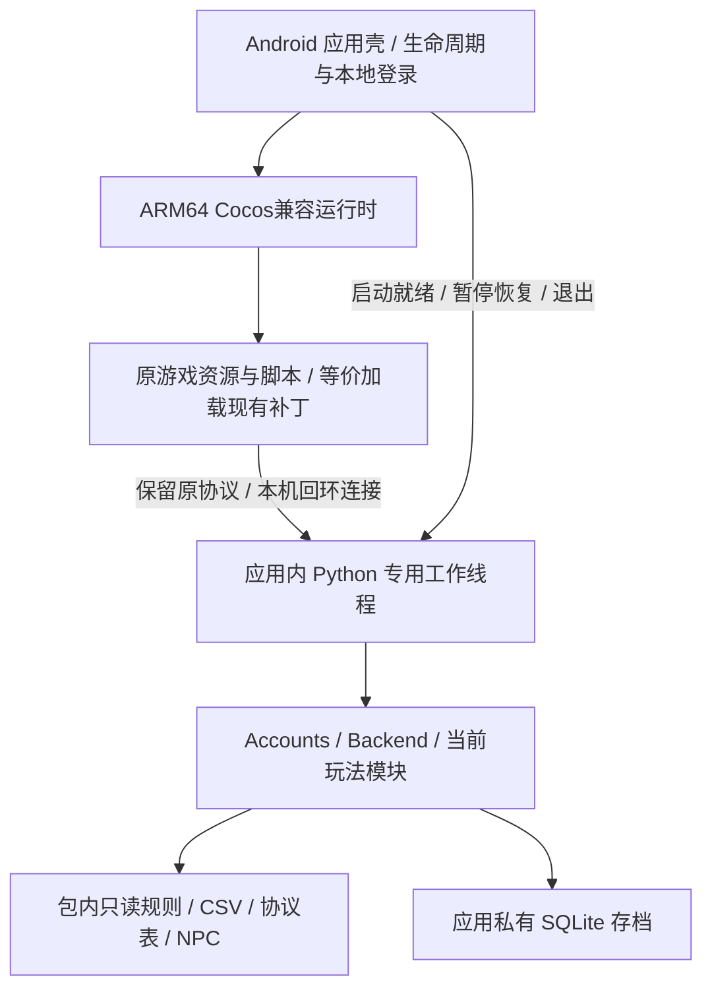

# 金箍棒 3.87：单机整合与 Android 64 位 APK 可行性分析

分析日期：2026-10-28（Asia/Shanghai）  
分析对象：`JGBOLNew` 当前工作区，包含已有未提交及未跟踪文件。  
任务范围：项目结构、客户端、服务端、运行资源、构建链和迁移方案分析；**本轮不实施迁移，不修改游戏代码、配置、存档或 APK。**

## 1. 结论

**将当前已经实现的客户端与本地服务端封装进一个离线单机 APK，在架构上可行；将现有游戏直接转换为真正的 ARM64 APK，目前不具备条件。主要阻塞是客户端原生源码和旧 LuaJIT 兼容性，而不是 Python 服务端能否放进手机。**

| 用户目标 | 判断 | 主要条件或限制 |
|---|---|---|
| 一个 APK，手机上独立运行，无需电脑 | 有可行的整合路线，尚未实现或真机验证 | 应用内启动业务服务，内置全部运行资源，替换 ADB／Frida 接入流程 |
| 断网、飞行模式下正常游玩 | 可作为交付目标 | 登录、区服、更新和业务请求均在本机闭环；首次启动也不能依赖外网 |
| 保持当前项目已有的游戏内容 | 可作为迁移验收标准，不能仅凭静态检查保证 | 冻结当前资源、Lua 补丁、规则、NPC、开关和存档，再逐项差分验证 |
| 保持历史官方网游全部内容、数值和真人交互 | 现有材料无法保证 | 缺原服务端及历史配置；现有实现含推测规则、NPC 替代和未接入分支 |
| 原 APK 直接改包成为 64 位 APK | 不可采用 | 改目录名、Manifest、签名或压缩方式不会把 ARM32 指令变成 ARM64 |
| 经重编译或兼容重建后得到 ARM64 APK | 有条件可行，客户端风险高 | 优先取得完整 native／Lua 工程；否则需要研究兼容恢复，工期及等价性无法先行保证 |

**推荐决策：先通过 ARM64 客户端可行性验证，再推进完整单机封装。** 优先寻找原始 C/C++、Lua 源码及构建材料；拿不到源码时，以小规模验证决定是否投入兼容重建。服务端优先保留现有 Python 业务和原协议，避免同时重写客户端与游戏结算。

本文默认“不更改游戏内容”指**保持本次工作区已经实现的离线版本**。将历史官方网游未恢复的内容补齐，或者调整概率、奖励、活动开关，不属于本次移植范围。

## 2. 本轮解析范围与证据边界

本轮进行了项目目录和文件类型盘点、Python AST 静态扫描、关键调用链及路径依赖复核、APK ZIP 结构检查、Manifest／ELF／Lua 字节码检查，并参考现有专项分析和 Android、Python、LuaJIT 官方文档。全项目结构已覆盖，但这**不等于逐函数证明正确或完成全游戏动态验收**。

没有启动模拟器或服务，没有执行构建、安装、充值、业务结算或存档迁移，没有读取玩家数据库内容，也没有重新执行全量业务测试。历史文档中的实机截图和测试通过数，均不冒充本轮验证结果。文件数量为本次读取时的快照，不包含缓存和 `.DS_Store`；后续工作区变化可能改变数量。

| 区域 | 当前材料与规模 | 在独立 APK 中的定位 |
|---|---|---|
| `jgbol3.87/` | 原 UC 包解压内容：DEX、二进制 Manifest、资源、两个游戏 native 库 | 客户端二进制与内容来源；不是完整源码工程 |
| `build/` | 原版、360、360-list、本地账号等 4 个 APK | 已有产物和对照样本；不能替代可编译 native 工程 |
| `network_redirect/` | 108 个 Python 文件，约 21,077 行；44 个 Lua、5 个 JS、1 个 HTML | 业务核心可复用；桌面注入与控制层需剥离 |
| `server_config/` | 54 个 JSON，原始文件合计 183,421 字节 | 当前规则、内容开关和本地补全配置，需保留 |
| `analysis/configs/` | 361 个 CSV，合计 1,343,445 字节 | 后端运行时数据，不能当作纯分析附件删除 |
| `analysis/evidence/` | 协议表、枚举、Lua 反汇编、截图、日志等 | 只打包运行时真正依赖的数据；分析证据保留在开发仓库 |
| `analysis/evidence/lua_named/` | 323 份 Lua 反汇编文本 | 还原依据，不是可直接编译的原始 Lua 源码 |
| `analysis/npc_design/` | NPC 目录、快照及设计文件 | 运行时使用的 NPC 数据必须保留；无需带入全部设计过程 |
| `local_login/` | 1 个 `LocalLogin.smali` | 已有本地登录窗口，需要移植进正式 Android 壳 |
| `android_emulator/`、`observability/` | 模拟器、ADB、网页显示和日志观测工具 | 开发工具，不是手机游戏运行依赖 |
| `tests/` | 111 个 Python、26 个 Lua、1 个 JS 测试文件 | 迁移回归基础；未证明 Android 兼容或内容完整 |
| `analysis/tools/` | 资源解析、审计、验证和文档工具 | 大部分仅构建／验证时需要，少数运行引用要单独拆分 |
| 根目录启动／构建脚本 | 启动器、改包、签名、基础接收端、区服抓取等 | 目前是桌面运行链，需要建立新的 Android 构建入口 |
| `.runtime/` | 约 11 GiB：SDK、JDK、模拟器、venv、缓存、日志、存档、覆盖资源 | 不能整体入包；其中有效覆盖资源和旧存档需分别盘点、迁移 |
| `docs/`、背景音乐提取目录 | 历史分析、规则说明、导出素材 | 文档与派生材料，不等于新增的游戏内容 |

静态语法检查中，`network_redirect/` 的 108 个 Python 模块均可被 AST 解析；这只表示语法可解析，不表示其所有依赖均可在 Android 上运行。

## 3. 当前程序实际上怎样运行

### 3.1 当前架构

关键证据：

- [start_game.py](../start_game.py) 的第 23、59–64 行读取配置，启动模拟器，再使用项目 Python 环境启动 `redirect_game.py start --offline --probe`。
- [network_redirect/cli.py](../network_redirect/cli.py) 第 120–162 行在电脑上创建账号服务、TLS 和监听器，通过 `adb reverse` 接入模拟器，并组装客户端补丁。
- 同文件第 42–60 行明确使用 Frida 16.2.1、root adbd 和 ARM32 frida-server。**这是现有接入方案的依赖，并非做独立单机 APK 理论上必须 root。**
- [local_login/LocalLogin.smali](../local_login/LocalLogin.smali) 第 61–68 行打开 `http://127.0.0.1:18770/local-login`；当前网页与登录业务由电脑服务提供。
- [network_redirect/server.py](../network_redirect/server.py) 第 60–62 行监听 `127.0.0.1`，承担 HTTP、TLS 和游戏协议入口。

因此，现有 `build/jgbol3.87-local.apk` 的“local”是本地账号接入含义，**不是已经把服务端嵌入 APK**。将它复制到普通手机，并不会自动获得电脑上的 Python 服务和存档。

### 3.2 当前本地 APK 的实测静态信息

| 项目 | 结果 |
|---|---|
| 文件大小 | 161,741,608 字节，约 154.25 MiB |
| ZIP 条目 | 8,006 项 |
| 包名 | `com.sygame.jingubang.p360` |
| 版本 | `versionName=3.87`、`versionCode=90` |
| SDK 声明 | `minSdkVersion=8`、`targetSdkVersion=10` |
| 游戏原生库 | `lib/armeabi/libxiyoujilua.so`、`lib/armeabi/libpocketsphinx_jni.so` |
| 后端入包情况 | 未见 Python 运行时、`network_redirect`、`server_config` 或业务数据库 |
| 玩法脚本情况 | 主要游戏脚本藏在 `.data` 资源中；不能依据没有 `.lua` 扩展名就判断包里没有 Lua |

本地 APK 的两个游戏 native 库与原包逐字节一致。323 个 Lua 逻辑资源中，仅更新管理脚本 `lua/update/update_mgr.lua` 与原包不同；大量当前修复通过运行时注入生效。

## 4. 客户端 ARM64 迁移的主要障碍

### 4.1 核心库只有 ARM32，现有工程无法直接重编译

本轮 ELF 检查确认：

| 库 | 原始大小 | 架构 | 相关问题 |
|---|---:|---|---|
| `libxiyoujilua.so` | 4,813,828 字节 | ELF32、ARM EABI5 | 含旧引擎、LuaJIT、自定义桥接和网络逻辑；动态节有 `DT_TEXTREL` |
| `libpocketsphinx_jni.so` | 515,220 字节 | ELF32、ARM EABI5 | 语音 JNI；动态节有 `DT_TEXTREL` |

4 个现存 APK 都没有 `lib/arm64-v8a/` 下对应的游戏核心库。原 UC 包在 **`assets/ucgamesdk/` 内有 ARM64 渠道组件**，但它们不能替代游戏引擎；360 包内的其他 ABI `libframeso.so` 也不是游戏核心的对应版本。

排除 SDK、JDK、venv、模拟器等工具目录后，当前项目未找到可重建游戏的 C/C++、头文件、原始 Java、Gradle、CMake 或 NDK `Android.mk/Application.mk` 工程。smali、DEX、ELF 和反汇编可以用于分析与恢复，但不等于完整源工程。

Android 的 64 位支持要求实际提供匹配架构的 native 代码；Java／Kotlin 壳支持 64 位，不会使它加载的 ARM32 库自动成为 ARM64。[Android 官方 64 位迁移说明](https://developer.android.com/games/optimize/64-bit)

由此可以排除以下“快捷转换”：重命名 `armeabi` 目录、修改 Manifest、提高版本号、重新签名、只新增 64 位 Python 库，或在 64 位 Activity 里直接加载旧游戏 `.so`。它们都没有解决主程序机器码及 ABI 问题。

### 4.2 这不是换一个通用 Cocos 库就能解决的问题

主库含 Cocos2d-x、CCBReader、tolua、自定义 `LuaInterface` 和 `CurlSocket`。符号包括资源映射、消息缓冲、发送与解包接口，见 [native_symbols.txt](../analysis/evidence/native_symbols.txt)。其职责不仅是绘图，还包括：

- Cocos 场景、控件、CCBI 和纹理／字体／音频加载；
- Lua 虚拟机和 Lua／C++ 类型、对象生命周期绑定；
- 自定义逻辑路径到 `.data` 文件的资源索引、更新覆盖；
- 协议编解码、连接与回调，以及 Android JNI 功能。

换成现成的 ARM64 Cocos 或 Cocos Creator，不会自动具备这些私有接口；准确的引擎分支及修改集合仍需还原。

### 4.3 Lua 字节码是第二道迁移关卡

当前 323 个 Lua 资源均为 LuaJIT dump v1，文件头为 `1b 4c 4a 01 00`。主库有 `LuaJIT 2.0.1` 标识；323 份 `lua_named` 文本是反汇编，而非原作者完整源码。

LuaJIT 官方列出的 ARM64 支持从 2.1 开始；其字节码还涉及版本以及 GC64／非 GC64 格式，不能直接假定原 2.0 字节码在目标运行时可加载。[LuaJIT 平台支持](https://luajit.org/status.html)、[字节码兼容说明](https://luajit.org/extensions.html)、[运行与字节码选项](https://luajit.org/running.html)

可研究的路径是：取得 Lua 源码后在目标运行时重编译；或从现有材料恢复源码／实现经验证的字节码兼容转换，再重建绑定。**这里不是断言所有 Lua 字节码都依赖 CPU 位数，而是当前样本的运行时版本和格式存在具体差异。** 仅关掉 JIT、改版本字节或替换解释器，不能据此证明兼容。

必须验证闭包、upvalue、变参、数值取整、table 行为、调用约定、对象释放和原生绑定，不能以“成功显示登录页”作为整个客户端迁移成功的依据。

### 4.4 当前 native 修补显式绑定 ARM32

[network_redirect/offline.js](../network_redirect/offline.js) 第 77–113 行检查：

- `Process.pointerSize === 4`；
- `getSocketFd` 位于 `base + 0x105350`；
- 对象字段偏移为 `0x81a8`、`0x18c`、`0x194`、`0x190`。

这些代码修复旧 CurlSocket 的异步连接判断。ARM64 的地址、指针大小和对象布局会改变，原补丁不能原样搬迁。正式版本宜把等价修复放进源码／兼容层，而非继续依赖硬编码内存位置。[summon_client.js](../network_redirect/summon_client.js) 第 14 行的 `luaL_loadbuffer` 长度参数声明也需要按目标 `size_t` ABI 审核。

### 4.5 语音库与现代加载规则也需要处理

Activity 的 smali 静态加载两个库，并包含语音 JNI 和 RecognizerTask。证据位于 `.runtime/local-build/smali/com/sygame/jingubang/uc/xiyoujilua.smali` 第 63–70、673–682、690–770 行。尚无证据证明该功能可以删除；“单机不需要网络”不能推导“可以删除语音功能”。应恢复对应 ARM64 接口或先证明它在目标基线中不可达。

两库含 `DT_TEXTREL`。Android 官方明确：目标 API ≥23 的应用不能加载包含文本重定位的共享库，64 位本来就不支持这种方式。因此，**单纯提高 targetSdk 还会触发另一项加载障碍**。[Android linker 官方说明](https://android.googlesource.com/platform/bionic/+/master/android-changes-for-ndk-developers.md)

主库现有 LOAD 对齐为 `2**15`，语音库为 `2**12`，不能笼统写成“全部旧库只按 4 KiB 对齐”。这些检查也不构成目标 ARM64／16 KiB 环境的运行验证。

## 5. 服务端整合：哪些能保留，哪些必须适配

### 5.1 优先保留 Python 业务和原协议

业务主干由标准库、SQLite 和规则数据组成。`Accounts` 负责本地账号，`Backend` 负责分发，战斗、养成、活动等由独立模块处理。无需为了“单机”将所有规则翻译成 Java、Kotlin 或 C++。

[protocol.py](../network_redirect/protocol.py) 第 15–17 行使用小端 `<HII`：10 字节头、明确宽度字段、最大包 32,768 字节。**宿主变成 64 位，不应改变线上协议字段长度。** native 重建时尤其不能把协议字段机械替换为平台相关 `long` 或 `size_t`。

第三方依赖不能只看顶层 import：`backend.py:37` → `fetch_server_list.py:15` → `luaparser`，用于解析登录参数中的 Lua 字面量。移植时需携带其依赖，或把这段解析能力拆成独立模块并保持语义。该 import 本身不等于运行时会去网上抓区服列表。

Python 官方支持 Android 应用内嵌解释器，业务代码、标准库和 native 依赖随应用发布。[Python 官方 Android 嵌入说明](https://docs.python.org/3/using/android.html)

可评估 Chaquopy 或自行嵌入 CPython。当前 Chaquopy 官方说明支持 `arm64-v8a`，要求 `minSdk` 至少 24；解释器也是 native 组件，必须与客户端架构匹配。这里只是候选集成路线，**本轮没有验证某一版本组合可以构建本游戏**。[Chaquopy 官方集成文档](https://chaquo.com/chaquopy/doc/current/android.html)

### 5.2 必须进入运行包的数据闭包

| 材料 | 代码依据／规模 | 处理原则 |
|---|---|---|
| 后端业务与规则 | `network_redirect/` 业务模块、54 份 `server_config/*.json` | 保持冻结版本及规则含义；剥离桌面工具依赖 |
| CSV 配置 | `summon.py:14–16`、`backend.py:31`、`formation.py:41` 等读取 `analysis/configs/` | 初版保留完整 361 表，再以依赖审计决定是否裁剪 |
| 协议表 | `protocol.py:12` → `analysis/evidence/protocol_tables.json`，47,224 字节 | 必须携带，属于运行数据 |
| 活动枚举 | `activity.py:15` → `analysis/evidence/activity_enums.json`，99,181 字节 | 必须携带 |
| 八卦属性数据 | `cheer.py:15` → `analysis/evidence/cheer/role_attributes.json`，5,882 字节 | 必须携带 |
| NPC 数据 | `npc_players.py:11,62–66` 的 catalog 与引用文件 | 现索引有 1,725 名 NPC，引用 100 份快照；连索引去重共 66,292,163 字节，约 63.2 MiB |
| NPC 的其他直接引用 | `activity_rank.py:47`、`activity_party.py:37` | 不只依赖统一加载器，还需覆盖这些路径 |
| 当前客户端补丁 | `summon.client_source()` 及其调用者，44 份 Lua 模板，共 250,578 字节 | 保留模板及展开配置，在游戏 Lua 线程正常加载 |
| 登录页面与本地区服信息 | `server.py:116`、`cli.py:145` | 内置页面及本地端点，消除首次启动的远端依赖 |
| 游戏资源及生效的更新覆盖 | 原包 assets、实际加载的 `release_w` | 根据版本／优先级合并，不能仅复制原包 |
| SQLite 存档结构 | `backend.py:97–100`、`accounts.py:19–21` | 新建空存档；旧玩家数据通过单独迁移流程导入 |

目前静态定位的材料不应被误认为最终已经闭合的打包清单。资源路径有动态拼接、NPC 索引引用和运行时配置展开，实施阶段还需要在隔离环境跟踪文件访问，确保没有隐含的开发目录依赖。

`analysis/` 不能全部删除，也没必要整体打包；`.runtime/` 更不能整体打包。Mac SDK/JDK、模拟器、Frida、venv、日志、个人玩家数据库和开发 CA 私钥都不是默认游戏资源。

### 5.3 44 份客户端补丁属于内容保持的必要条件

[summon.py](../network_redirect/summon.py) 第 90–149 行不仅处理召唤，还拼接养成、活动入口、仙盟、战报、状态刷新和天书等代码，并将服务端配置写入模板。补丁通过 [summon_client.js](../network_redirect/summon_client.js) 调用 `luaL_loadbuffer/lua_pcall`，在游戏 Lua 线程生效。新角色引导则由 `new_role_guide.py` 配合原客户端逻辑实现，不属于这批 Lua 模板。

独立版应把相同行为接入正式脚本加载流程，保留初始化顺序、重连逻辑和配置替换。只搬 APK 与 Python 后端，会丢失当前已有的界面修复和交互表现。

### 5.4 Android 运行容器需要的改动

| 适配项 | 当前情况 | 建议处理 |
|---|---|---|
| 路径 | 大量 `Path(__file__).parents[1] / analysis/...` | 统一资源定位；将所需只读数据释放到应用私有目录，或实现等价资源读取层 |
| 服务启动 | 由电脑 CLI、ADB 和 Frida 驱动 | 应用内启动工作线程与解释器；服务就绪后再开放游戏连接 |
| 线程 | `server.py:181` 在 asyncio 回调中同步执行业务 | 不放 UI／渲染线程；由稳定的后端线程串行持有 SQLite 连接 |
| 生命周期 | 桌面常驻进程，票据和回包缓存位于内存 | 应用回收后重新建会话、重取角色快照；不要求退出游戏后永久后台运行 |
| 数据库 | SQLite 中角色保存为 JSON，有部分事务与防重 | 保留事务；验证进程死亡、重复提交和升级恢复，不能假设所有请求已跨崩溃精确去重 |
| TLS | `tls.py:30–31` 调宿主 `openssl`，旧连接兼容 TLS 1.0 | 明确改成本地端点／包内桥接；若保留 TLS，提供应用内初始化与信任方案 |
| CPU／内存 | JSON 解析、全角色深拷贝、战斗和 NPC 缓存 | 真机测量峰值与延迟；可做无损缓存优化，不以删 NPC 或改战斗规则换性能 |
| 密码登录 | PBKDF2 600,000 轮同步计算 | 后端线程执行并测耗时，不能为移植擅自降低已有参数 |
| 时间 | 已有按配置时区和时间戳的日周活动及离线补算 | 保持现有时区与周期；测试跨日、换周、换期和时间回拨 |

SQLite 默认有连接线程约束；不能简单把 `backend.respond` 随意丢给线程池。现有去重缓存、登录票据和回包历史多数在内存中，需特别验证“事务已提交、回包尚未送达就被系统杀死”的恢复行为。

纯离线版无法取得官方可信时间。应保持当前本地时钟和回拨处理规则，不额外改变活动周期，也不承诺手机改时后的行为与历史官方服务器完全等价。

## 6. “不更改游戏内容”的明确边界

### 6.1 当前版本不等于历史官方完整版本

现有实现明确区分原客户端可证规则【A】与缺失服务端的补全规则【B】：

- [summon.py](../network_redirect/summon.py) 标记 `official_verified=False`；[formation.py](../network_redirect/formation.py) 也明确推测规则边界。
- 当前 `server_config` 的 54 份文件中，50 份为 `inferred`，其余包括 `inferred_server`、`offline_cards`、`strict_official` 及未设 mode 的文件。`summon_official.json` 的名称／mode 不代表已恢复官方数值，其中仍有待补的空数据。
- [guild_rules.json](../server_config/guild_rules.json) 当前 `wars_enabled=false`；充值、NPC 排行和部分多人玩法已有离线替代规则。
- [backend.py](../network_redirect/backend.py) 仍存在 `game_unimplemented` 返回分支。封装应用不会自动补齐缺失玩法。

[功能差异清单](当前游戏与原版功能差异及未实现模块清单.md) 中的“37 个无业务路由请求／15 个未接入口”是历史快照，文首已说明后来又有新接入。本文**不将这两个数字当作截至本轮重新测得的缺口或完成率**。

纯离线环境不能原样保留真实玩家在线、跨服匹配和官方运营生态。可以保留当前 NPC／本地账号版本的内容和表现；若要求与原在线服务完全等价，则需要原始服务端、历史参数及对照数据，而且真人交互本身与纯离线目标存在冲突。

### 6.2 迁移必须冻结的基线

| 基线层 | 应固定的内容 | 验证方式 |
|---|---|---|
| 客户端表现 | 画面、文本、布局、音频、动画、输入和页面顺序 | 原运行环境与新端对照截图、录像及交互脚本 |
| 客户端逻辑 | 323 个原逻辑脚本、44 份补丁、加载顺序和配置展开 | 资源哈希、加载记录、同操作回调对照 |
| 业务规则 | 规则 JSON、CSV、公式、概率、奖励、开放等级、开关 | 固定状态、测试时间和随机输入的结果／状态差分；票据、序号等非内容字段按明确规则归一化 |
| 世界内容 | NPC 阵容、名称、活动日历和既有离线替代语义 | 数据数量、哈希、榜单与活动边界对照 |
| 存档 | 账号、角色、背包、计数、邮件、活动进度和领取标记 | 导出副本迁移、重启／升级前后字段核对 |
| 当前限制 | 已关闭及尚未接入的内容 | 保持现状并记录，不在架构移植时顺手改玩法 |

当前 `.runtime/release_w/` 有 471 个文件，约 61.2 MiB，并存在 `index_1258.txt`；原包资源索引为 1205。**本轮没有确认该缓存就是设备当前实际生效的更新层，也不能假定所有缓存都应覆盖原包。** [登录静态分析](../analysis/登录到主场景静态分析.md) 也明确保留了设备覆盖资源的验证边界。

实施前应冻结“实际使用的 APK＋设备生效覆盖资源＋Lua 注入内容＋规则与 NPC＋存档版本”的清单，而不是仅以 `jgbol3.87/` 为基线。宿主缓存、设备私有目录和启动加载顺序必须相互核对。

## 7. 可选路线比较

| 路线 | 做法 | 内容保持能力 | ARM64 目标 | 判断 |
|---|---|---|---|---|
| A：取得原工程后移植 | 恢复 Cocos/native/Lua 源码及依赖，编译 ARM64，嵌入现有 Python 后端 | 最有利于保持逻辑和表现；仍需全面回归 | 条件满足后可正式实现 | **优先选择**；目前缺源码与完整构建输入 |
| B：恢复兼容客户端 | 复用资源，恢复 Lua 源码或字节码兼容层，重建引擎绑定、资源和网络桥接 | 可以以当前版本等价为目标，但恢复误差风险高 | 理论可行，未完成验证 | 无源码时的候选路线；必须先做小范围技术验证 |
| C：重写客户端／全部业务 | 新引擎重建页面、战斗展示和规则 | 容易出现表现、时序、数值差异 | 可做 ARM64 新应用 | 难以证明满足“不更改游戏内容”的约束，不建议首选 |
| D：保留 ARM32，只将服务端入包 | 在支持 32 位的特定系统中整合应用 | 较容易维持旧客户端，但仍需处理注入和加载 | 不满足真正 ARM64／64 位专用设备要求 | 只能是诊断或过渡路线；现代 target/TEXTREL 仍是障碍 |
| E：64 位壳内放 32 位模拟／翻译层 | 运行旧 APK 或旧 native 代码的兼容环境 | 可能复用旧二进制，但性能、图形、输入和系统兼容成本高 | 只是壳为 64 位，核心未完成原生迁移 | 非通用转换方案；当前项目没有可交付的 Android 端实现 |

`.runtime/compat32/native-engine` 是 Mac 上的 ARM 模拟器相关程序，不是可直接放进手机的 ARM64 游戏引擎。电脑模拟器能运行旧 APK，不能证明普通 ARM64 手机可以加载它。

服务端也有“嵌入 Python”和“重写为 Kotlin/C++”两种选择。前者更能保留当前约两万行业务及规则，适合作为首版；后者增加数值、事务和随机行为漂移风险，只应在性能实测证明必要时按模块考虑。

## 8. 推荐的单 APK 架构

### 8.1 首版保留回环协议边界

同一个 APK 内存在“客户端”和“本地服务端”模块，不影响它成为单机游戏；判断标准是能否在手机上独立闭环，而不是是否消灭了所有 socket。

建议首版复用 3001／3002 登录、1001／1002 游戏认证及既有业务包。应用启动后初始化私有资源与数据库，在后端工作线程启动监听器，确认就绪后才进入登录。客户端连接显式本地端点；不再依赖 DNS 全局拦截、ADB 转发或外部 Frida。

本机 TCP 可以保留已有序列化、请求序号、分片和回调行为。若后续改成 JNI／进程内队列，也需保留同等的异步顺序、错误和重连语义，不宜在首版同时更改两端全部接口。

监听器只绑定回环地址，并继续保留会话检查；“位于同一手机”不等于端口只有本应用能访问。若使用独立 Android 进程，还需设计进程间就绪通知和退出协调，不能默认线程内对象可跨进程共享。

### 8.2 完全离线启动的要求

原登录、区服、热更新、公告及渠道初始化路径应逐个确定本地行为。保留当前可见内容，但把数据来源固定为包内版本或本地数据库。通过联网和飞行模式两组检查，确认没有请求悄悄回退到远端域名。

开发用健康检查、修复工具、证书安装和终端命令不应成为玩家首次启动步骤。普通玩家安装 APK 后就应能创建本地角色、进入游戏和保存进度。

## 9. 构建与现代 Android 兼容事项

### 9.1 当前改包链不是完整源码构建链

[build_channel360.py](../build_channel360.py) 第 53、94–101 行引用 `jgbol3.79/` 的 Android 壳和渠道资源，但该目录在当前工作区不存在。[build_local.py](../build_local.py) 第 10–16 行可以利用已保存的 `build/jgbol3.87-360-list.apk` 继续打本地登录补丁。

所以准确的判断是：**有可用中间 APK，但没有齐全的原始输入和 native 编译工程。** README 中历史“3.79 目录保留”的文字不能代替当前文件检查。[本地账号说明](本地账号登录.md) 也记录了这一限制。

现有脚本执行 Apktool、smali、ZIP 对齐和签名，没有编译游戏 native 库。未来应建立可从明确输入重建的 Gradle／NDK 工程，锁定工具链与依赖，并把测试签名和正式发布签名单独管理。

### 9.2 安装与 native 加载需一起升级

当前 targetSdk 为 10。Android 15 默认不允许安装 targetSdk 低于 24 的应用；调试安装的例外不是普通用户安装方案。单独把 targetSdk 提高，又会遇到上文 TEXTREL 和旧组件行为问题。[Android 15 官方行为变更](https://developer.android.com/about/versions/15/behavior-changes-all)

目标应明确为 `arm64-v8a`；`x86_64` 可按模拟器验证需要另行构建，不是手机 ARM64 的替代。是否保留 ARM32 包属于额外兼容决策，不是本任务的必要条件。

### 9.3 16 KiB 页大小与第三方库

现代 Android 的 16 KiB 页大小兼容需覆盖所有 native 依赖：游戏引擎、Lua、Python、C++ 运行库、语音及其他保留组件。需检查 ELF 段和 APK 内未压缩库的对齐、运行时代码的页大小假设，再在 16 KiB 环境测试。官方推荐可用 AGP 8.5.1+／NDK r28+ 配合兼容依赖作为起点；这不等于项目已经兼容。[Android 官方 16 KiB 迁移说明](https://developer.android.com/guide/practices/page-sizes)

用户请求的是可安装 APK，本方案不把 Google Play 上架作为前提；若日后上架，另按当时商店要求确定 target API、AAB 等发布条件。

### 9.4 其他需要逐项审核的兼容点

- Manifest 中的旧渠道 Activity、组件 `exported`、旧权限和 `preferExternal`；先核对调用，再清理无关组件。
- WebView 的本地登录、回环 HTTP 策略、Cookie 和返回键行为；无需依赖旧渠道 SDK 登录。
- 旧外部存储资源路径应转为应用私有目录；导出／导入存档另设明确的文件选择流程。
- 横竖屏声明、刘海与系统栏、触摸坐标、Surface／GL 上下文重建、音频暂停恢复。
- 旧 libcurl／OpenSSL 与引擎的自定义接口。主库有 `libcurl 7.26.0`、`OpenSSL 1.0.0a` 标识，升级依赖时应保留上层行为并重新验收。
- 指针存入整数、JNI `jint/jlong`、结构体填充和 Lua userdata 绑定，避免截断或对象生命周期错误。

## 10. 存档、体积和性能评估

### 10.1 存档迁移

现有权威存档位于电脑的 `.runtime/offline/game.sqlite3`，不是已经全部存在于 APK 私有目录。仅安装新 APK不会自动继承电脑上的角色。

后续迁移应先在副本上验证：通过 SQLite backup API 或停服后的一致性快照导出数据库及必要版本信息，避免直接复制正在写入的数据库；在应用私有目录导入，保持账号、角色 JSON、邮件附件、领取标记和活动计数，导入失败保留原档。应用更新时保持迁移版本记录与回滚能力。

如果沿用包名，应使用兼容签名并提高 versionCode；若改包名或签名，不能假定 Android 会自动继承原应用数据。更不能把当前玩家真实账号数据库作为所有安装者的默认资源。

### 10.2 包体不能简单按当前 APK 大小估算

当前本地 APK 约 154.25 MiB；原 `release_` 资源原始数据约 149.27 MiB。另有约 63.2 MiB 的实际 NPC 数据、Python 解释器与标准库，以及尚待确认的更新覆盖层。

这些数值包含压缩前后不同口径，覆盖资源也可能替换原资源，**不能直接相加得出最终 APK 大小**。无损压缩、索引去重和按需解包可评估，但不能以删图、降音质、缩减 NPC 或删玩法来满足“不改内容”的目标。

正式估算应分别报告下载 APK、首次安装展开量、运行缓存和存档增长；本轮不提供未经构建测得的容量承诺。

### 10.3 性能必须真机测量

较大的 NPC JSON 解析成 Python 对象后会占用更多内存；客户端纹理、音频、Lua VM、Python VM 也会同时存在。当前模拟器的运行表现不足以证明手机峰值内存、耗电和温升合格。

重点场景为冷启动、账号登录、连续战斗、长战报、大背包、切换排行榜、活动换期和后台恢复。先测量，再做不改变结果的缓存与数据组织优化；没有依据预先承诺 64 位一定更快或更省内存。

## 11. 后续实施阶段与停止条件

以下仅为方案，**本轮未执行其中任何实现步骤**。

| 阶段 | 工作与交付 | 通过条件／停止条件 |
|---|---|---|
| P0：冻结与补材料 | APK、有效覆盖资源、补丁、配置、数据、存档格式清单；找原 native/Lua 源码及缺失输入 | 基线可复现；无法确定实际资源版本时，不宣称内容可等价迁移 |
| P1：ARM64 技术验证 | 目标运行时启动，加载样本脚本和绑定，显示代表性 CCBI 场景，处理一条真实协议 | 在无 ARM32 支持的 ARM64 环境正常运行；字节码／绑定不可恢复则暂停整体封装承诺 |
| P2：后端手机化验证 | 内嵌 Python，装载完整数据闭包，在临时私有库上完成登录、战斗与存档 | 无桌面路径、无外网依赖；协议和状态与冻结基线一致 |
| P3：单 APK 全链路 | 正式加载全部 Lua 补丁，本地端点、资源层、生命周期、恢复与升级 | 安装后可独立游玩；不依赖 root、ADB、Frida、电脑或单独安装 Python |
| P4：内容与设备回归 | 模块回归、差分、64 位专用设备、4 KiB／16 KiB、断网、系统回收与旧档 | 达到下节验收标准；不能只凭主界面或少数战斗通过交付 |

规模只能给有条件的工程估算：在**获得可用原工程、资源基线明确、由熟悉 Android NDK 与该项目业务的人员实施**的前提下，native／Lua 迁移约 4–10 人周，后端与资源封装约 2–4 人周，生命周期／存档／构建约 2–5 人周，内容和设备回归约 3–6 人周。部分可并行，不能把人周直接当作日历工期；这些是规划区间，不是排期承诺。

无源码走路线 B 时，兼容恢复的工作可能超过上述范围。应先限定约 1–2 周做技术验证，再依据字节码、绑定和渲染恢复结果重估；在这之前不承诺完成日期或“100% 原样移植”。

## 12. 未来验收标准

| 维度 | 最低验收要求 |
|---|---|
| 真正 ARM64 | 全部实际加载的 native 库为 AArch64；在没有 ARM32 运行支持的设备／环境通过，不能只看目录名 |
| 独立单机 | 普通安装，无 root／电脑／ADB／Frida；首次启动与重启在飞行模式下正常 |
| 资源完整 | 所有实际引用资源可读取；原包、更新覆盖、补丁和配置版本一致，无缺图／缺音／失效页面 |
| 协议等价 | 原请求、分片、回调和错误处理保持；固定测试时间和随机源，对票据、序号等动态字段明确归一化后比较，不因64位改变包宽度 |
| 内容等价 | 冻结基线的入口、等级、奖励、概率、消耗、活动开关与NPC不变；画面、声音、动画及交互对照 |
| 业务覆盖 | 登录／新角色、旅途与战斗、养成、背包、装备法术、仙盟、活动、充值金卡、邮件、成就等已有模块逐项回归 |
| 存档可靠 | 新建／导入／升级／重启正确；被杀前后无异常丢档、重复扣除或重复领奖 |
| 时间正确 | 离线恢复、跨日／周／活动换期、手机时区变化与回拨场景保持当前规则 |
| 生命周期 | 前后台、锁屏、切应用、GL重建和系统回收后可恢复，不依赖常驻后台服务 |
| 现代兼容 | 覆盖确定的目标 Android 版本、4 KiB／16 KiB 环境及目标设备档位；无加载错误、ANR或持续崩溃 |
| 可重复构建 | 明确源码／资源清单、锁定依赖和工具版本，可从干净环境生成并验证 APK |

可复用现有 `tests/test_local_accounts.py`、`test_offline_backend.py`、战斗／旅途等测试和 Lua 回归材料；移动端生命周期与内容差分仍需专项验证。**现有测试数量不代表所有游戏功能均已覆盖，本轮也未重跑并宣称这些测试通过。**

## 13. 关键证据与本轮文件指纹

源码依据以当前工作区为准。二进制结论来自本轮 APK／ELF／资源索引读取；历史规则边界参考 [客户端静态分析](../analysis/客户端静态分析报告.md)、[本地离线服务](本地离线服务.md)、[本地账号登录](本地账号登录.md) 和 [功能差异清单](当前游戏与原版功能差异及未实现模块清单.md)。官方平台资料已在相应结论旁给出链接，实施时仍需锁定实际选用版本。

以下为本轮读取时的 SHA-256，用于识别分析对象；**不是已冻结全部运行环境的完整清单**：

| 文件 | SHA-256 |
|---|---|
| `build/jgbol3.87-local.apk` | `82cffb9e08d3fa0042a10005e590c87f0b43d8d9ed3a2ba6ccb8f16ee75460d6` |
| `jgbol3.87/lib/armeabi/libxiyoujilua.so` | `1ea4ed769527deae3ee79c60d2c749c6f4834b9c321f012d5784318d3112fe86` |
| `jgbol3.87/lib/armeabi/libpocketsphinx_jni.so` | `be0fa29419bf021e4cb5548af871a5bc3c2418eeb126d58fd24d5723a6da70aa` |
| `network_redirect/backend.py` | `bf42862529dfd2a48d8459759d8c4a3306b209efd0942755d0b8c00558224547` |
| `network_redirect/offline.js` | `7fdd4a089bacfb19d1d91398c0389ff6a03b071888b45442379a7a6c563ad64e` |
| `network_redirect/summon.py` | `09cdd6b47ae112af58c28b7f26f5a8ac6cc6812c0b9cd2364398774ce6fe32f5` |
| `build_local.py` | `6a8ad1f988ece486ebf090b8fdcc0411b68aff2d015a12d511eb37129f649408` |
| `build_channel360.py` | `51b601f5ddb6a374373334e8626cf9dfc83c784d87f9059dd2a7c4ce4e75b744` |

本次交付仅为此说明文档；未创建移植工程、未更改游戏内容、未生成新的 APK。
