# 原服十四项活动：玩法、奖励与界面预览（规则 A／B）

整理日期：2026-11-02。范围：周末小游戏、淘金、邀友、灯谜、富翁、猜谜、万寿山、雪人、梦境、天象／年兽、炼丹、夏日、科举、救悟空。**仅解析和制作文档，未接入游戏，未修改服务端、客户端补丁、存档或 APK。**

## 阅读方法与证据边界

本次以原服 Android 资源 **1263** 为末版，补充保留在其中的旧版说明。提取载体是已经与原服热更新核对过的 v107 APK 内客户端资源，**不采用离线服务端的自定义玩法作为原版规则**。每项提取资源均重新与原始1205资源字节或既有原服热更新 SHA-256 审计值核对，详见[提取与图片来源清单](../analysis/evidence/original_activities_20261102/manifest.json)。没有登录原服进行结算实测。

| 标记 | 本文含义 | 可用范围 |
|---|---|---|
| **A·表值** | 原版 CSV 或客户端实际读取／提交的字段、公式 | 可确证客户端配置与操作；不等于已验证原服务器结算 |
| **A·说明** | 原版手册、文字、物品描述、界面资源 | 可确证原版宣称的规则；过时或互相矛盾的文案单列 |
| **B·缺失** | 客户端依赖服务端下发，但现存证据中没有具体值 | 标“未知”，不以0、默认值或同类玩法替代 |
| **B·推测／冲突** | 从界面推断的解释，或不同原版证据相互冲突 | 不当作已恢复的原版定值，也不据此直接实现 |

**预览图说明：** 14张图全部使用原游戏素材制作，展示背景、主要控件和玩法区域。它们是**重排布局的静态界面示意，不是原服实机截图，也不是已经可玩的离线界面**。题面、账号、排行、掉落和服务器状态不编造；扫雷／救猴格子仅是示意窗口，不代表原地图尺寸；灯谜答案框数量也不代表所有题目的字数。图片右侧 A／B 注释及页眉、页脚为本次添加。点击图片可查看大图。

[十四项界面总览](assets/original_activities/overview.jpg) · [可重复提取与制图脚本](../analysis/tools/build_original_activity_reference.py) · [请求结构](../analysis/evidence/original_activities_20261102/requests.json) · [活动原文汇编](../analysis/evidence/original_activities_20261102/activity_strings.json)

## 活动索引

活动入口编号与消息ID是两种编号；下表消息ID用于定位原客户端，不表示已经接入。

| 活动 | 原界面／实际名称 | 消息ID | 核心玩法 | 奖励证据完整度 |
|---|---|---|---|---|
| [周末小游戏](#activity-01) | miniGameUI／混元五行阵 | 1308，组队1303的id=2 | 五关团队小游戏 | 得奖条件明确，具体奖池缺失 |
| [淘金](#activity-02) | goldRushUI／浪裹捞金 | 1207 | 投元宝撒网返元宝 | 九档投入／返还范围完整，概率缺失 |
| [邀友](#activity-03) | friendsUI／呼朋唤友 | 1101 | 邀请绑定、好友升级／升VIP | 奖励表完整，限额文案冲突 |
| [灯谜](#activity-04) | lanternRiddleUI | 1214 | 拖字组成谜底 | 奖励种类可知，数量概率缺失 |
| [富翁](#activity-05) | richmanUI／蓬莱访仙 | 1222／1223／1224 | 骰子前进、里程兑换 | 奖励清单和价格由服务端下发 |
| [猜谜](#activity-06) | guessUI／灯谜会 | 1132 | 点击选字作答 | 奖励种类可知，数量概率缺失 |
| [万寿山](#activity-07) | kickUI／魂缘万寿山 | 1323 | 摘果、法力衰减、积分榜 | 末版六档榜奖完整，抽取／阶段奖缺失 |
| [雪人](#activity-08) | snowmanUI／全服堆雪人 | 1324 | 全服提交材料、雪魄兑换 | 进度档位明确，奖励清单缺失 |
| [梦境](#activity-09) | dreamUI／仙梦居 | 1325 | 六关拼图、好友祝福 | 六关及祝福奖励完整，充值文案冲突 |
| [天象／年兽](#activity-10) | omenUI／年兽请留步 | 1327 | 鞭炮阻拦年兽、保卫粮食 | 排行／保粮表完整，其他奖池缺失 |
| [炼丹](#activity-11) | alchemyUI／八卦炼丹炉 | 1134 | 材料与灵气炼丹、丹药换物 | 灵气来源表完整，出丹和商店缺失 |
| [夏日](#activity-12) | summerUI／雷区寻宝 | 1331 | 扫雷、开宝箱、集字换奖 | 组合与奖品提示明确，数量概率缺失 |
| [科举](#activity-13) | answerUI／科举考试 | 1335 | 多轮答题、晋级和排名 | 赛制／榜奖完整，题库和公式缺失 |
| [救悟空](#activity-14) | saveMonkeyUI／十万猴急 | 1346 | 破石救猴、碎石兑换 | 工具作用明确，奖励清单缺失 |

<a id="activity-01"></a>

## 1. 周末小游戏／混元五行阵

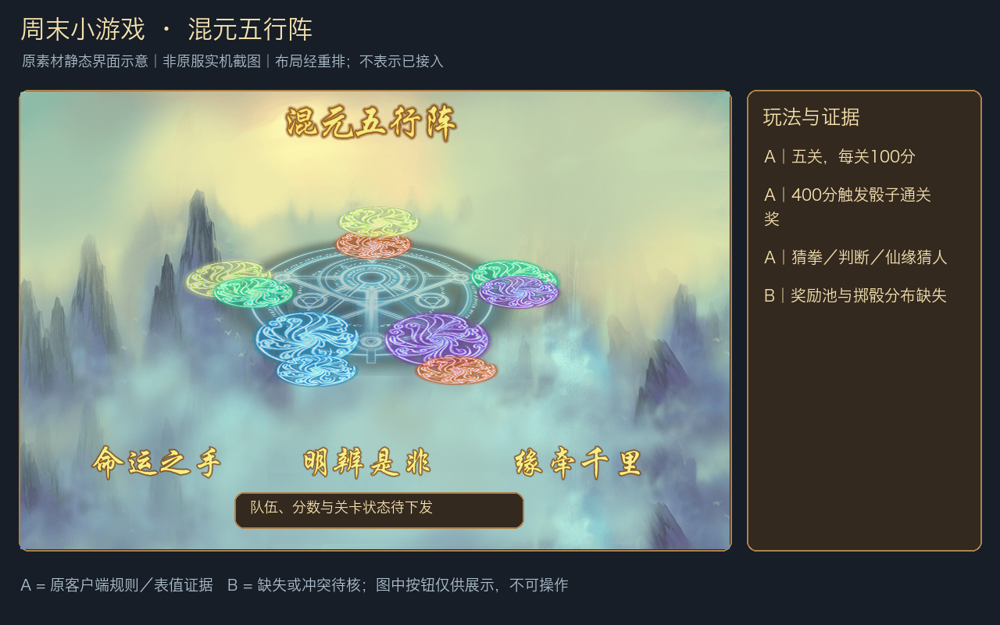

**玩法：** 建队或加入队伍，准备后进入五行阵。无密码的队伍可直接加入，有密码的需输入密码；队长能踢人、转移队长，队内可交流。进入闯关后不能再加入。五关依次为坎一、坤二、震三、巽四、中宫，考验来自三种小游戏。

### 规则 A：玩法数值与奖励条件

| 项目 | 原版明确规则 |
|---|---|
| 关卡／分数 | 共5关；每关通过100分，失败0分。因此五关全过为500分（按原规则相加） |
| 每日奖励 | 当日第一次闯完5关获得奖励，每日仅一次；团队闯关奖按团队分数发放，在贴标签界面领取 |
| 额外通关奖 | 团队分数≥400，投掷骰子决定通关奖励 |
| 命运之手 | 玩家轮流与BOSS猜拳；BOSS10血，团队6血，共15次出手机会。赢则BOSS减1血，输则团队减1血；平手不计次数，也不换人 |
| 猜拳时限／暴击 | 10秒内出手，超时服务器随机选；选择闪光手势且获胜触发暴击。BOSS死亡通关，团队死亡失败 |
| 明辨是非 | 3道判断题；每题25秒读题＋5秒作答。读题时不可作答；提交后不可改；超时随机选。团队严格超过半数答对才计本题正确，3题答对至少2题通关 |
| 千里仙缘一线牵 | 各玩家看到仙缘提示，共同猜神仙，由队长选择答案。限2分钟、3次猜测；在限制内猜对一个即过关；猜错且尚有时间／次数时换另一个神仙继续 |

以上为 **A·说明**，来自完整的原版玩法说明，不是仅靠图片猜测。

### 规则 B：缺失／推测

具体分数档奖励、骰子结果对应的道具数量、幸运点数奖励映射与概率均缺失；暴击具体扣几血未写明。队伍人数上下限、各关小游戏分配、每周开放时段和准入等级仍需服务端配置。名称“周末”不能推出固定周六／周日几点开放。不能把五个阵位图标直接当作已证实的五人硬门槛。

证据：[总规则](../analysis/evidence/original_activities_20261102/csv/guide_index.csv)、[三个小游戏详细规则](../analysis/evidence/original_activities_20261102/csv/guide_detail.csv)、[UI反汇编](../analysis/evidence/original_activities_20261102/miniGameUI.txt)（原源码L271～274加载规则表）。

<a id="activity-02"></a>

## 2. 淘金／浪裹捞金

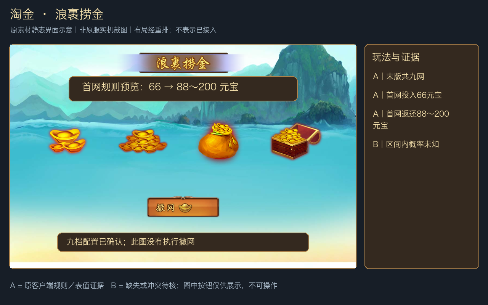

**玩法：** 按当前网次投入元宝撒网，获得该档范围内的元宝返还，然后进入下一网。客户端显示当前网次、投入、最低返还和所得元宝消息。这里的“奖励”是返还总额，不是另加在投入之上的净收益。

### 规则 A：1263末版九档

| 网次 | 投入元宝 | 返还元宝范围 | 净增范围（返还减投入） |
|---|---:|---:|---:|
| 1 | 66 | 88～200 | 22～134 |
| 2 | 666 | 888～1,000 | 222～334 |
| 3 | 2,666 | 2,999～4,000 | 333～1,334 |
| 4 | 8,888 | 9,999～12,000 | 1,111～3,112 |
| 5 | 16,666 | 18,888～20,000 | 2,222～3,334 |
| 6 | 28,888 | 31,888～35,000 | 3,000～6,112 |
| 7 | 48,888 | 52,888～56,000 | 4,000～7,112 |
| 8 | 68,888 | 72,888～76,000 | 4,000～7,112 |
| 9 | 99,999 | 103,999～120,000 | 4,000～20,001 |

投入、上下界为 **A·表值**；净增是直接算术派生，并非实测掉率。热更新1219从六档扩到九档，应使用末版表。

### 规则 B

每档区间内分布、是否有离散档位、各档权重、是否受账号或充值条件限制、活动重开后是否重置均未知。不能假定均匀随机，也不能以区间中点当作原服期望奖励；九档配置不等于每日可重复九次。

证据：[末版淘金表](../analysis/evidence/original_activities_20261102/csv/gold_rush_config.csv)、[goldRushUI](../analysis/evidence/original_activities_20261102/goldRushUI.txt)、[data读取逻辑](../analysis/evidence/original_activities_20261102/data.txt)（搜索`g_goldRushTable`、`pay/min_gain/max_gain`）。

<a id="activity-03"></a>

## 3. 邀友／呼朋唤友

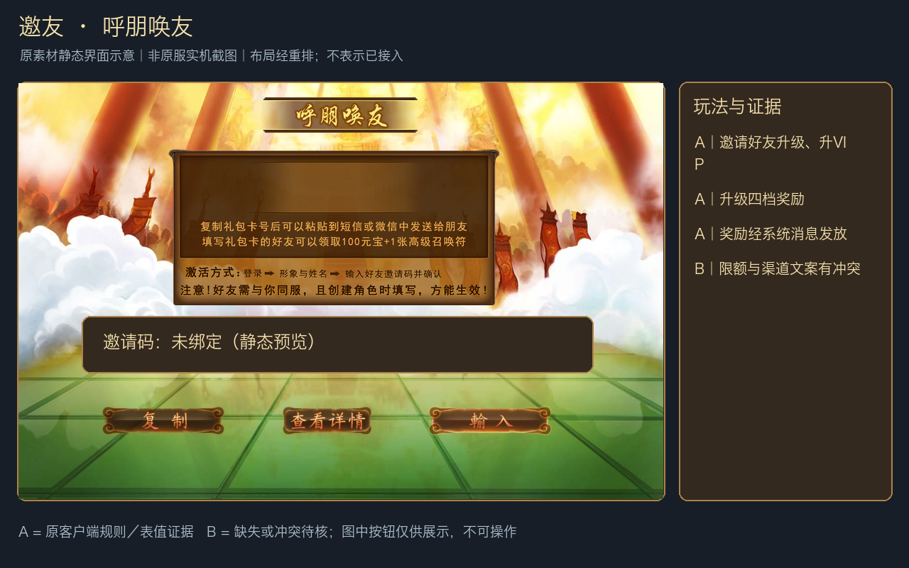

**玩法：** 分享自己的邀请码，好友激活后建立邀请关系；被邀请者升级或达到VIP档位，邀请者获得系统消息奖励。原文字还描述新角色激活邀请码可得**100元宝＋高级召唤符×1**，超过15级不能领取，且不能使用自己的邀请码、不能重复领取（A·说明）。这不是普通兑换码礼包。

### 规则 A：邀请者奖励表

| 好友等级 | 奖励 | 表内max_count |
|---|---|---:|
| 15 | 元宝×50 | 10 |
| 25 | 元宝×100、VIP乾坤袋×2 | 10 |
| 36 | 元宝×1,000、VIP乾坤袋×5 | 10 |
| 60 | 元宝×3,000、VIP乾坤袋×10 | 10 |

| 好友VIP等级 | 元宝奖励 | 表内max_count |
|---|---:|---:|
| 1 | 100 | 10 |
| 2 | 300 | 9 |
| 3 | 500 | 8 |
| 4 | 1,000 | 7 |
| 5 | 3,000 | 6 |
| 6 | 5,000 | 5 |
| 7 | 8,000 | 5 |
| 8 | 10,000 | 5 |
| 9 | 30,000 | 5 |
| 10 | 50,000 | 5 |

表值是 **A·表值**，`max_count`确实由UI读取；这里保留字段名，避免未经原服验证就断言其所有计数口径。

### 规则 B：限额冲突

`friends_vip2`文案写“系统消息自动发放，不限人数”，但表内存在各档`max_count`，且UI有读取。**不能同时声称“无限人数”和“每档严格限这么多好友”均为末版服务端规则。** 表内限额究竟按人数、领取次数、活动批次还是渠道计算，以及跨档累计、老账号绑定、跨区有效性、反重复判定和邀请码有效期，均待确认。资源含不同渠道的邀请说明，不能把某个渠道的激活步骤推广到所有渠道。

证据：[升级奖励表](../analysis/evidence/original_activities_20261102/csv/friends_lv_reward.csv)、[VIP奖励表](../analysis/evidence/original_activities_20261102/csv/friends_recharge_reward.csv)、[friendsUI](../analysis/evidence/original_activities_20261102/friendsUI.txt)、[原文键friends_*／friend_code_*](../analysis/evidence/original_activities_20261102/activity_strings.json)。

<a id="activity-04"></a>

## 4. 灯谜／元宵灯谜会

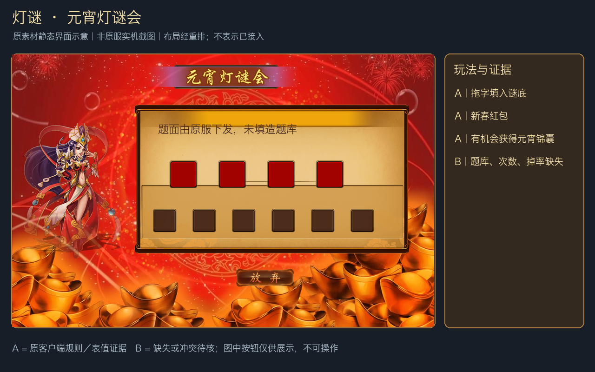

**玩法：** 进入题目，将备选文字拖到谜底框，组成正确答案；界面有放弃、今日已猜数量和错误重试反馈。题目与状态通过1214提交／获取。

**规则 A·说明：** 答对获得**新春红包**，并“有机会获得**元宵锦囊**”；有每日猜谜次数限制，耗尽后不可进入下一题。客户端请求字段包含`flag/index/answer`。备选字资源`RiddleChooseWords.csv`可以证明有选字素材，不能证明保存了完整题库及答案。

**规则 B·缺失：** 每日次数、题目数量、题库和标准答案、每题红包数量、锦囊概率、红包／锦囊在本活动中的具体开出清单、放弃是否扣次数、错误重试是否有代价，都未得到完整活动结算证据。不能把“有机会”写成必掉，不能将猜谜1132的奖品照搬过来。

证据：[lanternRiddleUI](../analysis/evidence/original_activities_20261102/lanternRiddleUI.txt)、[选字表](../analysis/evidence/original_activities_20261102/csv/RiddleChooseWords.csv)、[原文lanternRiddleHint／riddleMaxHint](../analysis/evidence/original_activities_20261102/activity_strings.json)。

<a id="activity-05"></a>

## 5. 富翁／蓬莱访仙

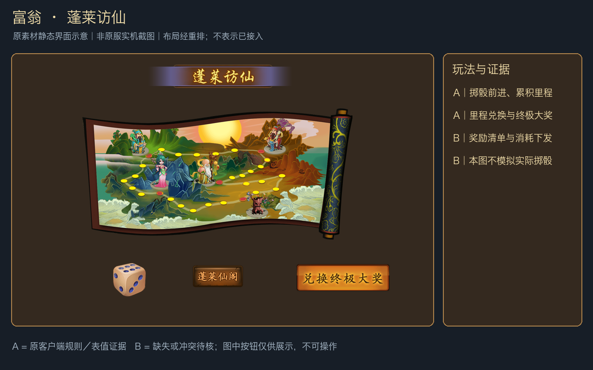

**玩法：** 在蓬莱地图上掷骰、前进，遇到桃林迎客、杏仙送礼、福星应门、禄星品茗、寿星指路等事件，积累里程；进入蓬莱仙阁，用里程兑换商品或终极大奖。界面提供里程记录、现有元宝、兑换数量和剩余次数。

**规则 A·客户端：** 查询1222、兑换1223（`prize_id/count`）、掷骰1224（`roll_type/roll_times`）相互独立；UI接收`max_free_times`、`miles`、`max_miles`等字段，故免费次数和里程状态是服务器数据，不应由按钮图推算。文案资源存在“**接引佛祖魂魄×40**”，可作为曾设计的奖品例子（A·文案），**不能据此认定它就是末版固定终极大奖**。

**规则 B·缺失：** 每日免费投掷次数、付费投掷成本、骰子分布、事件触发率、每格／每圈里程、商品里程价格、终极大奖身份和数量、限兑与活动重置均未恢复。不能从骰子六面图推断原服每面概率均为1/6，也不能将一次商品展示文字当完整奖池。

证据：[richmanUI](../analysis/evidence/original_activities_20261102/richmanUI.txt)（原源码L151～172读取免费次数／里程，L996～1013发兑换／掷骰请求）、[原文richman_*](../analysis/evidence/original_activities_20261102/activity_strings.json)。

<a id="activity-06"></a>

## 6. 猜谜／独立的灯谜会

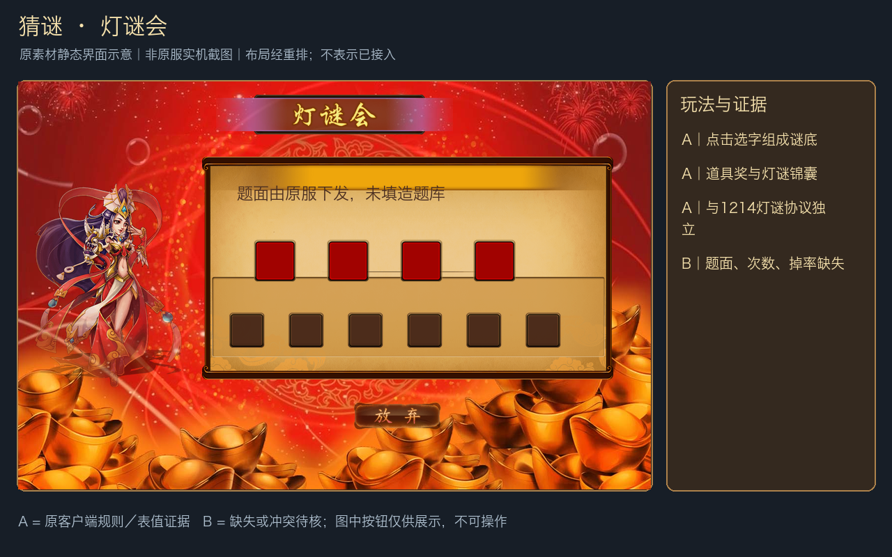

**玩法：** 点击备选字放入谜底框，提交正确答案获得奖品。与上一项共用灯谜美术资源，因此界面相似，但它使用`guessUI`及1132（原协议名`msg_valentine_activity`），应作为独立活动理解。

**规则 A·说明：** 答对可得**道具奖励**，并有机会获得**灯谜锦囊**；存在每日次数用尽提示和答错重试提示。UI显示日期，提交结构同样包含`flag/index/answer`。这里的锦囊名称是“灯谜锦囊”，不是灯谜1214文案中的“元宵锦囊”。

**规则 B·缺失：** 每日题数、题库、单题固定道具与数量、锦囊概率、开放周期、错答／放弃代价、是否和1214共用计数器均未知。仅凭英文协议名不能把活动开放日期固定为情人节或七夕；两者共享素材也不能证明共享奖励。

证据：[guessUI](../analysis/evidence/original_activities_20261102/guessUI.txt)、[原文guess1～3](../analysis/evidence/original_activities_20261102/activity_strings.json)。

<a id="activity-07"></a>

## 7. 万寿山／魂缘万寿山

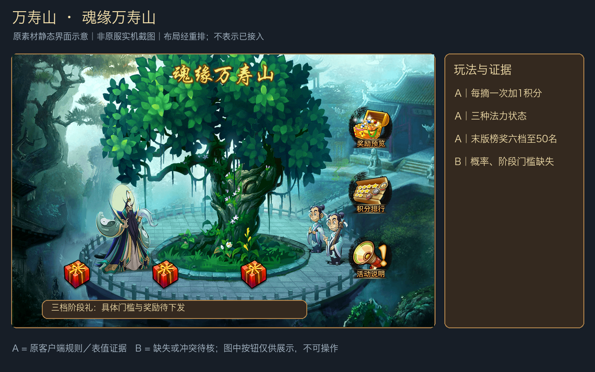

**玩法：** 消耗元宝施法摘取人参果，每摘一次随机获得预览池中的一件奖励，并获得1积分。摘取次数增加会削弱法力；积分用于阶段领奖与活动榜。这里的`kickUI`名称不能解读成只有“踢人”功能。

### 规则 A：操作与奖励

| 项目 | 原版规则 |
|---|---|
| 法力状态 | 充沛：仙缘果概率较大；衰弱：概率降低；枯竭：概率为0；法力不能恢复（A·说明） |
| 每次摘取 | 消耗元宝、随机得一个池内物品、加1积分；元宝单价从服务器字段`gold_count`读取 |
| 三档阶段奖 | 达到各档积分可累计领取；未领取的原说明称活动结束邮件补发 |
| 榜奖 | 同时满足名次和积分条件，领取最高符合档，不叠加；结束后邮件发放 |
| 仙缘果 | 原手册说明定向换已开放S级神仙魂魄：已拥有神仙1:10，未拥有1:1；实际目标名单／五法界魂分支应另核，不在本报告扩张 |
| 五星装备宝箱 | 原手册说明随机获得一件五星武器或五星防具；这说明箱子内容，不证明每次摘果必得箱子 |

**1263末版榜奖（A·表值）：** 奖品均为五法界魂箱（1249）。

| 名次范围 | 最低积分 | 五法界魂箱数量 |
|---|---:|---:|
| 1～2 | 1,000 | 1,200 |
| 3～5 | 700 | 800 |
| 6～10 | 450 | 450 |
| 11～20 | 350 | 250 |
| 21～30 | 150 | 100 |
| 31～50 | 10 | 30 |

### 规则 B：旧说明冲突与缺失

旧手册称“前20名”“四等排行”，而表在1260已由五档改为六档，末版明确覆盖至50名。本文采用末版表介绍奖励，不把旧文案的四档当作末版。**实际榜单展示长度、低积分高名次者是否降档发奖，仍需要服务端确认。** 同分先到者在前，是旧手册规则，不是已实测的末版排序。

摘取单价、三档阶段门槛／奖品、法力衰减次数阈值、各法力状态的仙缘果概率和完整抽取池均缺失。“概率较大／降低”没有对应百分比，不能自行写成10%／5%。

证据：[旧手册](../analysis/evidence/original_activities_20261102/csv/newbie_content7.csv)、[末版榜奖](../analysis/evidence/original_activities_20261102/csv/hill_top_prize.csv)、[kickUI](../analysis/evidence/original_activities_20261102/kickUI.txt)（`hill_prize_config/score_prize/gold_count`）。

<a id="activity-08"></a>

## 8. 雪人／全服堆雪人

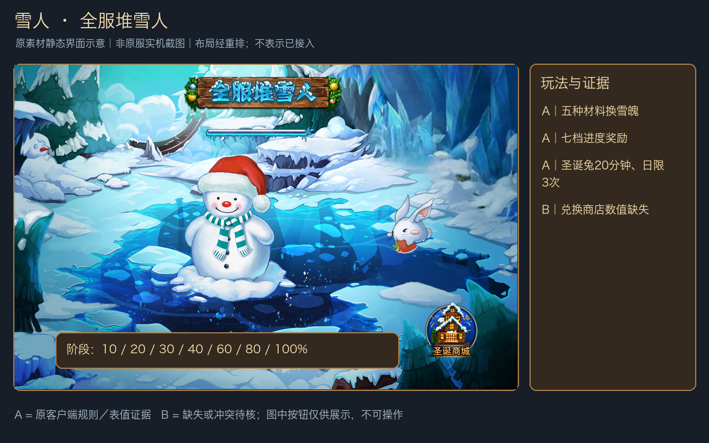

**玩法：** 旅途掉落堆雪人材料，点击雪人提交材料，全服共同提高建造进度；个人获得雪魄，可在圣诞商城兑换道具；圣诞兔出现时可以许愿领奖。

### 规则 A·说明

| 项目 | 原版明确内容 |
|---|---|
| 材料 | 小雪球1113、大雪球1114、雪人鼻子1115、雪人眼睛1116、雪人帽子1117 |
| 提交方式 | 提示为点击后上交该类型全部材料；UI显示每个材料可得多少雪魄 |
| 阶段领奖 | 进度达到10%、20%、30%、40%、60%、80%、100%共七档；点击进度条领奖。没有50%、70%、90%档 |
| 圣诞兔 | 每日随机出现，每次存在20分钟；选择一只兔子许愿，每人每日最多3次；UI防止同次重复许愿 |
| 奖励渠道 | 提交材料得雪魄；七档阶段奖；兔子许愿奖；雪魄商店兑换 |

### 规则 B·缺失

五类材料各加多少全服进度、各给多少雪魄、全服目标总量、旅途掉落率、七档奖励清单、商城商品及价格／限兑、兔子刷新时刻和许愿奖池均未取得。也不能假定一个单机角色提交一次就代表全服完成。七档进度是A，七档各发什么仍是B。

证据：[雪人手册](../analysis/evidence/original_activities_20261102/csv/newbie_content8.csv)、[snowmanUI](../analysis/evidence/original_activities_20261102/snowmanUI.txt)、[原文snow1～12](../analysis/evidence/original_activities_20261102/activity_strings.json)。

<a id="activity-09"></a>

## 9. 梦境／仙梦居

> 后续实现：2026-11-02已完成工作区接入，规则选择、验证与边界见[梦境实现说明A与B](梦境离线活动实现说明_A与B.md)。本文其余部分保留为接入前原始证据整理。

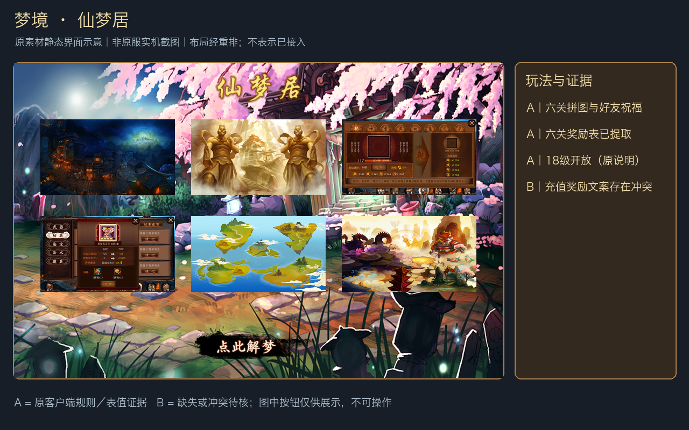

**玩法：** 原手册标明18级开放。点击入梦，将图片拼回正确图像；六个梦依次名为相遇、相识、相知、相恋、相爱、相守。每关解梦有奖励，通关后可向好友送祝福，自己和对方分别得奖；全部六关还关联仙梦居祝福／充值领奖。

### 规则 A：1263末版通关奖励

| 梦境 | 解梦奖励 |
|---|---|
| 1 相遇 | 包子×5、仙丹×5、超级召唤符×2 |
| 2 相识 | **6级法宝灵石×1、7级武器灵石×1、7级防具灵石×1** |
| 3 相知 | 五法界魂箱×10、圣母蟠桃×10 |
| 4 相恋 | 五星灵器×3、太古水晶×5 |
| 5 相爱 | 猎魂宝箱×20、紫色精魄碎片×5 |
| 6 相守 | 传世金卡×1 |

六关的`own_wish_prizes`相同：**金丝乾坤袋×5、银绸乾坤袋×5、蟠桃×100**；`other_wish_prizes`均为**蟠桃×68**。这是祝福奖励配置，**不擅自按“每个好友再乘一次”计算总收益**，因为每关祝福人数及结算口径还依赖服务器。

以上是 **A·表值**。梦境奖励串为`物件类别|道具ID|等级|数量`，所以第二关不是“法宝灵石6个／武器灵石7个”。传世金卡的原物品描述为等同充值50元；这里确证活动产出1张卡，不代替充值系统对兑现与活动计费资格的判定。

### 规则 B：充值奖励存在三处信息

1. 末版手册写：六梦解完，活动期充值30元可领**造化神石×3**（A·说明）。
2. 原文字`dream20`仍为**修炼果×999、精魄石×10000、包子×50、圣母蟠桃×200**，且UI中仍有引用。
3. UI同时从服务端读取`min_charge`和`charge_prize`，并按返回状态显示。

因此不能把30元、造化神石×3与另一组奖励拼成一个已验证的大礼包。**实际末版充值门槛、发奖内容及不同状态分支归B·冲突待核**；本文将两套原文都保留，避免挑一套冒充原服结算。后续字节码复核已确认【A】：每关3×3、任意两块交换、一次最多2位好友（原L533～620、L844）；仍缺好友收祝福上限数值、跨日／换期及服务器重复结算细则，实施方案见上述实现文档【B】。

证据：[末版六关奖表](../analysis/evidence/original_activities_20261102/csv/dream_prize_config.csv)、[末版梦境手册](../analysis/evidence/original_activities_20261102/csv/newbie_content9.csv)、[dreamUI](../analysis/evidence/original_activities_20261102/dreamUI.txt)（原源码L382～422、L1042～1053）、[dream20原文](../analysis/evidence/original_activities_20261102/activity_strings.json)。

<a id="activity-10"></a>

## 10. 天象／年兽／年兽请留步

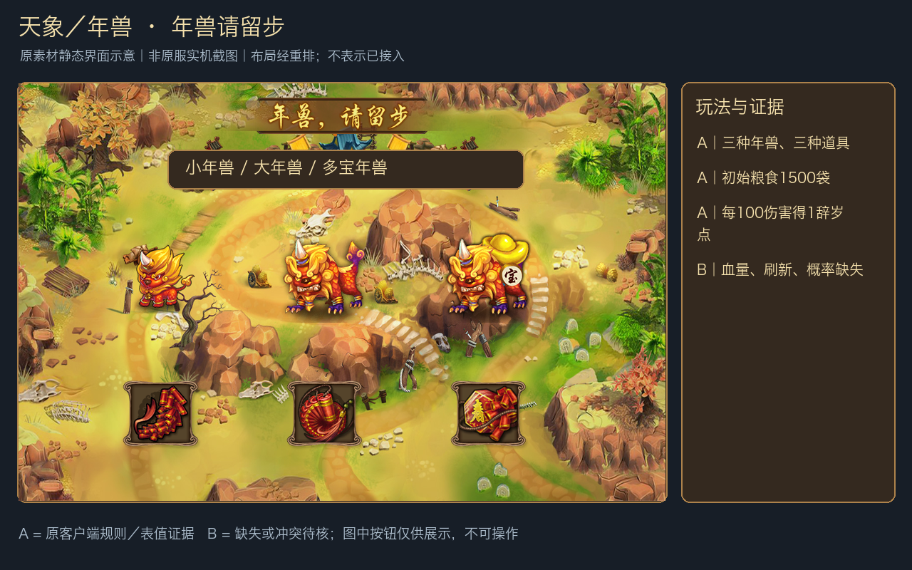

**玩法：** 三种年兽沿三条道路接近村庄。玩家用鞭炮、炮仗、爆竹攻击，保护粮食并获得辞岁点；辞岁点用于商店兑换和排行榜。活动入口“天象”与协议“年兽”是同一条玩法链。

### 规则 A·说明

| 项目 | 原版内容 |
|---|---|
| 时间／失败条件 | 开放7日，每日00:00～08:00不开放；村庄初始1500袋粮食，粮食归0立即结束 |
| 小年兽 | 开始即刷新；击杀或偷粮后立即刷新一只；有逃跑概率 |
| 大年兽 | 每日12:00开始刷新；数量与所杀小年兽数量有关；若偷粮则停止刷新（手册未说明是否次日重开） |
| 多宝年兽 | 小年兽被杀／逃跑后有概率刷新；充值会提高出现概率，未给百分比 |
| 鞭炮1125 | 仅对小年兽；固定伤害100；日常掉落／充值获得 |
| 炮仗1126 | 对大年兽、多宝年兽；鞭炮每使用3次得1个；手册未给固定伤害值 |
| 爆竹1127 | 可攻击全部年兽；固定伤害3000；充值获得 |
| 辞岁点 | 每造成100伤害得1点；商店兑换次数每日刷新，具体刷新时点由UI参数显示 |
| 发奖 | 手册称每日01:00按剩余粮食发全服邮件；击杀年兽也有全服奖励，在01:00邮件发放 |

### 规则 A·表值：保粮日奖

| 剩余粮食门槛 | 贡献令 | 银两 | 修炼果 | 元宝 |
|---|---:|---:|---:|---:|
| 1,400 | 50 | 20,000,000 | 10 | 100 |
| 1,200 | 40 | 10,000,000 | 5 | 50 |
| 900 | 35 | 8,000,000 | 3 | — |
| 600 | 25 | 5,000,000 | 2 | — |
| 200 | 15 | 2,000,000 | — | — |
| 10 | 5 | 1,000,000 | — | — |

“—”表示该行未配置该物品。表给出门槛及附件，未据此补造档位累计／补发规则。

### 规则 A·表值：辞岁点榜奖

| 排名 | 奖励 |
|---|---|
| 1 | 金丝乾坤袋×25、升阶宝箱×20、五星佛界魂×80 |
| 2～3 | 金丝乾坤袋×20、升阶宝箱×15、五星佛界魂×60 |
| 4～10 | 银绸乾坤袋×15、升阶宝箱×10、五星佛界魂×30 |
| 11～20 | 银绸乾坤袋×10、升阶宝箱×5、五星佛界魂×15 |
| 21～200 | 银绸乾坤袋×10、升阶宝箱×5 |
| 201～5000 | 银绸乾坤袋×10 |

### 规则 B

各年兽血量、行走到村庄用时、偷粮量、刷新数量公式、逃跑／多宝出现概率、炮仗伤害、超额伤害及不足100伤害如何取整、击杀／伤害／逃跑奖励、充值礼包和辞岁商店清单未知。保粮档位是否只发最高档、活动中途粮食归0后的结算行为也需确认。**00:00～08:00休战与01:00结算均为原说明；不能“修正”为自己认为合理的时间。**

证据：[年兽手册](../analysis/evidence/original_activities_20261102/csv/newbie_content10.csv)、[保粮表](../analysis/evidence/original_activities_20261102/csv/monster_food_prize.csv)、[榜奖表](../analysis/evidence/original_activities_20261102/csv/monster_top_prize.csv)、[omenUI](../analysis/evidence/original_activities_20261102/omenUI.txt)。

<a id="activity-11"></a>

## 11. 炼丹／八卦炼丹炉

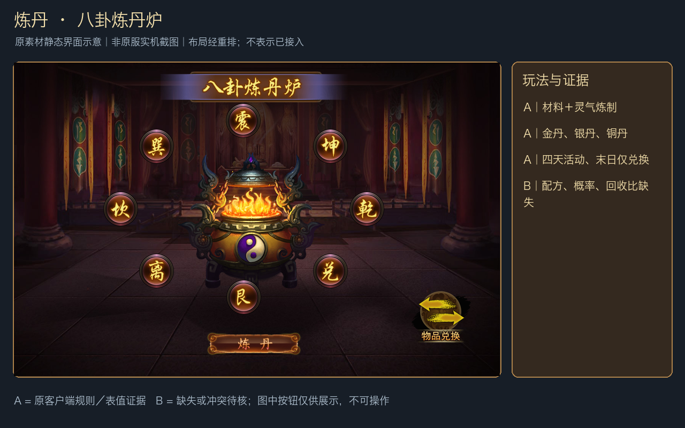

**玩法：** 选择卦位，投入法术、装备或道具，并消耗灵气炼制；产出铜丹、银丹，有机会出稀有金丹。丹药在三种兑换区换成道具。它使用1134，**不是九幽药神殿1329**。

### 规则 A：材料、周期与灵气

原手册规定活动共4天，最后一天炉子停止炼制但仍可兑换；结束后剩余灵气和丹药折成蟠桃返还。UI明确可选**2～4星法术（排除4星被动）**和**2～3星装备**，还有道具材料分支；卦位有解锁条件，炼制次数次日恢复，未满材料可二次确认炼制。材料数量和炼制次数等仍需服务端参数。原版图片另明确三档当日充值解锁：**任意充值解锁艮、离；充值30元再解锁坎、巽；充值50元再解锁震、坤**（A·图片说明，不代表已验证实际到账条件）。证据：[任意充值](assets/original_activities/alchemy_original_unlock1.png)、[30元](assets/original_activities/alchemy_original_unlock2.png)、[50元](assets/original_activities/alchemy_original_unlock3.png)。

`get_lingqi_method.csv`被alchemyUI直接读取；下表完整保留原`per/sum`数值，分别用于每次获取量和来源上限展示（A·表值）。

| 来源 | per | sum |
|---|---:|---:|
| 每日首充 | 450 | 450 |
| 单次充值 | 15 | 750 |
| 大闹蟠桃会 | 10 | 100 |
| 体力消耗 | 5 | 100 |
| 西天取经 | 25 | 50 |
| 秘境探宝 | 10 | 50 |
| 天命 | 50 | 50 |
| 宠物任务 | 50 | 50 |
| 渡劫刷新 | 10 | 50 |

**奖励：** 炼制得到金／银／铜丹；兑换区给道具；活动结束给剩余资源折算的蟠桃。末版可用证据没有完整三色丹药商店商品表，不能列出虚构的“金丹兑换五星神仙”等清单。

### 规则 B

解锁充值的累计／单笔口径、每日炼制次数、材料价值换算、每炉最低／最高投入、灵气成本、普通成功／大成功区别、金丹概率及三色丹产量、兑换价格／限额、活动结束折桃比例均未知。UI还接收`lingqi_limit/gold_lingqi/material_lingqi/consume_lingqi_max`等服务端参数。上表“单次充值”不能仅凭列名解释成每笔固定15点；原文又提示“如充值1元也获得灵气”，实际按金额还是次数累计及各来源上限重置口径需核实。

证据：[炼丹手册](../analysis/evidence/original_activities_20261102/csv/newbie_content13.csv)、[灵气来源表](../analysis/evidence/original_activities_20261102/csv/get_lingqi_method.csv)、[alchemyUI](../analysis/evidence/original_activities_20261102/alchemyUI.txt)（原源码L217～223读取per/sum）。

<a id="activity-12"></a>

## 12. 夏日／雷区寻宝与集卡

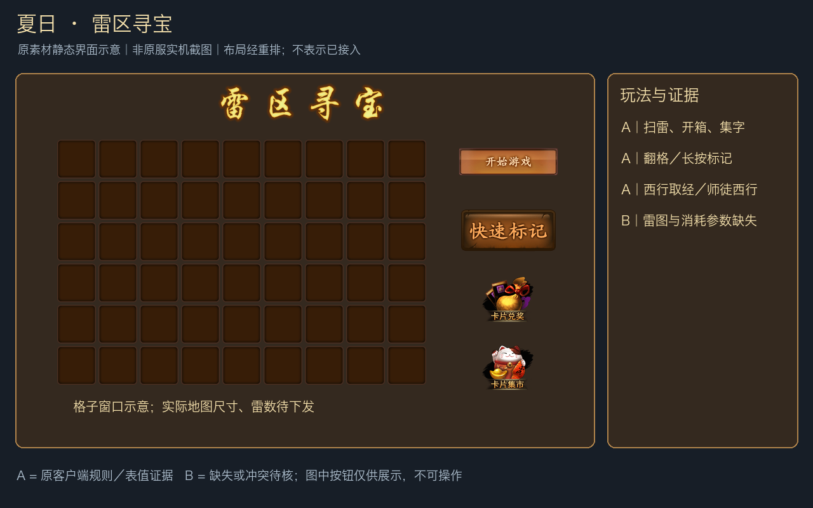

**玩法：** 消耗行动力进入扫雷。点击翻格、长按标记，翻开全部非雷格获胜；格子下可能触发宝箱，得到字卡与其他奖励。字卡可组成词组换奖，也可在玩家集市交换。

### 规则 A

| 分支 | 可确认内容 |
|---|---|
| 扫雷 | 翻完非雷格获胜；显示雷数量；有失败续关、快速标记、结束本轮及进度保存提示 |
| 快速标记 | 随机标出一个带炸弹的格子，消耗行动力；费用通过格式化参数显示，没有固定写死数值 |
| 行动力 | 日常玩法与充值获得；获取任务计数每日0点重置（文字summer8），不据此推定现有行动力也清零 |
| 六种字卡 | 西、徒、行、取、经、师（表中level依次1～6，为字卡键值，不是品质／等级加成） |
| 特殊组合 | “西行取经”“师徒西行”；拖卡入槽兑换。单字和非以上组合也可以兑换 |
| 末版奖品提示 | 西行取经：轮回舍利、五法界魂箱等；师徒西行：经验丹、元宝等 |
| 玩家集市 | 普通上架：双方需花元宝；快速上架：上架方花元宝，交换方不花。具体费用下发 |

### 规则 B

地图宽高／雷数、雷与宝箱生成分布、每次开始／续关／快速标记行动力、行动力来源数值、宝箱奖励与字卡概率、组合兑换数量和随机权重、集市费率与上架上限都缺失。奖励提示中的“等”不是完整奖池，不能据此写出确定数量。背包中的**雷区寻宝卡1344**归此活动材料链；它的活动结算不能用普通背包使用代替，也不能与春节／唐王字牌玩法混算。

证据：[扫雷手册](../analysis/evidence/original_activities_20261102/csv/newbie_content14.csv)、[字卡表](../analysis/evidence/original_activities_20261102/csv/summer_cards_letter.csv)、[末版奖品提示](../analysis/evidence/original_activities_20261102/csv/summer_cards_tip.csv)、[summerUI](../analysis/evidence/original_activities_20261102/summerUI.txt)。

<a id="activity-13"></a>

## 13. 科举／科举考试

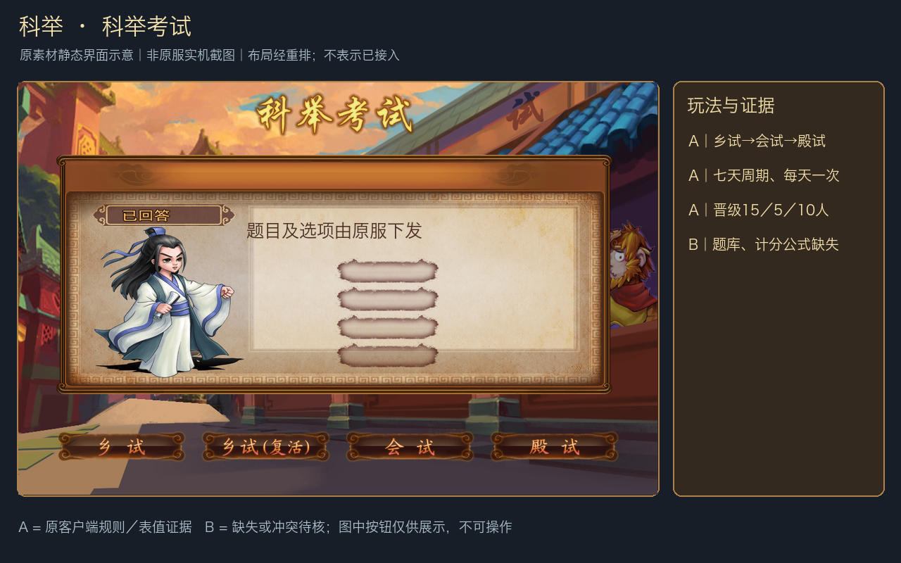

**玩法：** 每日进入一次答题，通过正确率和答题时间得分参与排名，逐轮晋级。界面有乡试、复活赛、会试、殿试、排行榜和奖励；未晋级仍可参与乡试答题。超时会随机选择答案，答完倒计时进入下一题。

### 规则 A：七天赛程

| 天数 | 阶段 | 排名／晋级 |
|---|---|---|
| 第1～3天 | 乡试 | 三天累计成绩，前15名进会试 |
| 第4天 | 会试第一天，同时举行乡试复活赛 | 复活赛前5名进会试 |
| 第4～5天 | 会试 | 两天取最好成绩，前10名进殿试 |
| 第6天 | 殿试 | 当天成绩决定最后排名 |
| 第7天 | 放榜 | 活动最后一天公布结果 |

赛程为原说明的直接展开；每天一次来自原文字`answer17`。精确开始时刻仍由服务器给出。

### 规则 A：晋级与殿试表奖

| 阶段／名次 | 奖励 |
|---|---|
| 乡试1～15 | 元宝×200 |
| 复活赛1～5 | 元宝×200 |
| 会试1～10 | 元宝×300 |
| 殿试1 | 元宝×600、太古水晶×2、7级法宝灵石×1 |
| 殿试2 | 元宝×500、太古水晶×2、7级武器灵石×1 |
| 殿试3 | 元宝×400、太古水晶×2、7级防具灵石×1 |
| 殿试4～20 | 元宝×300、太古水晶×1、灵丹×10 |
| 殿试21～50 | 元宝×200、远古水晶×2、灵丹×5 |
| 殿试51～100 | 元宝×150、远古水晶×1、灵丹×5 |

界面及称号表提供**状元（53，第1名）、榜眼（52，第2名）、探花（51，第3名）、进士（50，殿试前100名）**；这是A·表内获取说明。实际发放、多个称号是否并授、期限与属性应按称号系统另核，不把称号图片当道具附件。

**字段特别说明：** 科举表奖励串顺序为`物件类别|道具ID|数量|等级`，与梦境／年兽等奖励串相反。`answerUI`原源码L140～148明确按第3段取数量、第4段取等级，所以上表灵石为7级×1，不是1级×7。

### 规则 B：赛程与奖励范围不完全吻合

会试只取前10进入殿试，但奖表又包含殿试4～20、21～50、51～100档。两者均为原版资源事实；**不能擅自将会试改成100人晋级，也不能删除奖表21～100档**。可能涉及全服／跨服聚合或历史模板残留，但这只是B·推测，没有足够证据定论。

还缺每日题数、题库答案、正确题基础分、时间奖励窗口和公式、同分排序、复活资格、弃答惩罚、排名范围、称号发放口径、榜奖领取／邮件补发规则。UI中有`get_rank_prize`操作，只证明存在领取入口，不能推出断线或漏领补发政策。

证据：[赛制表](../analysis/evidence/original_activities_20261102/csv/answer_rule.csv)、[奖励表](../analysis/evidence/original_activities_20261102/csv/exam_rank_prize.csv)、[answerUI](../analysis/evidence/original_activities_20261102/answerUI.txt)、[称号配置](../analysis/evidence/original_activities_20261102/csv/title_config.csv)。

<a id="activity-14"></a>

## 14. 救悟空／十万猴急

后续接入更新：已核实链雷珠实际为连续2×2，以及原版四档仙人助力表，并完成源码接入；见[实现说明（A与B）](救悟空十万猴急离线活动实现说明_A与B.md)。下文保留此前审计快照。

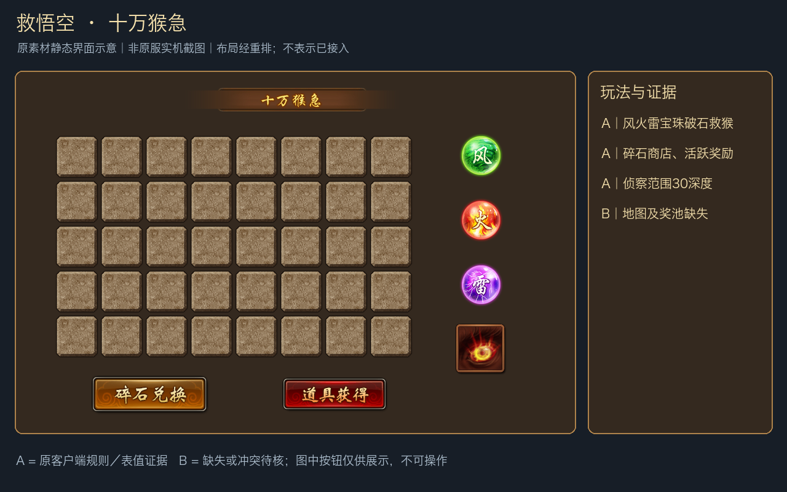

**玩法：** 在纵向石块区域使用宝珠破石，救出大小猴子、获得奖励与碎石；碎石到商店换物。日常任务累计活跃度领取工具礼包；救猴数量还与充值特权解锁关联。活动名称“十万猴急”来自原图，不是自行起名。

### 规则 A：工具与操作

| 道具／对象 | 原版明确作用 |
|---|---|
| 1350 定风珠 | 破坏1格石块 |
| 1351 爆火珠 | 以一个位置为中心，破坏周围一圈8格；无石块处使用／石块处使用有不同提示，具体适用工具按UI选中校验，不能全部一概而论 |
| 1352 链雷珠 | 破坏指定4格石块 |
| 1353 起爆符 | 消除中心周围距离为2的石块；原新手引导图还说明起爆符被消除后立即自动使用；未独立证明几何距离算法和总格数 |
| 1354 火眼金睛术 | 查看30深度范围内道具分布 |
| 1355 大猴子 | 原新手引导图：累计积分＋2，额外元宝×8；UI将1355映射到图中的大猴头像 |
| 1356 小猴子 | 原新手引导图：累计积分＋1，额外精魄石×10；UI将1356映射到图中的小猴头像 |
| 花岗岩 | 原文明确不可破坏，不应设计成多点几次就能破坏 |
| 使用方式 | 先选风／火／雷宝珠，点击位置预览效果，再次点击同位置使用；位置不合法会提示错误 |

原版的新手引导图（未经重排，保留原字样）：[查看原图](assets/original_activities/saveMonkey_original_guide.png)。大小猴固定奖励属于A·图片说明；是否仍与末版服务端结算完全一致未实测，不与其他不明奖池相混。

**奖励链（A·说明／客户端）：** 救猴奖励、破岩碎石、碎石商店、活跃度小礼包、累计条件奖励和充值特权均有独立界面／请求证据。原文明确：累计拯救猴子达到条件可解锁充值特权，解锁前充值也计入；**道尊金卡不计入该充值累计**；赠送的道尊金卡通过邮件发放。不能把原文的充值累计排除条件反过来理解成所有金卡都能触发该特权。

### 规则 B

地图宽度、总深度、岩层生成、不同石块耐久、猴子／工具出现率、每次消耗工具数量、是否另有随机救猴附加奖、每种岩石产多少碎石、碎石商品与价格／限兑、活跃度任务数值、救猴积分解锁阈值、充值档位／赠卡数量都未取得完整配置。起爆符的“距离2”究竟按方形、菱形还是其他形状，不能从一句描述算出必定24格；需要进一步按位置选择函数核对。

证据：[saveMonkeyUI](../analysis/evidence/original_activities_20261102/saveMonkeyUI.txt)、[物品定义1350～1356](../analysis/evidence/original_activities_20261102/csv/item_name.csv)、[原文saveMonkey_info1～30](../analysis/evidence/original_activities_20261102/activity_strings.json)。

## 附录：数值采用原则与后续可用资料

### 已提取、可直接查表的部分

- 淘金：九档投入及返还上下界。
- 邀友：四档升级、十档VIP奖励及表内max_count。
- 万寿山：六档名次＋积分门槛＋五法界魂箱数量。
- 梦境：六关奖励及祝福双方附件。
- 年兽：六档保粮附件、六档排行附件。
- 炼丹：九条灵气来源per/sum。
- 科举：赛制、晋级与殿试奖励附件。
- 周末小游戏、雪人、年兽、炼丹、夏日：手册明确的时限、次数或条件。

### 不能直接当作可执行配置的部分

各活动的历史实际开放日期、服务器全服状态、随机分布、付费资格、社交验证、排行榜结算、跨日／跨期迁移和邮件补偿，都不能只凭客户端素材完整恢复。文中没有证据的数值保持B，不生成默认配置，不把B写回游戏。

奖励类别中，本报告实际用到的`object_type=5`为物品、11为元宝、12为银两；物品名称统一按本次提取的1263物品表解析。等级与数量按各调用点分别解释，不对所有CSV使用同一拆串顺序。

### 复现与校验

```sh
python3 analysis/tools/build_original_activity_reference.py
```

脚本只读取APK资源和既有原服审计材料，写入本报告证据目录与`docs/assets/original_activities/`。不启动模拟器、不连接游戏、不读玩家数据库、不写业务配置。图片与证据路径均在仓库内，Markdown可直接在IDE预览。

相关基线：[原服后续热更新与v107离线版差异审计](原服后续热更新与v107离线版差异审计.md)。该基线中“尚未接入”的结论与本次静态界面示意并不矛盾：有资源和玩法说明，不代表服务端业务已实现。
