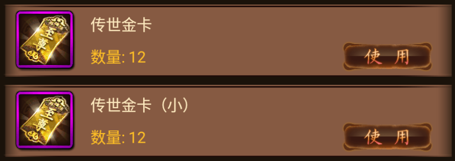

# 至尊金卡、道尊金卡、传世金卡：原版机制、数值与图标

> 离线实现更新：本文保留原版小卡10元的文案证据；2026-10-27实现按用户指定将1156小卡设为5元，大卡1152保持50元。使用、VIP及活动联动见[金卡充值系统实现说明](金卡充值系统实现说明.md)。

整理日期：2026-10-27。解析对象：本仓库保存的《金箍棒》3.87 原版客户端资源、CSV 配置和 LuaJIT 字节码。

**结论：三种金卡都是“获得元宝、等同充值”的消耗道具，共用同一张图标。传世金卡明确标价50元；至尊、道尊没有找到固定面额。道尊金卡有明确的活动例外：不计入拯救猴子活动的充值额度。**

本文用“原版确认”表示原配置、脚本或文案直接支持的内容；“换算”表示由已知比例推导；“未确认”表示现存客户端不足以还原。没有取得官方服务端兑现规则或原服实际到账记录，因此不把本地模拟充值数值当作原版金卡数值。

## 1. 三种道具对照与提取图标

| 项目 | 至尊金卡 | 道尊金卡 | 传世金卡 |
|---|---|---|---|
| 原版图标 |  |  |  |
| 道具ID | **1150** | **1151** | **1152** |
| 原文用途 | 使用可以获得元宝 | 使用可以获得元宝 | 使用可以获得元宝 |
| 原文充值面额 | 未填写 | 未填写 | **50元** |
| 每张实际到账元宝 | 未确认 | 未确认 | 未确认；按大陆普通充值比例可折算为 **500元宝本金** |
| 额外赠送／首充翻倍 | 未确认 | 未确认 | 未确认 |
| 名称表获取来源 | 充值赠送 | 充值赠送 | 充值赠送 |
| 背包使用数量 | 每次请求1张 | 每次请求1张 | 少于10张时每次1张；达到10张时可选批量，单次最多15张 |
| 结果展示 | 专用金卡结果弹窗 | 通用容器结果展示 | 通用容器结果展示 |
| 已确认特殊规则 | 弹窗从返回奖励数量换算“充值多少元” | 拯救猴子活动邮件发放，且不计入该活动充值额度 | 与“传世金卡（小）”为不同道具 |

三个 PNG 均为 **120×120、RGBA**，保留原图的透明区域、紫色边框、底纹和卡面文字。三张图片像素及文件哈希一致，这是原版复用资源的结果。卡面写“至尊”，但道尊与传世在原基础表中同样引用该图，不能按名称另画不同图标。

原始文案见 [item_name.csv](../analysis/configs/item_name.csv) 第134～136行：

- 至尊、道尊：“珍贵的金卡，价值连城，使用可以获得元宝，等同于充值。”
- 传世：“珍贵的金卡，价值连城，使用可以获得元宝，等同于充值50元。”

## 2. 数值能确认到什么程度

### 2.1 传世金卡的50元与500元宝

**50元面额是原版明确写出的数值；500元宝是本金换算，尚非卡片到账实测。**

原 `vipUI.lua` 的源码行130～139在非台湾地区将“还差的充值元宝”除以10后显示为金额。结合传世金卡文案，可得到大陆普通充值口径下的换算：

```text
50元 × 10元宝/元 = 500元宝本金
```

证据见 [VIP字节码摘录](../analysis/evidence/gold_cards/vipUI_excerpt.txt)：该函数数值常量为10，源码行136执行除法。这个公式不能证明金卡沿用充值商城的赠送，也不能据此把到账写成550、1000或其他数值。实际充值累计增加多少、是否享受首充或活动赠送，都需要金卡对应的服务端规则。

另有 **1156「传世金卡（小）」**，原说明写“等同于充值10元”，也使用资源217。它不是1152的另一种叫法；大小卡的图标和原生列表样式对照见本文第7节。[名称表第140行](../analysis/configs/item_name.csv)

### 2.2 至尊与道尊没有找到固定面额

两者名称表未写充值金额；基础表除ID外与传世金卡相同，没有独立的元宝奖励字段。客户端使用请求只传道具和数量，不传卡片面额。因此，目前不能确认两者每张值多少元、给多少元宝，也不能仅凭名称推定价值排序。

至尊金卡的专用弹窗提供了一条更具体的线索：当返回奖励列表只有一项时，客户端读取第一项的 `attach_count`，将 `floor(attach_count / 10)` 填入“充值多少元”的显示位置，奖励名称及数量也取自返回附件。

```text
至尊金卡结果弹窗显示金额 = floor(服务端返回的第一项奖励数量 / 10)
```

原字符串为“恭喜你，充值         元， 获得%s”。这说明客户端能根据返回值展示金额，**不证明该卡随机面额或可变面额**；固定值也可以由服务器返回。它也不能代替实际VIP累计到账规则。见 [commonLayerUI摘录](../analysis/evidence/gold_cards/commonLayerUI_excerpt.txt)，源码行497～506、555～570、731～747。

### 2.3 三种卡相同的基础字段

以下数值均来自 [item_base.csv](../analysis/configs/item_base.csv) 第134～136行，已逐行核对原包对应CSV。

| 字段 | 三者共同值 | 可以确认的含义／边界 |
|---|---:|---|
| `resource` | 217 | 共用图标资源编号。 |
| `main_type` | 6 | 原枚举 `lottery_bag`，走容器类使用流程；分类名本身不证明奖励随机。 |
| `sub_type` | 0 | 未细分子类。 |
| `quality` | 0 | 未配置星级；图中的紫框不等于配置为紫色品质。 |
| `top_level` | 1 | 基础表等级参数，不能直接解释为角色使用等级门槛。 |
| `can_stack` | 1 | 可堆叠；表中未给出堆叠上限。 |
| `equip_pos` | 0 | 未配置装备位置。 |
| `effect_field` | 0 | 没有用此字段指定常规属性加成。 |
| 攻击、防御、生命、体力、精力、战斗次数、经验、贡献加成 | 均0 | 基础表没有配置这些属性的直接加成。 |
| `script_fun` | 3 | 客户端读入为 `script_id=3`；未取得其服务端兑现公式，不能把3当元宝数量。 |
| `upgrade_plus` | 0 | 客户端读入为 `effect_plus=0`，不是“兑换0元宝”的证据。 |
| `use_target` | 1 | 读入为 `ownerType`；实际使用请求目标也是角色类型1。 |
| `random_weigth` | 0 | 原字段拼写；不能解释为中奖概率0%。 |
| `use_limit` | 1 | 原值保留；没有证据把它解释为每天只能用1次。 |
| `show_level` | 0 | 未显示额外等级标签。 |

## 3. 背包使用与结果展示

### 3.1 发往服务端的请求

原 `packageUI.requestUseItem` 首先检查物品数量大于0，再构造 `msg_use_item`（协议 **1051**）：

| 字段 | 内容 |
|---|---|
| `item_type` | 1150／1151／1152，对应道具模板ID |
| `item_id` | 背包道具实例ID；不是模板ID |
| `item_count` | 本次使用张数，未传数量时默认1 |
| `des_type` | 1，角色 |
| `des_id` | 0 |

协议还含序列号 `serial_num`。请求中没有充值金额、元宝数量、VIP经验、赠送倍率等字段；奖励由服务端决定。此流程不需要玩家在充值商城另选商品。

证据：[背包字节码摘录](../analysis/evidence/gold_cards/packageUI_excerpt.txt)，源码行1814～1874；[协议表](../analysis/协议定义表.md) 的1051条目；[原枚举](../analysis/evidence/lua_named/lua/common/common_def.lua.txt) 的 `object_type.role=1`。

### 3.2 单张与批量的区别

- **至尊、道尊**：源码行1854专门匹配1150与1151，立即调用默认数量为1的发送函数，绕过后面的批量选择。即使背包有很多张，每次该入口仍请求使用1张。
- **传世**：没有上述专用匹配，按 `main_type=6` 进入容器分支。持有1～9张时直接使用1张；持有至少10张时弹出数量选择，最小1，最大 `min(15, 持有数量)`。例如持有12张最多选12，持有20张最多选15。

**15是客户端单次批量选择上限，10是弹出批量窗口的库存门槛，都不是日限。** 服务端是否另设限制尚未确认。该发送函数中的VIP1检查专属于1031「VIP乾坤袋」，不能套到这三种金卡上。

### 3.3 结果展示差异

`commonLayerUI` 定义 `goldcard=1150`。当使用结果的道具为1150且主类为容器时，刷新背包并调用 `showGoldCardResLayer`；道尊、传世则进入通用 `showQianKunResLayer` 分支。两条路径都依据返回的 `attach_list` 展示奖励。

至尊专用弹窗的“充值多少元”计算见第2.2节。**弹窗不同只证明表现层有区别，不能单凭这一点认定道尊、传世不计入VIP，或至尊计入所有充值活动。**

## 4. 获取来源与道尊金卡的活动例外

三者的 `product_desc` 都是“充值赠送”。除此之外，原版字符串及 `saveMonkeyUI.lua` 能确认道尊金卡与**拯救猴子活动**关联。

`v2/String2.plist` 的 `saveMonkey_info5` 原文：

> 累计拯救猴子达到某个数量时将可以解锁充值特权，解锁前充值均有效，但道尊金卡不会对该额度进行累计，道尊金卡将以邮件形式发放

`saveMonkey_info7` 原文：

> 累计充值%d元，赠送%d张道尊金卡

据此可确认：

1. 活动存在随拯救猴子数量解锁的充值特权。
2. 解锁之前的充值对该活动额度有效。
3. **道尊金卡不会对该额度进行累计**，不能拿发放的道尊金卡继续累积这一活动额度。
4. 道尊金卡通过邮件发放。

**充值门槛、赠卡张数、解锁所需猴子数量未在这些文案中写死。** 原 `getRechargeConfig(index)` 从服务端数据 `score_prize_list[index].charge_data` 读取 `point`、`prize_list[1].attach_count`、`status`；档位数量也来自该列表长度。不能凭模板中的两个 `%d` 还原具体充值返卡比例，更不能将“赠送张数”当成“每张面额”。

证据：[保存的原字符串及资源哈希](../analysis/evidence/gold_cards/audit.json)、[活动配置读取摘录](../analysis/evidence/gold_cards/saveMonkeyUI_excerpt.txt) 源码行1385～1398，以及 [saveMonkeyUI完整字节码](../analysis/evidence/lua_named/lua/ui/saveMonkeyUI.lua.txt) 源码行1170～1199。

本次扫描361份已提取CSV，未找到以 `5|1150|…`、`5|1151|…`、`5|1152|…` 表示的静态物品奖励条目；这仅是该奖励编码的检索结果，不排除邮件、动态活动或其他编码的产出。至尊、传世更细的赠送档位和赠送条件仍未确认。

## 5. 图标提取位置与复核方法

从基础表的资源编号217出发，按原 `data.lua` 图标函数定位：

```text
每张道具图集 = 8列 × 8行 = 64格
图集序号 = floor((217 - 1) / 64) + 1 = 4
图集内序号（从1开始） = 217 - 3 × 64 = 25
图集尺寸 = 960 × 960
单格尺寸 = 120 × 120
左上角坐标 = (0, 360)
裁剪矩形 = (x=0, y=360, width=120, height=120)
```

原逻辑资源：`items/all_daoju4.png`。原包实际文件：[6dd31b9994bbe654e770fb50a4d792c5.data](../jgbol3.87/assets/release_/6dd31b9994bbe654e770fb50a4d792c5.data)。图集左上角为坐标原点，定位在第4行第1列。

导出文件：

- [1150_至尊金卡.png](assets/gold_cards/1150_至尊金卡.png)
- [1151_道尊金卡.png](assets/gold_cards/1151_道尊金卡.png)
- [1152_传世金卡.png](assets/gold_cards/1152_传世金卡.png)

三者共同的SHA-256：`92d6f6f93766a0b74cbb76085ab6b8b982b3d3ca17dc460394e5fbc34540d11c`。

这是按原客户端坐标对原图集进行无损裁剪，并转换为RGBA PNG；没有重绘、修补或放大。已检查导出图片尺寸、像素一致性，并目视核对卡面和边框。定位函数见 [data.lua摘录](../analysis/evidence/gold_cards/data_excerpt.txt)，原源码行330～347、540～635；8×8定义见 [完整data.lua](../analysis/evidence/lua_named/lua/data.lua.txt) 原源码行113～114。

## 6. 证据范围与未恢复项

本次重新读取原包的两张道具CSV并与仓库提取表核对，解析323份原LuaJIT资源的相关数字常量，复核使用、结果展示、充值换算和活动字符串。审计记录保留原资源文件名、SHA-256、道具完整字段、检索候选及图标坐标：[audit.json](../analysis/evidence/gold_cards/audit.json)。数字检索产生的关卡脚本1152命中实际是文本框宽度，不作为传世金卡机制证据。

现有资料仍不能确认：至尊／道尊每张面额、三者实际到账与额外赠送、首充翻倍、VIP累计具体数值、除上述道尊活动例外以外的充值活动计入规则、服务端日限／总限、绑定与交易限制、有效期，以及完整发行档位。未查到不等于这些规则一定不存在。

当前离线项目的既有探针曾发现三者1051兑现分支未接入，不能用本地使用失败反推原版道具无效，亦不能用本地模拟充值商品替代原卡兑现规则。相关背景见 [VIP模块规则与调试](VIP模块规则与调试.md)。本次交付仅为说明文档、原图标及解析证据，不修改游戏逻辑或角色存档。

## 7. 大、小传世金卡图标与道具列表样式（补充核对）

**这里“大传世金卡”指1152「传世金卡」。原版名称表没有“大传世金卡”或“传世金卡（大）”这一名称；小卡的正式名称是1156「传世金卡（小）」。**

### 7.1 两张卡各自的图标

| 项目 | 大卡 | 小卡 |
|---|---|---|
| 原版名称 | 传世金卡 | 传世金卡（小） |
| 道具ID | 1152 | 1156 |
| 原图标 |  |  |
| 图标资源 | 217 | 217 |
| 导出尺寸 | 120×120 | 120×120 |
| 图标上的文字 | 至尊 | 至尊 |
| 面额说明 | 等同于充值50元 | 等同于充值10元 |

**两张卡的图标逐像素相同**：都有紫色外框、棕色底纹、斜置金牌和“至尊”文字。小卡没有缩小图标，没有额外“小”角标，也没有另一种边框颜色；“小”显示在列表名称中。

### 7.2 原生道具列表行预览



上行为大卡，下行为小卡。此图使用本地客户端中的原版 `createCellOnPackage` 绘制函数，以两个独立临时节点离屏渲染并导出，**不是手绘示意图，也不是实际背包持有记录**。两行的“数量: 12”都是为对比样式设置的示例值；没有把卡片放入账号背包，也没有点击使用。

| 列表元素 | 原版表现 |
|---|---|
| 行背景 | 同款棕色横条，带深色边缘和亮边；原资源为 `v2/packageUI/xinxilan.png`。 |
| 左侧图标 | 两者同尺寸、同资源，垂直居中；没有用大、小图形区分面额。 |
| 名称 | 图标右侧偏上，分别显示“传世金卡”和“传世金卡（小）”；字体配置 `arial`、字号30、颜色RGB **(254,235,192)**（浅米黄）。 |
| 数量 | 名称下方显示 `数量: N`，数量来自该道具自己的 `count`；字号30、颜色RGB **(253,190,37)**（金黄）。数量不是叠在图标右下角。 |
| 星级／等级 | 这两种卡不显示星级或装备等级行；`quality=0`，主类是容器。紫框来自图标像素，不代表列表额外加了一圈品质框。 |
| 操作按钮 | 右侧偏下同款“使用”按钮，正常图 `v2/packageUI/use1.png`，按下图 `v2/packageUI/use2.png`。没有单独的“大卡使用”或“小卡使用”按钮。 |
| 面额文字 | 该列表行不直接显示50元／10元，也不展示完整道具描述；面额在道具配置的详细说明中。 |
| 批量入口 | 库存达到10张也仍显示“使用”。点击后才进入批量数量选择；两种卡都走通用容器分支，单次最多选择15张。不是直接把按钮换成“批量使用”。 |

按钮原资源：正常态 　按下态 

在这两个原道具的静态配置下，没有合成／分解配方或出售价格条目，也不在 `noUseBtnProps` 排除列表中，因此这里显示一个“使用”按钮，没有“出售”“合成”或“分解”按钮。该结论同时由本次原生列表渲染核对。

### 7.3 布局参数及验证记录

原背包列表行尺寸为可见区域的 `宽×0.7`、`高×0.21`。本次客户端可见区域为1280×752.941，单行逻辑尺寸为896×158.118，两行导出图片为896×317。字体与资源按原客户端渲染，其他分辨率下屏幕像素尺寸可不同。

原坐标系从左下角计：名称起点位于行宽20%、行高70%；数量起点位于行宽20%、行高30%；“使用”按钮中心位于行宽85%、行高30%。两卡没有各自独立的列表布局。

复核证据：

- [列表通用绘制摘录](../analysis/evidence/gold_cards/createCell_list_excerpt.txt)：名称、颜色、字号、数量和星级分支，原源码行169～362、455～457、480～500。
- [背包列表绘制摘录](../analysis/evidence/gold_cards/package_list_excerpt.txt)：按钮排除规则、使用／出售按钮分支、背景及行尺寸，原源码行293～304、322～528、588～633。
- [离屏渲染脚本](../analysis/evidence/gold_cards/native_list_preview.lua)及[结果记录](../analysis/evidence/gold_cards/native_list_preview.json)：图片成功保存，游戏请求数为0，临时替换的发送函数已恢复；预览节点未加入实际场景。
- [补充审计记录](../analysis/evidence/gold_cards/audit.json)：1156图标导出信息、UI资源哈希及预览索引。大小卡PNG哈希相同，均为第5节所列值。
