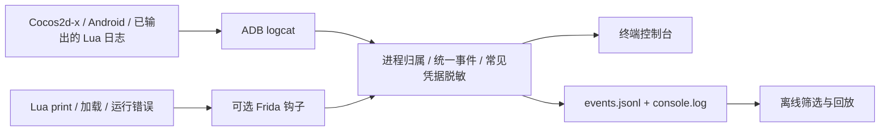

# 金箍棒 3.87 统一观测工具

## 目标与项目适配

参考图中的「引擎日志 + 虚拟机日志 → 统一控制台输出 / 统一保存」，本工具为当前已编译客户端提供统一日志入口。客户端是 **Cocos2d-x + Lua 5.1、Android ARM32**，主库为 `libxiyoujilua.so`，不是 Unity 项目。



默认模式只需要 Python 3.9+ 和项目自带 ADB。钩子模式另需匹配版本的 Frida 主机包和设备服务端。两种模式均复用 `game.json` 的包名、设备序列号和运行目录。

## 快速使用

先双击项目原有的 `启动游戏.command`，等待 Android 启动。随后双击 **`启动观测.command`**，会读取现有缓冲并持续采集。在观测终端按 **Ctrl+C** 结束采集、写出汇总；游戏继续运行。

也可在项目根目录执行：

```sh
# 设备、ABI、主进程/子进程、当前解释器的可选依赖检查
python3 observe_game.py doctor

# 读取当前 logcat 缓冲，保存后退出
python3 observe_game.py snapshot

# 持续采集新日志；Ctrl+C 停止
python3 observe_game.py collect

# 同时读取已有缓冲，采集 60 秒
python3 observe_game.py collect --history --duration 60

# 先开始采集，再启动/切回游戏 Activity
python3 observe_game.py collect --launch

# 终端只看 Lua 警告及错误；所有接收到的事件仍会落盘
python3 observe_game.py collect --source lua --level W

# 筛选消息关键字，可重复 --source
python3 observe_game.py collect --source engine --source lua --contains update

# 只保存，按每个文件 16 MiB、每种日志 6 个旧分卷滚动
python3 observe_game.py collect --quiet --max-mb 16 --backups 6
```

`--config /路径/game.json` 放在子命令前；`--output /路径/观测记录` 放在 `collect` / `snapshot` 后，可覆盖默认会话根目录。

## 会话输出与回放

每次运行新建 `.runtime/observations/<UTC时间>-<随机标识>/`，不会覆盖前一次会话。

| 文件 | 内容 |
|---|---|
| `session.json` | 包名、设备、ABI、模式、开始时间和 schema 版本 |
| `events.jsonl` | 每行一个统一 JSON 事件，便于脚本/AI 分析 |
| `console.log` | 同一批事件的人类可读文本，不受终端筛选影响 |
| `summary.json` | 正常结束、Ctrl+C、SIGTERM 或已处理错误后的计数与保留策略 |
| `events.jsonl.1` 等 | 滚动分卷，`.1` 最新，编号最大最旧 |

默认每个当前文件约 8 MiB，各保留 4 个旧分卷；两种日志合计约 80 MiB/会话，单条记录可能让阈值略微超出。**会话目录数量不自动清理**，长期使用应按需要归档或删除旧会话。汇总计数包括已被滚动淘汰的事件，因此可能大于当前保留文件的行数。

```sh
# 替换成终端打印的真实会话目录；传目录会按时间顺序读取全部保留分卷
python3 observe_game.py replay .runtime/observations/<会话目录>
python3 observe_game.py replay .runtime/observations/<会话目录> --level E
python3 observe_game.py replay .runtime/observations/<会话目录> --contains update
```

回放不连接设备。损坏的 JSONL 行会显示文件和行号，跳过后继续读取，退出码为 1。

事件主要字段：

| 字段 | 含义 |
|---|---|
| `schema` / `session` / `sequence` | 格式版本、会话 ID、宿主接收顺序 |
| `time` | 宿主接收时间，UTC ISO 8601 |
| `device_time` | logcat 原始月日时分秒，或钩子生成的 UTC 时间 |
| `source` | `engine`、`lua`、`android`、`crash`、`observer` |
| `transport` | `logcat`、`frida`、`host` |
| `kind` | 日志、进程变化、脚本加载、Lua 错误、采集状态等 |
| `level` | `V/D/I/W/E/F`；原始 logcat `A` 规范化为 `F` |
| `pid` / `tid` / `process` | 可获取时写入进程、线程、进程名称 |
| `tag` / `message` | 日志标签、消息正文 |

`sequence` 表示采集到达顺序；PID 等待归属和 Frida 批量发送会带来延迟，不能据此证明不同线程事件的精确发生顺序。logcat 时间没有年份和时区，原样保留，不与宿主时间强行换算。

常见 `access_token`、`auth_key`、`password`、`passwd`、`token`、`authorization` 字段在终端与文件输出前会被遮盖。它是有限规则匹配，不保证覆盖任意自定义日志格式。终端中的换行和控制字符会转义，JSONL 保留对应字符串内容。

## Lua 日志钩子

### 观察点

脚本位于 [`observability/hooks/cocos_lua.js`](../observability/hooks/cocos_lua.js)，按主库导出符号定位：

| 钩子 | 事件与覆盖范围 |
|---|---|
| 全局 `print` 对应的 C 函数 | `lua_print`：在原函数执行前读取参数，因此可观察函数内部被关闭的输出 |
| `lua_pcall` | 非零返回时读取栈顶错误；保留已有错误文本中的堆栈 |
| `lua_resume` | 捕获协程错误；正常 yield 不误报 |
| `luaL_loadbuffer` / `luaL_loadfile` | 脚本/chunk 名、字节数（可用时）、加载失败原因，可辅助定位热更新脚本 |
| `luaL_openlibs` / `lua_close` | 发现 print 函数、清理 Lua state 记录 |

钩子不替换 `print`，不执行业务 Lua，不修改日志开关，也不修改 APK。读取全局 `print` 时使用 Lua 5.1 `LUA_GLOBALSINDEX` 和 raw lookup，操作完成恢复栈顶。输出字符串、数字、布尔、nil；table/userdata/function 只显示类型占位，不调用 `tostring` 或元方法。每条 print 最多 32 个参数，原生字符串最多读取 4 KiB，消息落盘最多 16 Ki 字符。

观察事件按约 100 ms 批量发送；缓冲满时丢弃新事件并产生 `hook_overflow`。运行时插桩仍有性能开销，不宜将观测时序当作未插桩性能基线。

### 本项目环境准备

主机与设备端使用相同版本。本次验证使用 **Frida 16.2.1 + Android ARM32 server**，可选依赖单独记录在 [`requirements-hook.txt`](../observability/requirements-hook.txt)。没有替换现有模拟器依赖锁文件。

```sh
.runtime/venv/bin/python -m pip install -r observability/requirements-hook.txt
```

服务端来自 [Frida 官方 16.2.1 发布页](https://github.com/frida/frida/releases/tag/16.2.1)，选择 `frida-server-16.2.1-android-arm.xz`，解压后存为 `.runtime/observer/frida-server-16.2.1-android-arm`。当前工作区已下载准备好该文件，主机可选依赖也已安装；验证结束已停止服务端，使用钩子前须按下面命令启动。

```sh
# 当前独立模拟器 adbd 已是 root；其他设备须先满足 Frida 的 root 条件
.runtime/sdk/platform-tools/adb -s emulator-5562 push \
  .runtime/observer/frida-server-16.2.1-android-arm /data/local/tmp/jgbol-observer-frida
.runtime/sdk/platform-tools/adb -s emulator-5562 shell chmod 755 /data/local/tmp/jgbol-observer-frida

# 只在 Android 设备回环地址监听；已有该服务运行时无需重复启动
.runtime/sdk/platform-tools/adb -s emulator-5562 shell \
  /data/local/tmp/jgbol-observer-frida -D -l 127.0.0.1:27042

# 必须用安装了 Frida 的项目虚拟环境解释器
.runtime/venv/bin/python observe_game.py collect --hook
.runtime/venv/bin/python observe_game.py collect --hook --launch --duration 60
```

工具按配置中的**精确设备序列号**连接 Frida，仅附加主游戏进程。游戏重启后会随 PID 变化重新附加；子进程的现有日志仍通过 logcat 采集。退出观测会卸载脚本和 detach，但不会停止独立启动的 frida-server。可用 `adb shell ps` 找到 `/data/local/tmp/jgbol-observer-frida` 的 PID 后执行 `adb shell kill <该PID>`；停止整个项目模拟器也会结束它。

`hook_attached` 只说明脚本已加载。请继续查看 `hook_status` 的 `installed` / `missing` / `errors`，并以 **`print_hook_ready`** 判断全局 C print 是否实际挂接。缺少依赖、服务未启动、脚本执行失败等不会静默冒充钩子成功。

### 已知边界

- 默认模式只能收到客户端已经输出到 logcat 的日志；关闭输出的 Lua print 需钩子补充。`source` 分类在 logcat 层属于标签/文本启发式判断，精确 VM 事件以 `transport=frida` 为准。
- 附加后第一次 `lua_pcall` 或 `luaL_openlibs` 才有机会发现 print。已经执行过的 print/脚本加载无法补录；若全局 print 被 Lua 函数替换、使用局部缓存的其他函数、直接使用 `lua_load` 等未覆盖入口，也可能漏记。
- 当前模式是运行中附加，不提供 spawn-gating；`--launch` 不能保证覆盖冷启动最早一瞬间。旧版 Frida 采用 250 ms 模块轮询，也可能错过早期调用。
- 错误钩子保留现有错误信息；不额外调用 Lua traceback，因此原日志无堆栈时不会凭空补全堆栈。Lua 内部已捕获的错误不一定经过原生 `lua_pcall` 边界。
- 同一条 Lua 日志可能同时来自 logcat 和 Frida，使用 `transport` 区分，未按消息内容盲目去重。
- 采集器每约 1 秒刷新进程表，启动前尚未识别 PID 的日志最多等待 3 秒；极短命进程和设备断连期间仍可能漏记。设备断连会记录错误并以 1 退出，重新连接后启动新会话。
- `snapshot` / `--history` 根据当前 PID 归属筛选历史缓冲，无法完整恢复已退出旧进程的身份；PID 曾复用时历史归属也可能不准确。
- Native 崩溃只在 DEBUG 记录明确出现本包名后接收该线程后续片段，窗口为 10 秒；不会无差别收集其他应用的整个崩溃缓冲，亦不保证获得完整 tombstone。
- 当前观测不包含网络协议解码、资源解密、更新文件完整性核对、服务端恢复或图形性能分析；Lua 加载事件也不等于热更新成功证明。

## 故障排查

| 现象 | 检查方法 |
|---|---|
| `doctor` 设备不在线 | 先运行 `启动游戏.command`，确认 `emulator-5562` 完成 Android 启动 |
| `processes` 为空 | 游戏尚未运行；使用 `collect --launch` 或已有游戏启动入口 |
| 有引擎日志，没有 `lua_print` | 检查是否启用 `--hook`、是否出现 `print_hook_ready`，并触发会执行 Lua 的正常界面操作 |
| 找不到 frida | 使用 `.runtime/venv/bin/python`，确认可选依赖装在此环境 |
| Frida 无法连接 | 确认设备端服务在运行、版本同为 16.2.1、ABI 为 ARM32、服务有足够权限 |
| `missing` / `errors` 非空 | 可能更换了客户端主库或符号，依据状态定位，不能直接套用其他版本偏移 |
| 错误没有立即显示 | 终端过滤可能隐藏它；检查 `console.log`、`events.jsonl` 或去掉过滤条件 |

API 适配参考 [Frida JavaScript API](https://frida.re/docs/javascript-api/) 和 [Android 接入文档](https://frida.re/docs/android/)。旧 Android 的运行兼容性以当前设备实测为准。

## 维护与验证

```sh
python3 -m unittest discover -s observability/tests -v
node --check observability/hooks/cocos_lua.js
.runtime/venv/bin/python -m unittest discover -s android_emulator/tests -v
```

新增测试覆盖 Android 6 / 新版 ps 格式、主子进程隔离、PID 变化、崩溃片段归属、启动日志等待、脱敏、终端转义、筛选不影响落盘、多线程序号、滚动回放、损坏记录与断连失败。

实测记录见 [`观测验证.md`](观测验证.md)。实现文件：`observe_game.py` 为入口，`observability/cli.py` 负责命令与生命周期，`collector.py` 负责 ADB/Frida 接入，`events.py` 负责统一事件与文件，`hooks/cocos_lua.js` 负责 VM 观测。
