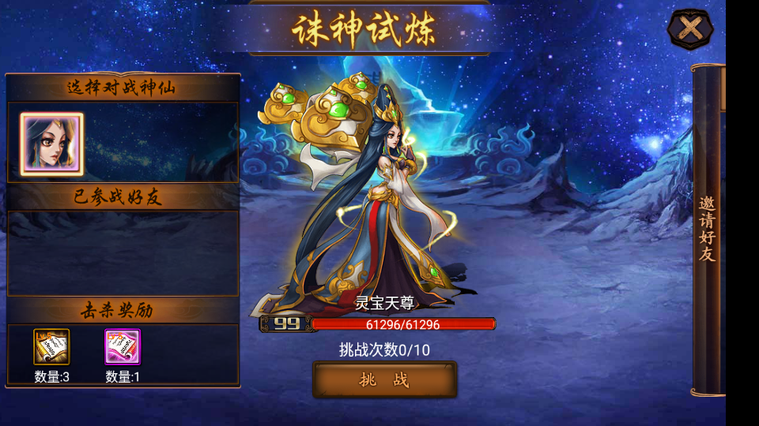

# 诸神试炼活动实现说明

更新：2026-10-27。原包部分文案写作“诛神试炼”，协议名称为 `train_boss`，界面为 `shilianUI`。本文描述活动中的诸神试炼，与主角修炼、仙盟灵兽试炼分别处理。

现已实现：每日五星首领、旅途遭遇、原版活动入口、真实战斗及战报、首领剩余血量保存、累计伤害显示、冷却与每日挑战次数、击杀后手动领奖、重新登录恢复、跨日刷新及重复领奖防护。邀请好友、广播求助、接受助战暂不开放。

标记说明：**【A】原包可确认；【U】本次用户指定；【B】原服务端缺失后的推测补齐。** 本实现遵循已确认的原版协议与交互，但不能将推测的首领强度、掉落数量、次数和概率称作原服精确数值。

## 如何游玩

1. 在主界面打开“试炼”分类，选择原版卡片“诛神试炼”，即可查看今日首领、剩余气血、奖励预览和挑战次数。
2. 点击原版“挑战”按钮，使用当前上阵神仙进行真实战斗。每次挑战免费，不扣体力、精力或元宝。
3. 未击杀时，保存战斗结束后的首领气血；冷却结束后可再次挑战。可以先调整阵容或培养神仙再来。
4. 击杀后按钮变为领奖，点击领取预览中的奖励。领奖后关闭原版奖励弹窗，返回活动列表。
5. 当日领取后不再生成第二只首领。北京时间零点进入新的一天后可挑战新首领。

普通、精英旅途的手动战斗胜利也可能提前遭遇今日首领，沿用原版遭遇弹窗。尚未遭遇时，直接进入活动会保证生成首领，避免玩家因随机事件而无法游玩。扫荡暂不触发遭遇。

## 原版依据与修复

| 内容 | 依据与结论 |
| --- | --- |
| 查询／领奖 | 【A】请求1064；查询 `flag=2,id=0`，领奖 `flag=9,id=0`；回复为事件75。 |
| 挑战 | 【A】请求1026，`fight_type=11,des_type=8,des_id=首领类型编号,des_value=0`。旧实现误读 `des_value`，已修正。 |
| 战报与返回 | 【A】1028阵容、1027战报、事件75的 `flag=8` 更新活动状态，事件44触发原版战后流程。 |
| 击杀状态 | 【A】`result=7` 表示自己击杀，`is_dead=true` 切换领奖按钮；未击杀不能领奖。 |
| 冷却和次数 | 【A】客户端读取 `last_train_time` 作为下次可挑战时间，而非上次挑战时间；`train_times` 为已用次数，`day_max_train_num` 为上限。原包未提供这两个限制的具体服务端配置。 |
| 奖励预览 | 【A】客户端消费服务端的 `prize_list`，击杀后另发领奖请求；原包未恢复到自己的首领掉落表。 |
| 旅途遭遇 | 【A】新手说明明确旅途闯关有概率遇到首领；事件75的 `flag=5` 加入遭遇队列。这是服务端推送，不接受客户端请求来重抽首领。 |
| 好友奖励线索 | 【A】原文提到接受助战获得体力、有机会获得仙佛密卷；“今日奖励达到5次”位于助战处理路径。它不能证明自己的首领每天可领奖5次。 |
| 神仙模型、成长和技能 | 【A】从原包神仙基础表读取品质、基础四维、成长、天生法术，名称与模型使用原包资源。 |

主要证据：

- [原版 shilianUI 字节码](../analysis/evidence/lua_named/lua/ui/shilianUI.lua.txt)：原始源码行137—168为挑战字段；328—435为首领和奖励展示；1344—1550为查询、战斗、领奖回调。
- [原版枚举](../analysis/evidence/activity_enums.json)：`train_boss_type`、`train_boss_result`。
- [旅途新手说明](../analysis/configs/newbie_content3.csv)：编号16。
- [神仙基础表](../analysis/configs/cortege/cortege_base_0.csv)、[神仙名称表](../analysis/configs/cortege/cortege_name_0.csv)。
- [物品基础表](../analysis/configs/item_base.csv)、[物品名称表](../analysis/configs/item_name.csv)。

## 每日首领与数值

**已实现随玩家角色等级成长。** 首领生成时读取主角等级，按该神仙的原包基础属性与原表120%的等级成长计算攻击、防御、法力和气血，并额外应用随等级提高的首领气血倍率。当前不按玩家面板战力另加倍率，也没有单独显示的首领“综合战力”字段；实际强度由战斗使用的属性与技能决定。

成长在**生成新首领时**生效：例如今天生成的是60级首领，之后玩家升到61级，今天的首领仍保持60级和原剩余气血；次日生成新首领时按当时的角色等级计算。换装备、换阵容、重复进入或重新登录都不会重算已生成首领的强度，因此玩家可以通过培养来击败当天首领。

| 项目 | 最终规则 | 来源 |
| --- | --- | --- |
| 候选首领 | 原包基础神仙中 `5000 ≤ type_id < 6000` 且品质5的46位；不抽主角、怪物模板或转生变体 | 【A】数据，【U/B】筛选和抽取方式 |
| 每日抽取 | 每个账号每日等概率抽取一位，保存后同日查询、重新登录不会换人；允许相邻两天抽中同一位 | 【U】每天随机一个，【B】等概率和账号维度 |
| 首领数量 | 每天1只，领取后结束；没有额外付费刷新 | 【U/B】 |
| 刷新时间 | 北京时间每天00:00，按活动公共时区配置计算 | 【B】 |
| 等级 | 首次生成时的角色等级，最低1、最高100；当天生成后固定 | 【B】 |
| 攻击、防御、法力 | `max(1, int(原包基础值 + 原包成长 × (等级−1) × 1.2))` | 【A】基础、成长，【B】用作首领的计算方式 |
| 气血 | 按上述公式计算气血后 × `min(12, 3 + floor((等级−1)/3))` | 【B】 |
| 法术 | 原包天生法术，技能等级1 | 【A】技能种类，【B】等级 |
| 每日挑战 | 10次，失败也占1次；不用客户端上传结果判胜 | 【B】 |
| 挑战冷却 | 每次合法战斗后60秒 | 【B】 |
| 遭遇概率 | 手动旅途胜利后10%；已有首领或当日已生成过时不会再触发 | 【A】遭遇机制，【B】概率与触发范围 |
| 挑战费用 | 免费 | 【B】 |

低等级使用较低血量倍率，使初始阵容也能通过多次挑战累积伤害；28级起达到12倍上限。该倍率不依赖玩家当前战力，调整装备或阵容不会让已生成的首领同步变强。

血量倍率达到12倍后，基础气血、攻击、防御和法力仍会随首领等级继续成长，直到首领等级上限100。超过该等级上限的玩家不会再使首领成长。同一神仙在更高等级生成时属性更高；由于每天随机神仙的基础属性和成长不同，连续两天抽到不同神仙时，不保证所有属性都比前一天高。

以下以同一位五星神仙“阎罗王”（5001）为例，使用实际生成公式计算，说明等级成长效果。此表不代表每天固定抽到阎罗王，也不是原服首领专属数值表。

| 生成时主角等级 | 首领最大气血 | 攻击 | 防御 | 法力 | 气血倍率 |
| ---: | ---: | ---: | ---: | ---: | ---: |
| 1 | 1566 | 218 | 124 | 137 | 3 |
| 10 | 5658 | 387 | 224 | 248 | 6 |
| 28 | 21420 | 726 | 424 | 470 | 12 |
| 60 | 39396 | 1329 | 781 | 865 | 12 |
| 99 | 61296 | 2064 | 1215 | 1347 | 12 |
| 100及以上 | 61860 | 2083 | 1226 | 1359 | 12 |

2026-10-27数值调整（v2）：按用户要求适度提高强度，新增 `boss_growth_percent=120`，将四维的每级成长提高20%，1级基础值和原有气血倍率曲线保持不变。总属性提升幅度小于20%，随等级提高逐步接近20%。这是【B】推测平衡配置；原版CSV没有改动。新生成首领使用v2，其他账号已生成首领继续使用原快照。

战斗复用现有服务端战斗引擎和真实阵容。每次我方以当前完整阵容开始，首领以保存的剩余气血开始；首领气血取引擎最终值，伤害榜取实际造成的气血伤害。治疗等效果可能导致“累计伤害”大于“最大气血减剩余气血”，因此不直接用累计伤害代替剩余气血。战斗引擎中尚未恢复的原服机制沿用项目现有推测实现。

## 奖励

| 物品 | 编号 | 击杀后领取数量 | 原表单本经验 |
| --- | ---: | ---: | ---: |
| 仙佛密卷 | 1041 | 3 | 1200 |
| 高级仙佛密卷 | 1042 | 1 | 2480 |

【A】两种物品及单本经验来自原包，走已有背包和仙佛密卷使用流程。【B】将密卷作为自己的首领奖励、采用上述固定组合和数量，均为推测；原包助战文案只提供密卷相关线索，不能证明该首领奖励组合是官方值。

奖励在生成首领时保存，预览与实际发放一致；修改配置不会改变已生成首领的奖励。没有额外每战奖励，也不沿用旧占位实现“击杀得10个蟠桃”的配置。

## 保存、跨日和防重复

- `activity.trial_meta` 保存每日抽中的类型、当天是否已生成、日期及最高已见服务端时间。
- `activity.trial` 保存完整首领快照，包括气血、属性、技能、奖励、累计伤害和生成日期。`trial_count`、`trial_next` 保存次数和冷却。
- 活动的公共每日重置不再直接清空试炼；试炼独立处理跨日。未击杀首领在新一天被替换，次数和冷却归零。
- 已击杀、尚未领奖的首领跨日保留，直到领取。领取旧首领奖励后重新进入活动，才出现当天的新首领；不会补发离线期间每一天的首领。
- 重复领奖、错误目标、冷却中挑战、次数用尽、未上阵、非法操作均拒绝。服务器时间回退不会重新发放当天机会。
- 沿用后端的请求序号去重及事务式保存：同一请求重传返回原结果；协议编码或结算失败不会只扣次数或只发奖励。
- 旧存档中已经击杀的占位首领奖励保留，按旧预览领取一次；未击杀的旧占位首领升级为当天五星首领，不清空账号其他数据。

## 客户端兼容

沿用原版布局、模型、挑战按钮、战报和奖励弹窗。修正／补充：

- 挑战目标按原版 `des_id` 校验，战斗和面板均显示真正的首领。
- `have_broad` 使用原界面期待的时间戳数值0，不再使用布尔值。
- 领取后清空残留的首领和挑战按钮，并清除首领选择，避免冷却到期回调访问已领取首领。
- 当日完成后再次点击入口，明确提示“明日零点刷新五星首领”。
- 好友助战按钮提示暂未开放；服务端同样拒绝广播／邀请／接受请求。好友列表查询返回空列表。
- 客户端适配随本地服务注入，停止重定向时恢复原函数，不需要修改APK。

## 文件与配置

| 文件 | 用途 |
| --- | --- |
| [activity_trial.py](../network_redirect/activity_trial.py) | 每日状态、首领生成、查询、挑战与领奖 |
| [trial_rules.json](../server_config/trial_rules.json) | 所有缺失数值的显式推测配置及来源标记 |
| [trial_client.lua](../network_redirect/trial_client.lua) | 原版界面的完成状态和助战提示适配 |
| [activity.py](../network_redirect/activity.py) | 活动1064／战斗类型11分发、公共准备阶段 |
| [journey.py](../network_redirect/journey.py) | 旅途胜利后的遭遇推送 |
| [summon.py](../network_redirect/summon.py)、[summon_client.js](../network_redirect/summon_client.js) | 注入及卸载客户端适配 |

旧 `activity_rules.json` 中的五项 `trial_*` 占位配置已移除，改由 `trial_rules.json` 管理。变更配置或代码后，需要重启本地服务；已生成的首领保持旧快照至结束或跨日。

## 验证

- v2服务端试炼专测16项：原版字段、真实战报、保存重连、冻结难度、冷却、次数上限、跨日、旧奖励迁移、领奖去重、时钟回退、失败回滚、好友禁用、配置校验和1级基础属性保持不变。
- v1活动、旅途、蟠桃、召唤、战斗引擎相关回归187项通过；追加的原表属性与冻结难度检查也已通过。
- v2重新验证全46位首领在初始账号和10／30／60／99级NPC阵容上，共230组真实战斗与领奖流程通过。初始账号各首领需要1—8次，所选四组NPC阵容均1次。测试使用固定随机种子，不代表所有玩家阵容和随机结果均保证同样次数。
- v1原版3.87客户端隔离验证13项：活动入口、原版挑战字段、46位首领模型、战报解析、冷却与返回、击杀、待领重连、领奖清理、领奖后冷却菜单刷新、退出重进后的状态替换、完成提示、助战禁用、旅途遭遇弹窗。测试挂载在原场景的独立隐藏层，网络发送被拦截，测试奖励与资源均来自临时存档。

v1真实入口查看记录（调整前）：99级灵宝天尊、气血61296/61296、奖励密卷3本与高级密卷1本、挑战次数0/10均正常显示；本次真实账号检查仅查询首领，没有消耗挑战次数或领取奖励。



验证记录：[客户端检查](../analysis/evidence/trial/client_validation.json)、[230组战斗记录](../analysis/evidence/trial/playthrough.json)、[各等级首领属性](../analysis/evidence/trial/boss_stats.csv)。

复现命令：

```sh
.runtime/venv/bin/python -m unittest tests.test_activity_trial tests.test_activity tests.test_journey tests.test_activity_party tests.test_summon tests.test_combat_engine
.runtime/venv/bin/python analysis/tools/verify_trial_playthrough.py
.runtime/venv/bin/python analysis/tools/verify_trial_client.py
```

第三项需要本项目模拟器和游戏进程已启动；前两项不需要读取真实账号。

## Ezan测试存档恢复（2026-10-27 09:06）

按用户要求，仅将账号 `ezan`（角色名“本地行者”）的诸神试炼恢复为可挑战状态。保留今日首领灵宝天尊（5045），按99级和v2配置重新生成：

| 属性 | 调整前 | 调整后 |
| --- | ---: | ---: |
| 最大气血 | 61296 | 72108 |
| 攻击 | 1680 | 1974 |
| 防御 | 725 | 852 |
| 法力 | 1110 | 1306 |

首领恢复满血、未击杀、累计伤害0；挑战次数0/10，冷却清零。此次人工测试重置允许再次挑战和正常领奖，不是新增每日重复刷新功能。之前已领取的奖励保留，没有额外直接发放奖励；其他活动、角色资源及其他账号均未修改。旧战斗及领奖摘要已随测试重置清除，原始记录保存在备份中。

修改前的完整Ezan存档已备份至 `.runtime/offline/backups/ezan-before-trial-v2-20261027-090609.json`，同目录另有此次重置的核验记录。
