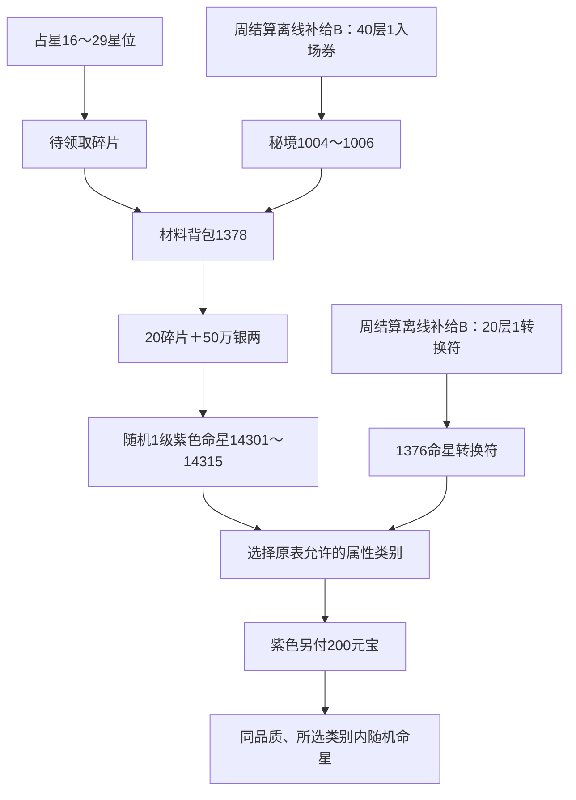

# 通天塔热更新、通天秘境与命星链补齐说明

日期：2026-10-31。对应原服资源：Android 1205→1263。实现对象：当前工作区 Python 离线服务及客户端注入补丁。

本文把原始资源可以直接证明的规则标为 **A**，缺少原服务端实现、运营投放配置或概率时采用的本地规则标为 **B**。A 不代表已经登录原服实测；B 不以“原版还原”名义呈现。

本次已接通：普通通天塔61～70层、20／40／60／70层阶段奖、五组通天秘境、命星转换请求1359、道具1376～1378、占星获得紫色命星碎片、碎片合成及后续转换。未修改玩家数据库；未构建、安装或发布新APK。已有v107安装包仍是原载荷，必须重新打包部署本次代码后才包含这些服务端改动。

## 1. 证据、版本与分类方法

### 1.1 原始证据

- [热更新差异审计](原服后续热更新与v107离线版差异审计.md)：保存了56个公开增量包的大小、MD5、ZIP CRC与版本链核查。该报告中的“未接”描述是本次修改前的基线。
- [原始CSV目录](../analysis/evidence/hotupdate_gap_20261031/official_csv)：本次直接使用末版数据，不按旧表外推61～70层。
- [原始字符串节选](../analysis/evidence/babel_hotupdate/original_strings.txt)：从v107携带且此前核对为原服1263的`v2/String.plist`、`String2.plist`提取。
- [通天塔UI](../analysis/evidence/hotupdate_gap_20261031/lua/ui/tongtiantaUI.lua.txt)、[秘境UI](../analysis/evidence/hotupdate_gap_20261031/lua/ui/tongtiantaSecretUI.lua.txt)、[命星转换UI](../analysis/evidence/hotupdate_gap_20261031/lua/ui/mxTransformUI.lua.txt)：客户端LuaJIT反汇编。
- [协议定义](../analysis/evidence/hotupdate_gap_20261031/protocol_tables_1263.json)、[操作枚举](../analysis/evidence/hotupdate_gap_20261031/common_tables_1263.json)。
- [本次机器核查](../analysis/evidence/babel_hotupdate/audit.json)：9张有效表／窄合并表的逐行一致性、SHA-256、30条转换及14个碎片星位的权重计算。

本次尝试重新读取公开更新清单，网页工具未能访问；实现依据是项目已经保存并核验过的原包及资源，不宣称本次成功访问了原服。

### 1.2 A／B总表

| 项目 | 原版规则A | 推测／实现规则B |
|---|---|---|
| 普通塔 | 36级入口；末版楼层表覆盖1～70；按末版掉落条目 | 地图、怪物属性、掉落条目等概率、每次奖励额外50通天币沿用离线重建 |
| 阶段奖 | 20／40／60／70四档和每档准确数量；文案为“到达” | 周四按已到达楼层累计发所有达标档，永久系统邮件；不能证明原服是否只发最高档 |
| 周期 | 新榜说明：周四0点结算、榜单不再变动，周一0点重置 | 惰性结算与离线补发、旧档缺快照的处理；NPC榜及榜奖数量仍属离线规则 |
| 秘境 | 五组、每组三层；每次传送1券；不限制生命／仙力 | 付券新开一轮、旧轮替换；查询不重置；普通塔跨周不清秘境；地图与难度 |
| 转换 | 30条表；38级；未锁未装1级蓝／紫星；1符；指定属性类别；紫星另耗200元宝 | 候选内等概率；必出一个、不设失败；拒绝部分喂养的1级星；产物新ID |
| 碎片 | 星位16～29有1378；权重、银两、20片＋50万配方、15种等权产物 | 占星推进／次数沿用既有离线规则；200格上限校验属于现有本地背包约束 |
| 符与券投放 | 道具文案仅写“活动产出、充值赠送” | 每周结算达到20层给1符，40层再给1券，独立补给邮件；无额外充值档位推造 |

## 2. 普通通天塔61～70层

### 2.1 原版规则A

采用`babel_tower_floor_prize.csv`原服1263的完整14档记录。1229扩到70层，后续高层材料调整也包含在本次采用的末版中。1～60层同时使用末版条目，不能只追加后两行而忽略原表前段变化。

61～65与66～70两组的末版奖池相同，每条数量均为1：

- 破障丹（1421）。
- 五星仙界魂（5001）、五星佛界魂（5005）对应的**道具对象**；本表`object_type=5`，不能因编号与神仙相同就直接发放神仙对象。
- 五法界魂箱（1249）。
- 天命石（1371）、魂石箱（1370）、魂石碎片（1375）。

具体名称以有效物品表为准，完整条目见[有效楼层表](../analysis/configs/babel_hotupdate/babel_tower_floor_prize.csv)。

### 2.2 推测规则B与可玩性

保留现有离线5×8地图、3×3可见区域、宝箱钥匙／锤子／道符交互。1～10层新建地图随机；11～70层沿用已有固定布局。存档中已保存的有效地图不重新随机，不恢复已拾取格。

守卫使用现有NPC资料库；按楼层固定选择，不随玩家战力动态抬高。61～70延续现有普通塔目标战力曲线，而非伪称恢复了原服怪物属性。可选NPC有限，因此高层选择可能重复。

奖池未带掉率，按条目等概率抽一个，保留重复条目的重复权重。普通塔原有箱子／守卫／最终楼梯奖励的额外通天币沿用当前配置`babel_cell_coins=50`。普通塔终层必须击败守塔者才能完成；70层终点每周只结算一次，变为空地，不生成71层。到达70层已满足阶段奖，不要求再击败70层守塔者，这与“到达”文案一致。

### 2.3 60层旧档迁移

- `max_floor`升级为70；不清空通天币、钥匙、道具、已到楼层或已探索地图。
- 旧档已经完成60层：撤销旧上限的`complete`，恢复60层右下角楼梯，使其能继续进入61层；其余已领取格保留为空。
- 旧档只到60层但未完成：保留地图与守卫，按正常流程继续。
- 查询、传送、重登不重新发60层旧终点奖励；新的终点奖励只在70层结算。

## 3. 阶段奖励与周结算

### 3.1 原版规则A：四档准确奖励

原表字段顺序为`对象类型|道具编号|数量|等级`，所有下列奖励均为道具、等级1。

| 到达楼层 | 该档奖励 |
|---:|---|
| 20 | 通天币（20000）×20000、铜钥匙（20012）×10 |
| 40 | 通天币（20000）×30000、银钥匙（20011）×5、铜钥匙（20012）×10 |
| 60 | 通天币（20000）×40000、金钥匙（20010）×3、银钥匙（20011）×5、铜钥匙（20012）×10 |
| 70 | 通天币（20000）×50000、金钥匙（20010）×5、银钥匙（20011）×10、铜钥匙（20012）×15 |

原UI L1724～1730读取此表并生成预览；奖励格回调仅显示物品介绍。本次没有找到独立领奖按钮，因此没有把保留的`draw=5`枚举擅自当成阶段奖接口，操作5仍拒绝。

### 3.2 周期A与结算解释B

原资源中存在两代文案：旧文案写周一结算发奖；新增`tongtianta18_1～18_3`写周四0点结算并冻结排行榜、周一0点重置。本次按后续热更新的新榜说明实现，所有时间使用游戏既有UTC+8周界限。

**B：阶段奖与新榜在同一周四结算，按截止时已到达的所有档位累计发放。** 到70层累计获得140,000通天币、金钥匙8、银钥匙20、铜钥匙45。这个合计来自明确的累计实现选择，不能用它反向证明原服累计发奖。

结算快照与进度分开：

1. 周一～周四0点前，攀登进度可以提升本周结算成绩。
2. 周四0点及以后，第一次登录／活动状态刷新先冻结成绩并发奖，再处理当次请求。恰在截止时跨层，按跨层前记录结算。
3. 周四后仍可探索与拿格子奖励；新到达楼层不追补已经结算的本周阶段奖，也不改变冻结榜单。
4. 下周一重置普通塔进度与地图；未领取邮件、道具和通天币保留。
5. 跨过多周未登录时，只结算存档记录的上次参与周，不凭空生成中间未参与周奖励。

采用永久系统邮件，不会因邮件过期丢奖；每个`周编号＋阶段`有稳定批次键。请求缓存、防重发、已领取标记共同防止重复获奖。周榜沿用原有本地NPC与2000／1500／1000／500／200通天币档位，此金额没有升级为A类。

**旧档兼容B：** 没有周四快照的旧参与存档，在首次结算时使用现存最高到达记录，无法倒推出旧版周四之前的精确楼层；升级前已经存在的记录不造假为历史服务器快照。首访在周四后的全新未参与记录会冻结在1层，不补发本周奖。

### 3.3 符、券的可获得来源B

原服表只证明1376、1377的定义和“活动产出、充值赠送”提示，没有给具体活动、阈值或概率。为使本次两条新增玩法可通过正常游戏获得入场材料，增加**独立离线活动补给邮件**：

| 周四冻结的普通塔成绩 | 每周补给 |
|---|---|
| 到达20层 | 命星转换符1376×1 |
| 到达40层 | 额外通天秘境入场券1377×1 |

两项可累计；不修改原版阶段奖励CSV，不混入A类阶段奖附件。首次上线的存档若已过周四且没有此前参与记录，需要下一周参与后再取得该周补给。此方案不是对原服充值活动的复刻。

## 4. 通天秘境

### 4.1 原版规则A

- 普通通天塔中的秘境入口；沿用36级通天塔入口限制。
- 原协议1353：操作12查询，13移动，14传送进入；返回事件203。
- 选择组编号`g=1～5`，原客户端发送入口层号`3*g-2+1000`，即1001／1004／1007／1010／1013。
- 每次传送消耗1377×1；一次副本三层，不是把1001～1015当成无需再次入券的连续15层。
- 原文明确“没有生命点数限制，没有仙力限制”。普通塔恢复药、200元宝恢复生命不是秘境入场条件。
- 金／银／铜箱仍检查对应钥匙，石块／篝火仍检查锤子／道符；原秘境移动UI保留这些判断。

| 组 | 层号范围 | 原表掉落条目 |
|---:|---|---|
| 1 | 1001～1003 | 精魄石（10000）×1、猎魂宝箱（1325）×1、蟠桃（1001）×1、紫色精魄碎片（10001）×1、魂石宝箱（1370）×1、天命石（1371）×1 |
| 2 | 1004～1006 | 星尘（10300）×1、蟠桃（1001）×1、紫色命星碎片（1378）×1、魂石宝箱（1370）×1、天命石（1371）×1 |
| 3 | 1007～1009 | 伏心转生石（1330）×1、魂晶（1441）×1、蟠桃（1001）×1、轮回舍利（1329）×1、魂石宝箱（1370）×1、天命石（1371）×1 |
| 4 | 1010～1012 | 四星灵器（1313）×1、精华礼包（1327）×1、升阶宝箱（1324）×1、蟠桃（1001）×1、远古水晶（1322）×1、太古水晶（1323）×1、五星灵器（1314）×1、魂石宝箱（1370）×1、天命石（1371）×1 |
| 5 | 1013～1015 | 破障丹（1421）×1、圣母蟠桃（1343）×1、蟠桃（1001）×1、魂石宝箱（1370）×1、天命石（1371）×1 |

1010～1012组的`1323`条目原表带第四个`1`，实现兼容已有等级字段，不再错误追加成五字段奖励。

### 4.2 推测规则B

- 五组均可凭券选择，没有补造原表不存在的通塔层数前置。
- 每次成功传送创建一轮新的三层地图，替换上一轮；再次传送即使选择同组也扣一券。没有券、入口非法时整次拒绝，不丢旧轮进度。
- 操作12只读取当前轮；重登保留已清格、楼层、位置和守卫。普通塔周一重置不清除已付券秘境。
- 每组三层各自保存地图；每层击败守塔者后走楼梯进入下一层。第3层完成后留在最终地图，可以继续探索剩余格；再次开新轮须重新付券。
- 地图沿用离线固定布局；守卫五组分别按普通塔40／45／50／55／60层难度选取现有NPC。没有把1001作为普通塔战力曲线输入。
- 秘境战斗仍由真实离线战斗引擎判胜负，失败不清除守卫；不扣生命、不扣仙力，普通塔资源不受影响。传给原界面的兼容资源字段不构成资源限制。
- 秘境按其原表条目等概率抽一个；不额外发普通塔的50通天币。钥匙守卫获胜仍有对应钥匙，锤子／道符格仍可拾取。
- 每轮最后楼梯奖励一次；清空格不能反复刷奖励，刷新／重登不重建掉落。

其中1004～1006组可以获得1378紫色命星碎片。这是原表明确列出的第二条来源；每次奖励触发等概率选5条之一，即本地B类规则下为1/5，不能声称原服秘境掉率20%。

## 5. 命星转换

### 5.1 原版规则A

`fate_star_transform.csv`含30条：蓝色13301～13315、紫色14301～14315各15种。物品表品质值分别是4／5，此处沿用游戏命星颜色命名，不能与神仙星数混淆。

- 最低角色等级38，由转换表确定；占星阁原有开放等级不因此改为38。
- 输入为1级命星；必须未锁定、未装备，`equip_pos/ext_awaken_pos/ext_skill_pos`为0。原客户端过滤对应L309。
- 每次消耗原命星1个、命星转换符1376×1。
- 选择的是目标**属性类别**`sub_type`，不是具体命星物品ID。`mxChange2`明确每种命星有出现概率。
- 紫色品质5指定类别额外200元宝，蓝色品质4为0；来自原UI L147～154和L189～197，不是从转换CSV推造的价格。
- 转换不跨品质，不包含原命星本身；候选必须在该来源行`des_material`中。

同品质允许范围可简写为三组，实际以每条原表去掉自身后的候选为准：

| 转换组 | 同组编号后两位 | 可以选择的属性类别 |
|---|---|---|
| 第一组 | 01、02、07、08、09、10、15 | 1、6、7 |
| 第二组 | 03、04、05、06 | 5、3 |
| 第三组 | 11、12、13、14 | 4、2 |

例如紫色14301指定类别6，候选为14307／14308／14309／14310；指定类别1只能得到14302。不能请求14301直接变14303，也不能把14307这个五位数当作协议里的单字节`des_type`。

### 5.2 推测规则B与继承边界

原转换表标随机，但所有候选权重为0，不能把这些0解释为真实概率。实现选择：在用户选中类别的合法候选中等概率产生一个，没有额外失败掷骰，不同候选数量决定最终概率。例如上述类别6为各1/4。

不支持2级及以上命星转换，因而没有虚构“高等级转换保留等级／经验”机制。对于仍为1级但已经投入部分星尘的命星，额外拒绝转换，避免无说明吞掉投入；此保护是B类限制，原UI只检查等级，没有证明原服如何处理这部分星尘。

旧堆叠命星`count>1`拒绝直接转换；正常占星、合成产物均为独立对象。成功时删除输入实体、创建1级新命星，使用新ID，品质由原目标表保持；刷新背包后才发成功事件。锁定／已装备星不会被偷偷拆卸或解锁。

协议：`1359(serial_num=I, star_id=d, des_type=B)`，成功为事件225 `{result=0, new_star_type=物品编号}`（原`smithUI`仅在`result==0`时转交成功回调）。`star_id`是实例ID，使用double保持原协议。资金／转换符不足、目标类别非法、输入不可用时不扣任何资源，不创建结果；重复相同序号请求返回缓存结果。

## 6. 紫色命星碎片的产出与合成链

### 6.1 产出A：占星星位16～29

每个成功抽中的碎片条目产1378×1。下表按原表条目权重求和，表示**当前已经位于该星位，完成一次占星抽取时**产碎片的概率。

| 星位 | 该次银两消耗 | 碎片权重／总权重 | 条件概率 |
|---|---:|---:|---:|
| 16 柳土獐 | 100,000 | 1/201 | 0.497512% |
| 17 星日马 | 100,000 | 1/437 | 0.228833% |
| 18 鬼金羊 | 100,000 | 1/201 | 0.497512% |
| 19 翼火蛇 | 100,000 | 1/201 | 0.497512% |
| 20 井木犴 | 100,000 | 1/201 | 0.497512% |
| 21 张月鹿 | 100,000 | 1/101 | 0.990099% |
| 22 轸水蚓 | 100,000 | 1/201 | 0.497512% |
| 23 亢金龙 | 200,000 | 199/2199 | 9.049568% |
| 24 心月狐 | 200,000 | 200/1200 | 16.666667% |
| 25 箕水豹 | 200,000 | 198/2198 | 9.008189% |
| 26 氐土貉 | 200,000 | 199/2199 | 9.049568% |
| 27 房日兔 | 200,000 | 198/4198 | 4.716532% |
| 28 尾火虎 | 200,000 | 198/2198 | 9.008189% |
| 29 角木蛟 | 200,000 | 199/2199 | 9.049568% |

星位1～15没有1378。概率来自`star_config.csv`，不是统一固定几率，也不是把条目权重直接当百分数。占星从哪里开始、如何推进、每天次数与购买费用沿用已有离线配置，属于既有B类服务端重建；因此不能把上表当作任意一次占星的总体概率或承诺多少次必出。

抽取先进入占星待领取列表，领取后合并到材料背包，不成为一个可装备命星。命星背包已满200颗时，只有碎片等材料的待领取列表仍可领取；如果列表中还包含会超过容量的实体命星，则整批保持待领取，不吞掉碎片。

### 6.2 产出A：通天秘境第二组

1004～1006层的掉落表有1378×1。具体抽取触发点和概率采用第4节B类重建规则。普通塔61～70原表不含1378，本次没有擅自把碎片塞进普通高层池。

### 6.3 合成A

原`material_transform.csv`类别10，分类名“命星”：

- 角色等级至少5。
- 每次消耗紫色命星碎片1378×20，银两500,000。
- 随机得到14301～14315中的一个，数量1，等级1。
- 15种产物权重均100，所以每种1/15，约6.666667%。
- 走原有材料合成1074，`flag=2`、`des_type=1`；`num`为次数。沿用请求的批量边界1～255，并检查实际材料、银两、背包容量。
- 未把枚举`fateStar_transform=6`仅凭名字解释成碎片合成；命星转换使用已证实的1359。

| 紫色命星编号 | 名称 | 属性类别sub_type |
|---:|---|---:|
| 14301 | 辛金神雷 | 1 |
| 14302 | 庚金神雷 | 1 |
| 14303 | 己土玄甲 | 5 |
| 14304 | 戊土玄甲 | 5 |
| 14305 | 乙木引气 | 3 |
| 14306 | 甲木引气 | 3 |
| 14307 | 少阳仙咒 | 6 |
| 14308 | 太阳仙咒 | 6 |
| 14309 | 柔阳仙咒 | 6 |
| 14310 | 刚阳仙咒 | 6 |
| 14311 | 丙火宝焰 | 4 |
| 14312 | 丁火宝焰 | 4 |
| 14313 | 壬水归元 | 2 |
| 14314 | 癸水归元 | 2 |
| 14315 | 太阴轮回 | 7 |

合成每颗产物使用独立实例ID；批量抽中相同种类也不会合成一叠，后续可分别升级、装备、分解、转换。材料锁定、数量不足、银两不足、背包已满时整笔拒绝，不扣碎片或银两。

### 6.4 可运行完整链



## 7. 实现、兼容与验证

### 7.1 改动入口

| 文件 | 作用 |
|---|---|
| `analysis/configs/babel_hotupdate/` | 5张完整末版表；1376～1378物品基础／名称、类别10配方／分类的窄合并表 |
| `network_redirect/summon.py` | 统一有效表加载，保留旧基线CSV用于历史审计 |
| `activity_babel.py` | 70层、旧档恢复楼梯、独立秘境轮次与移动、原表奖励 |
| `activity_babel_npc.py` | 周四冻结、阶段奖／周榜／补给邮件，秘境难度映射 |
| `protocol.py`、`reborn.py`、`backend.py` | 1359编解码、分发、防重放、成功前背包同步 |
| `reborn_stars.py` | 转换校验与结算；碎片占星池、领取不占命星格 |
| `equipment_crafting.py` | 接入类别10原配方，合成容量保护，独立命星产物 |
| `babel_client.lua` | 70层完成提示、周四结算提示 |

原来的`analysis/configs/babel_tower_floor_prize.csv`仍是1205历史基线，运行时由`summon.rows`切到专项末版；不能再只看旧基础文件就断言运行上限仍是60。新增物品采用窄合并，没有替换全游戏其他系统的物品或配方。

### 7.2 存档与事务

新增普通塔快照字段：`frozen_week/frozen_top/frozen_mine`。秘境状态在`activity.babel.secret_run`中，含当前组楼层、地图、位置、NPC、完成标记；普通塔`history_floor`绝不写入1001等秘境楼层。

新增邮件键：`babel-stage-{week}-{stage}`、`babel-supply-{week}`，周榜沿用`babel-rank-{week}`。角色操作使用Backend的脱离持久存储副本，全部成功后才保存；校验失败不保存中间扣除。服务端串行序号缓存处理重复包；数据库保存与邮件已领记录处理重新登录。

秘境不在查询时扣券、不在移动时扣券、不跨组三层自动加开。普通塔与秘境共用角色道具背包，所以秘境获得的钥匙可以用于普通塔，消耗钥匙也会减少同一背包；生命、仙力和楼层进度则互不污染。

### 7.3 验证记录

验证命令与结果见同目录证据。自动化使用临时数据库，不读取或改动玩家现用存档。

```sh
.runtime/venv/bin/python analysis/tools/audit_babel_hotupdate.py
.runtime/venv/bin/python -m unittest tests.test_babel_hotupdate tests.test_activity_babel tests.test_reborn tests.test_equipment_crafting -q
PYTHONPATH=/private/tmp/jgbol-rank-lua .runtime/venv/bin/python analysis/tools/verify_babel_client.py
.runtime/venv/bin/python analysis/tools/verify_babel_hotupdate_playthrough.py
```

Lua检查依赖本机已有`lupa.lua51`；路径只是本次验证环境，不是游戏运行依赖。真实战斗通关验证预置NPC资料库阵容、仙露和入场券，用来验证流程与资源隔离，不证明普通玩家的养成时间或经济平衡。未将静态反汇编或Lua沙箱结果写成Android原生界面完整验收。

验证记录（不把环境问题或既有失败隐藏为全绿）：

| 验证 | 结果／证据 |
|---|---|
| 原表核查 | 9张表／子集与原服逐行一致；30条转换、14个碎片星位，见[audit.json](../analysis/evidence/babel_hotupdate/audit.json) |
| 专项测试 | 16项通过；包含真实1359和1074包、完整碎片链、旧60层档、周四边界、秘境资源隔离与重复请求，见[专项日志](../analysis/evidence/babel_hotupdate/targeted_tests.log) |
| 首轮主体关联回归 | 67项通过，覆盖原通天塔、转生与材料合成，见[日志](../analysis/evidence/babel_hotupdate/core_tests.log)；随后新增边界测试由专项16项覆盖 |
| 扩大回归 | 首次199项中181项通过、3项断言失败、15项错误，详见[原始日志](../analysis/evidence/babel_hotupdate/tests.log)；错误的后续处理如下 |
| 回环网络复验 | 14项通过。首次沙箱禁止绑定127.0.0.1临时端口，经本地测试执行权限复验通过，见[日志](../analysis/evidence/babel_hotupdate/network_tests.log) |
| 逆天改命关联复验 | 10项通过。该旧测试模块使用裸`from test_activity`，补充`PYTHONPATH=tests`后通过，见[日志](../analysis/evidence/babel_hotupdate/fate_tests.log) |
| 3项既有登录断言 | `test_auth_reconnect_queries_and_expired_ticket`、`test_bootstrap_initializes_formation_and_innate_skill`、`test_ticket_replay_and_persistence`仍失败；旧断言漏掉已有事件80命星／逆天属性同步包。`Backend.bootstrap`的AST与HEAD完全相同，见[基线核对](../analysis/evidence/babel_hotupdate/bootstrap_baseline_check.json)。本次不修改该无关登录流程或旧断言 |
| Lua补丁 | Lua5.1沙箱验证普通塔／秘境完成回调、重装幂等、恢复及全量注入源码编译，见[结果](../analysis/evidence/babel_hotupdate/client_patch_validation.json)；不是Cocos原生实机验收 |
| 打包收集 | 9张表及运行模块均被现有载荷收集器纳入，见[清单检查](../analysis/evidence/babel_hotupdate/payload_manifest_check.json)；未产生新APK |

真实战斗完整验证通过：普通塔1～70层、五组秘境1001～1015，共1,610次协议请求、313场获胜战斗（普通塔208场、秘境105场）。30层中途重启、70层终点重复走格不重复领奖、五券对应五轮、普通塔资源隔离、商店与周榜邮件领取均通过。见[通关记录](../analysis/evidence/babel_hotupdate/playthrough.json)和[执行日志](../analysis/evidence/babel_hotupdate/playthrough.log)。

## 8. 尚不能声称恢复的原服细节

1. 原服普通塔及秘境的地图生成算法、怪物属性、掉落触发与权重未公开，本次重建仍为B。
2. 阶段奖励是否原服累计、发放方式与错过结算的处理没有服务端证据；文案只直接确认档位和新榜时间。
3. 1376／1377的原服具体活动、充值金额和投放频率未知，本次周补给需保持B标签。
4. 转换候选原表权重全0，实际各命星掉率、是否失败、部分经验的处理未知。
5. 本次没有改变原有占星星位推进概率，没有假装恢复每个普通玩家的碎片总体获取速度。

这些边界已经有可运行的明确规则，不会让玩法卡在“只有入口／只有图标”；未来取得新的原服证据时，应更新专项表或相应B规则，并保留旧档与已发邮件的幂等性。
