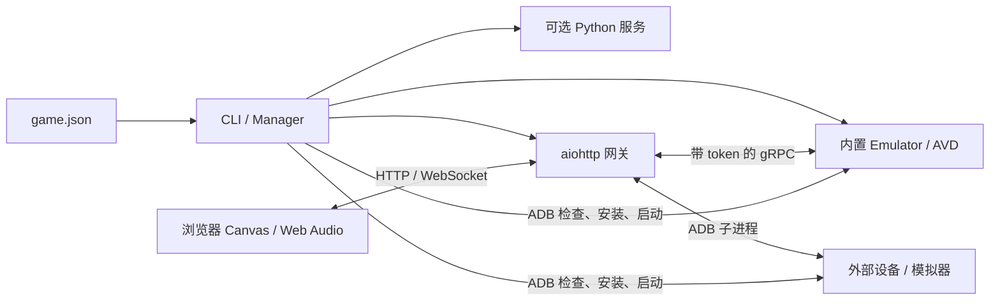

# 通用安卓模拟器游戏台实现文档

编写日期：2026-11-01。本文以当前仓库 `android_emulator/` 源码为准，描述已实现的模块、协议和部署方式；最后单列尚未实现的扩展项。适用于维护现有游戏台、独立复制模块及接入其他安卓游戏。

## 1. 目标与适用范围

游戏台通过一份游戏 JSON 配置，管理安卓运行环境、安装和启动 APK，并在本机浏览器中显示画面、接收操作和播放音频。

“通用”指游戏包名、Activity、APK、运行目录、端口和界面文案均可配置。模块不依赖金箍棒资源、业务协议、账号或存档代码，也不保证任意安卓游戏都能运行：实际兼容性仍取决于设备 ABI、Android 版本、图形能力和游戏依赖的服务。

| 能力 | 当前实现 |
| --- | --- |
| 内置安卓环境 | 启停指定 AVD，支持三种运行配置 |
| 外部安卓设备 | 通过指定 ADB serial 连接已授权手机或已有模拟器 |
| APK 管理 | 完整 APK 的 ABI 检查、覆盖安装、启动指定 Activity |
| 浏览器画面 | 内置模式 RGBA/PNG；ADB 模式 PNG 截图 |
| 输入 | 内置模式最多 10 个触点；ADB 模式单指完成手势；有限键盘输入 |
| 音频 | 内置模式通过 gRPC 转发 PCM 到浏览器；ADB 模式由设备播放 |
| 多游戏隔离 | 独立运行目录、进程记录、端口、配置和网页会话 |
| 附加服务 | 启停配置中的 Python 服务，检查其端口是否监听 |
| 游戏专用逻辑 | 由接入项目自行提供，包括账号、业务接口、资源补丁和存档 |

当前自动部署流程面向 Apple Silicon macOS。ADB 接入不需要部署内置镜像，但整个工具链尚未完成 Windows/Linux 平台适配与验证。

## 2. 架构与职责



网关按 `mode` 选择后端。内置模式使用 `AuthorizedStub` 调用模拟器控制协议；ADB 模式由 `AdbBackend` 提供同名的状态、截图、触摸和按键方法。上层网页协议由此保持一致。

### 2.1 源码结构

| 文件 | 职责 |
| --- | --- |
| [`run.py`](../android_emulator/run.py)、`__main__.py` | 脚本入口和 `python -m` 入口 |
| [`cli.py`](../android_emulator/cli.py) | 命令解析、动作分派、异常和退出码 |
| [`config.py`](../android_emulator/config.py) | 配置规范化、路径解析、字段校验、APK ABI 识别 |
| [`profiles.py`](../android_emulator/profiles.py) | 镜像、引擎参数、模拟器命令及环境变量 |
| [`manager.py`](../android_emulator/manager.py) | 设备检查、进程归属、启停、安装、启动与诊断 |
| [`gateway.py`](../android_emulator/gateway.py) | HTTP、WebSocket、会话、画面、控制和音频转发 |
| [`adb_backend.py`](../android_emulator/adb_backend.py) | 外部设备截图、完成式手势、按键和子进程清理 |
| [`avd.py`](../android_emulator/avd.py) | 创建独立 AVD，拒绝覆盖已有配置 |
| [`download.py`](../android_emulator/download.py) | 下载部署归档及官方索引 |
| [`runtime_setup.py`](../android_emulator/runtime_setup.py) | 校验 SDK/镜像归档、解压、记录部署凭据 |
| [`compat32.py`](../android_emulator/compat32.py) | ARM32 镜像、引擎副本、JIT 权限签名和 AVD 准备 |
| `proto/` | 已随模块提供的模拟器控制协议及 Python 绑定 |
| `web/index.html`、`web/style.css`、[`web/app.js`](../android_emulator/web/app.js) | 页面、Canvas、指针输入和 Web Audio |
| `examples/` | ADB、ARM32、ARM64 配置模板 |
| `tests/` | 配置、生命周期、隔离、画面、音频及前端输入测试 |

### 2.2 依赖

Python 依赖以 [`requirements.lock.txt`](../android_emulator/requirements.lock.txt) 为准：`aiohttp==3.13.5`、`grpcio==1.80.0`、`protobuf==6.33.6`。前端使用原生 JavaScript、Canvas 2D、Pointer Events、WebSocket 和 Web Audio，无前端打包步骤。

本次自动化验证使用仓库现有 Python 3.9 虚拟环境。Node.js 用于前端语法检查和输入测试，不是网页运行依赖。

## 3. 配置模型

### 3.1 路径与覆盖规则

`load_config()` 读取 JSON 对象，再调用 `normalize_config()`。所有配置内相对路径基于 **JSON 文件所在目录**；命令行 `install --apk` 的相对路径基于终端工作目录。

普通路径展开 `~` 并转为绝对路径。`python_path` 特意保留虚拟环境解释器的符号链接，避免解析成系统解释器后丢失虚拟环境依赖。

环境变量 `ANDROID_GAME_MODE`、`ANDROID_GAME_SERIAL`、`ANDROID_GAME_ADB_PATH` 可覆盖对应字段。`load_config(..., defaults=..., env_prefix=...)` 供游戏适配层注入默认值或独立前缀。

### 3.2 字段定义

| 字段 | 默认值 / 要求 | 用途 |
| --- | --- | --- |
| `title` | `安卓游戏`，非空字符串 | 网页和命令行名称 |
| `package` | 必填 | 目标应用包名 |
| `activity` | 必填，可写 `.MainActivity` | 与包名组合为启动 component |
| `apk` | 未提供则为 `null` | 默认完整 APK 路径 |
| `required_abis` | `null` | 诊断/启动所需 ABI 候选；`null` 时检查默认 APK，`[]` 表示无原生库要求 |
| `mode` | `emulator` | `emulator` 或 `adb` |
| `runtime_profile` | `arm64` | `arm64`、`arm32-native`、`arm32-software` |
| `runtime_dir` | `.runtime` | 当前游戏运行数据根目录 |
| `sdk_path` | `<runtime_dir>/sdk` | Android SDK 路径 |
| `adb_path` | `<sdk_path>/platform-tools/adb` | ADB 可执行文件 |
| `python_path` | `<runtime_dir>/venv/bin/python` | 网关及附加服务解释器 |
| `avd_name` | `android_game` | 内置虚拟设备名称 |
| `console_port` | `5556` | 5554—5682 范围的偶数，后一端口留给模拟器 ADB |
| `grpc_port` | `8556` | 模拟器控制服务端口 |
| `web_port` | `8767` | 本机 HTTP/WebSocket 端口 |
| `serial` | `emulator-<console_port>` | ADB 目标；外部设备接入时应显式填写 |
| `dns` | `8.8.8.8,1.1.1.1` | 内置模拟器 DNS |
| `token_discovery_dir` | macOS 默认 emulator 发现目录 | 获取当前模拟器 gRPC token |
| `ui` | `{}` | `eyebrow`、`edition`、`help` 界面文案 |
| `services` | `[]` | 附加服务数组，每项为 `name`、`script`、`port` |

配置校验要求控制端口、ADB 邻接端口、gRPC、网页及附加服务端口互不重叠；内置模式 serial 必须匹配控制端口。服务名称不能重复，也不能使用保留名称 `emulator`、`gateway`。ADB 模式仍会经过上述通用端口和 profile 字段校验。

### 3.3 完整示例

下面示例约定配置保存为 `my-game/game.json`，APK 保存为 `my-game/game.apk`。包名和 Activity 需要替换为实际值。

```json
{
  "title": "我的安卓游戏",
  "package": "com.example.game",
  "activity": ".MainActivity",
  "apk": "game.apk",
  "required_abis": null,
  "mode": "emulator",
  "runtime_profile": "arm64",
  "runtime_dir": ".runtime",
  "avd_name": "my_game",
  "console_port": 5564,
  "serial": "emulator-5564",
  "grpc_port": 8564,
  "web_port": 8772,
  "ui": {
    "eyebrow": "本机安卓游戏",
    "edition": "游戏台",
    "help": "连接画面后操作；关闭网页不会停止安卓设备。"
  },
  "services": []
}
```

附加服务可配置为 `{"name":"game-api","script":"server.py","port":18770}`。Manager 仅执行 `[python_path, script]` 并等待端口监听，不自动传入端口参数、不改变脚本工作目录、不配置 `adb reverse`，也不实现业务健康检查。脚本应自行确定资源路径和监听端口。

## 4. 运行环境与 ABI

### 4.1 运行配置

| Profile | Android / ABI | 默认资源 | 实现特点 |
| --- | --- | --- | --- |
| `arm64` | API 30 / Android 11 / `arm64-v8a` | 4 核、4096 MB、1280×720、240 DPI | SDK emulator，GPU `host` |
| `arm32-native` | API 23 / Android 6.0 / `armeabi-v7a` | 1 核、1536 MB、960×540、160 DPI | Apple Silicon 宿主上的 ARM32 引擎副本，`-accel off` 软件仿真 |
| `arm32-software` | API 23 / Android 6.0 / `armeabi-v7a` | 1 核、1536 MB、960×540、160 DPI | 旧 Intel launcher 路径，保留的实验配置 |

`arm32-native` 中的 native 指宿主引擎，不代表 ARM32 客体使用硬件加速。它仍受软件仿真性能限制。旧 Intel launcher 不由当前新环境部署流程自动安装。

模拟器统一使用 `-no-window`、`-no-snapshot`、`-no-boot-anim` 和 `-grpc-use-token`。AVD 使用 2G 数据分区、横屏、启用键盘与音频输出；不启用摄像头、麦克风或 Play Store。分辨率和资源参数来自 `profiles.py`，目前不是任意 JSON 字段。

ARM32 引擎额外使用 `-audio none` 避免宿主 CoreAudio 问题；该配置仍通过 gRPC 提供客体 PCM 音频。源码注明已在引擎 37.2.12 验证，不应推定所有版本行为相同。

### 4.2 ABI 检查算法

1. 确认 ADB 可执行文件存在，指定设备的 `get-state` 为 `device`。
2. 内置模式额外通过 `emu avd name` 验证 AVD 名称。
3. 获取 `ro.product.cpu.abilist`、`ro.product.cpu.abilist32`；必要时回退到 `ro.product.cpu.abi` 和 `abi2`。
4. 检查 `sys.boot_completed == 1`。
5. 将所需 ABI 与设备声明 ABI 做精确名称集合交集；存在任一交集才通过，无原生库要求则不限制 ABI。

`apk_abis()` 从 ZIP 的 `lib/<abi>/*.so` 提取 ABI，不改包。安装时始终分析**本次实际安装的 APK**，优先级高于配置中的 `required_abis`，防止使用 `--apk` 换包后误用旧检查结果。

此检查不解析 Manifest 的最低 Android API，不检查 Google 服务或动态加载的原生代码，也不验证 APK 包名是否与配置一致。配置必须对应实际应用。将 `armeabi` 目录改名为 `arm64-v8a` 不能转换指令集。

## 5. 生命周期与数据保护

### 5.1 `start`

启动顺序如下：

1. 创建运行目录中的 `android-user/`、`logs/` 和 `pycache/`，确认 Python 路径存在。
2. 读取 `processes.json`，检查计划使用的服务端口和已记录进程。
3. 遇到未跟踪服务占用端口，或已跟踪进程存在但尚未监听，报错并拒绝重复启动。
4. 检查附加服务脚本是否存在。
5. 内置模式检查引擎、AVD 和控制/ADB 端口，启动模拟器，最多等待 gRPC 端口 60 秒。
6. ADB 模式直接检查设备启动状态和 ABI，不启动外部设备。
7. 依次启动附加服务，再启动网页网关；各服务默认等待监听 15 秒。

`start` 的成功条件包含端口就绪，**不等于 Android 完全启动**；内置模式之后应运行 `doctor`。`start` 不会自动安装 APK。启动中途失败时，已经启动的进程会保留记录，当前没有完整启动事务回滚。

### 5.2 进程归属与 `stop`

每次启动子进程后，Manager 把 PID 写入临时文件，再替换 `processes.json`。日志追加到 `logs/<name>.log`。

停止前通过 `ps` 校验实际命令：模拟器匹配引擎路径、AVD 和控制端口；Python 服务匹配预期脚本及参数。仅对匹配的 PID 发送 SIGTERM。按进程记录逆序停止，通常先网关、再附加服务、最后模拟器；等待约 5 秒仍未退出则报错并保留记录，不强制 SIGKILL。

ADB 模式不关闭外部手机或模拟器。关闭浏览器只断开网页连接，不能替代 `stop`。

### 5.3 安装与启动

`install` 检查目标 APK 和设备后执行：

```text
adb -s <serial> install --no-streaming -r <apk>
adb -s <serial> shell am start -W -n <package>/<activity>
```

安装超时为 600 秒，Activity 启动超时为 120 秒；启动输出中出现 `Error:`、`Error type` 或 `Exception` 会报错。`launch` 只启动已安装应用。

覆盖安装不主动卸载、清数据、重签名或修改原生库。应用签名不同、版本不允许覆盖等情况由 Android 返回安装错误；应用自身升级迁移仍由游戏负责。

### 5.4 运行目录

```text
my-game/.runtime/
├── venv/                   # Python 环境
├── sdk/                    # 默认 SDK 位置，可另行指定
├── avd/                    # AVD 配置和安卓用户数据
├── android-user/           # 当前运行环境的 Android 用户配置
├── compat32/               # ARM32 镜像归档、引擎副本及校验记录
├── logs/                   # emulator.log、gateway.log、附加服务日志
├── pycache/                # 受管理子进程的 Python 缓存
├── processes.json          # 受管理进程 PID
└── downloads.json          # SDK/镜像安装凭据
```

路径随 profile 和部署方式变化。通用模块没有统一的游戏存档文件：内置应用数据通常位于 AVD 用户数据盘；外部设备数据在设备中；游戏附加服务的数据库由接入项目管理。`prepare-avd` 检测到已有 AVD 配置时拒绝覆盖，`setup-compat32` 则保留已有 AVD。

## 6. HTTP 与 WebSocket 接口

网关默认监听 `127.0.0.1:<web_port>`。访问首页获取会话 cookie 后，才能调用 API 和 WebSocket。

| 接口 | 用途 |
| --- | --- |
| `GET /` | 渲染游戏文案并设置会话 cookie |
| `GET /app.js`、`GET /style.css` | 仅提供白名单静态文件 |
| `GET /api/status` | 后端连接、设备信息、ABI、控制占用、累计帧/音频包数和 UI |
| `POST /api/action` | 无画面控制者时发送 `launch`、`back`、`home`、`volume_up`、`volume_down` |
| `GET /ws/screen?format=rgba` | 双向画面与操作通道，按后端协商编码 |
| `GET /ws/audio` | 内置模式 PCM 音频通道 |

`/api/status` 中 `emulator: true` 表示当前后端状态调用成功，在 ADB 模式同样使用该字段；还需要检查 `device.booted`、`device.compatible` 和 `device.issue`。状态失败可返回 HTTP 200、`emulator: false` 及 `message`，调用方不能只判断 HTTP 状态码。

HTTP action 请求示例：

```json
{"action":"launch"}
```

成功结果为 `{"ok":true,"result":"..."}`，设备操作错误通常为 HTTP 503 和 `{"ok":false,"error":"..."}`。已有画面控制者时，独立 HTTP action 返回 409；该控制者通过自身 WebSocket 发送 action。

### 6.1 画面协议与背压

每帧由两条有序 WebSocket 消息组成：

```text
服务端 → 客户端：JSON {"type":"frame","width":960,"height":540,"encoding":"rgba"}
服务端 → 客户端：二进制 RGBA8888 或 PNG 数据
客户端 → 服务端：JSON {"type":"ack"}
```

| 模式 | 编码 | 发送频率上限 |
| --- | --- | --- |
| 内置，查询参数 `format=rgba` | RGBA8888 | 30 FPS |
| 内置，未协商 RGBA | PNG | 20 FPS |
| ADB，包含请求 RGBA 的情况 | PNG | 5 FPS |

RGBA 长度必须为 `width × height × 4`；前端通过 `ImageData` 和 `putImageData()` 绘制。PNG 使用 `createImageBitmap()` 解码，绘制后释放 bitmap。

服务端发送一帧后等待 ACK，再允许下一轮截图；前端在绘制处理结束后确认。输入接收与截图任务并行，因此等待 ACK 时仍可操作。该机制针对正常客户端避免堆积过期画面；ACK 没有帧序号，也没有等待 ACK 的业务超时。

960×540 的 RGBA 每帧为 2,073,600 字节，30 FPS 裸像素约 62.2 MB/s，适用于本机回环链路。帧率上限不是游戏内部帧率或端到端延迟承诺。

### 6.2 输入消息

```json
{"type":"touch","id":1,"x":0.5,"y":0.5,"down":true}
```

`x/y` 是 0—1 归一化坐标；服务端映射到当前帧的 `[0, width-1]` 和 `[0, height-1]`。触点 ID 范围为 0—99999。`down: true` 同时表示按下或更新位置；`down: false` 表示释放。

前端按画面实际比例换算坐标并处理留白；使用 pointer capture 接收指针移出后的事件。移动事件按 `requestAnimationFrame` 合并，每个触点每轮发送最新位置；按下与释放立即发送。窗口失焦、指针取消和捕获丢失时释放触点。

内置后端通过 `sendTouch()` 发送压力 1/0，支持最多 10 个活动触点。连接断开时服务端补发释放，避免卡住。

ADB 后端记录按下起点和时间，直到抬起才执行 `input tap` 或 `input swipe`：位移曼哈顿距离小于 8 像素且时长小于 400 ms 时视为点击；否则执行起终点直线滑动，时长限制在 1—2000 ms。它不实时回放拖动轨迹，不提供实时多点触控；断开时清除未完成手势，不补点。

其他控制消息：

```json
{"type":"key","key":"Enter"}
{"type":"action","action":"back"}
```

支持 Enter、Backspace、方向键、Tab 和可打印 ASCII；前端 Escape 映射为返回。中文输入法、组合键映射、剪贴板和游戏手柄未实现。操作结果消息为 `action_result`，错误消息为 `{"type":"error","message":"..."}`。

### 6.3 音频

内置模式通过 `streamAudio()` 请求 44,100 Hz、双声道、16 位有符号 PCM。服务端把音频包直接转发为二进制消息，前端按小端交错声道读取，除以 32768 转为 Web Audio 浮点样本。

用户点击开启声音后创建并恢复 `AudioContext`。播放器在落后时从当前时间加约 40 ms 开始调度；已排队音频超过当前时间约 350 ms 时丢弃新到包，限制积压。服务端单次发送超时为 2 秒。

每个应用仅允许一个音频连接和一个画面控制连接，两者分别管理。断开声音时停止已排队 source、关闭 AudioContext、取消 gRPC 流；允许之后重新连接。ADB 模式访问音频接口返回 400。

## 7. 会话、隔离与运行边界

每次创建网关应用生成随机会话值。cookie 使用 HttpOnly 和 SameSite=Strict；名称取运行目录、包名、网页端口组合的 SHA-256 前 16 位，避免同一浏览器跨本机端口访问多个游戏时互相覆盖。

中间件校验本机 Host；提供 Origin 时必须同源；`/api/` 和 `/ws/` 要求 cookie 与当前应用会话一致。页面文案经过 HTML 转义，响应配置 CSP、禁止 MIME 猜测、无引用来源和不缓存等头部。该会话是本机控制保护，不是用户账号或多租户权限系统。

内置 gRPC 客户端连接 `127.0.0.1:<grpc_port>`，从 `processes.json` 读取 emulator PID，再读取发现目录中的 `pid_<PID>.ini`，提取 `grpc.token` 并添加 Bearer metadata。默认发现目录是 `~/Library/Caches/TemporaryItems/avd/running`；部署路径不同需配置 `token_discovery_dir`。

多游戏运行要求独立 `runtime_dir`、AVD 名称及端口。ADB server 仍共享端口 5037，每条设备命令显式携带 `-s <serial>`。同一外部设备若被多个游戏台配置指向，仍可能互相影响；当前没有跨进程设备租约。

## 8. 独立部署与接入步骤

### 8.1 准备目录和 Python 环境

保留 `android_emulator/` 文件夹名，将整个模块复制到新项目。建议目录：

```text
workspace/
├── android_emulator/
└── my-game/
    ├── game.json
    ├── game.apk
    └── .runtime/
```

以下命令均从 `workspace/` 执行，配置使用第 3.3 节示例的 `.runtime`：

```sh
python3 -m venv my-game/.runtime/venv
my-game/.runtime/venv/bin/python -m pip install -r android_emulator/requirements.lock.txt
```

仓库现有模板分别使用 `.runtime-adb`、`.runtime-arm32`、`.runtime-arm64`。直接复制模板时，应同步调整上述虚拟环境路径，或把模板的 `runtime_dir` 改为 `.runtime`。

### 8.2 内置 ARM64

```sh
python3 android_emulator/run.py --config my-game/game.json download-runtime
python3 android_emulator/run.py --config my-game/game.json setup-runtime
python3 android_emulator/run.py --config my-game/game.json prepare-avd
python3 android_emulator/run.py --config my-game/game.json start
python3 android_emulator/run.py --config my-game/game.json doctor
# 等待 doctor 确认 Android 启动和 ABI 检查通过后再安装
python3 android_emulator/run.py --config my-game/game.json install
```

示例网页地址为 `http://127.0.0.1:8772`。后续启动已安装游戏使用 `start`、`doctor`、`launch`。

### 8.3 内置 ARM32

将配置切换为 `runtime_profile: arm32-native`，为其使用新的运行目录、AVD 名称和空闲端口。完成 Python 环境、`download-runtime`、`setup-runtime` 后执行：

```sh
python3 android_emulator/run.py --config my-game/game.json setup-compat32
python3 android_emulator/run.py --config my-game/game.json start
python3 android_emulator/run.py --config my-game/game.json doctor
python3 android_emulator/run.py --config my-game/game.json install
```

`setup-compat32` 限制宿主为 Darwin/arm64；下载并校验 API 23 ARM32 镜像，从 SDK 复制 `qemu-system-armel-headless`，添加动态库搜索路径和 JIT 权限，以 ad-hoc 方式签名并验证，保存源文件与引擎副本 SHA-256。已有 ARM32 引擎运行时拒绝重新部署。

### 8.4 外部 ADB 设备

使用 [`adb-game.json`](../android_emulator/examples/adb-game.json) 模板，填写真实 `serial` 和 `adb_path`，准备与 `runtime_dir` 对应的 Python 环境。

USB 设备需先授权调试；TCP 设备需自行执行 `adb connect`。然后执行 `start`、`doctor`、`install`。此方式无需下载 SDK 镜像或创建 AVD。

### 8.5 下载和校验边界

部署代码记录了固定的 macOS emulator、platform-tools、build-tools、API 30 ARM64 镜像归档地址；JDK 17 使用随发布变化的下载地址。下载脚本按已知文件大小跳过或续传部分归档。

`setup-runtime` 将四个 SDK/镜像归档的 SHA-1 与下载的官方 XML 索引匹配后解压；ARM32 镜像按代码中固定 SHA-1 校验。JDK 不参与这四项摘要校验，不应把全部下载描述为同等校验强度。

本次文档生成未重新下载这些大文件，也未验证远端归档当前可用性。固定归档若不再出现在下载索引中，安装校验可能失败，需要维护下载清单与校验依据。

## 9. 命令和 Python 接口

| 命令 | 行为 |
| --- | --- |
| `start` | 按配置启动内置环境、附加服务和网关，或检查外部设备后启动服务 |
| `stop` | 停止归属当前配置的受管理进程 |
| `doctor` / `status` | 同一个诊断实现，输出 JSON；检查未通过返回非零 |
| `install --apk <path>` | 可选覆盖默认 APK 路径，检查实际 APK、覆盖安装并启动 |
| `launch` | 检查设备后启动配置中的 Activity |
| `restart-web` | 先仅停止网关，再执行 `start`；健康运行的设备和附加服务会复用 |
| `serve` | 前台运行 aiohttp 网关 |
| `prepare-avd` | 按 profile 创建新 AVD，已有配置则拒绝覆盖 |
| `download-runtime` | 下载内置环境归档 |
| `setup-runtime` | 校验和安装归档 |
| `setup-compat32` | 准备 Apple Silicon ARM32 引擎、镜像和 AVD |

`doctor` 报告设备、APK 是否存在、控制/gRPC/网页端口以及附加服务端口。当前成功退出码取决于设备无 issue 且附加服务全部监听，**没有把网页和 gRPC 端口的布尔值全部纳入成功判定**。运维检查需同时查看报告和网页实际连接结果。

Python 接入示例：

```python
from android_emulator.config import load_config
from android_emulator.manager import Manager

config = load_config("/absolute/path/to/game.json")
manager = Manager(config)
manager.start()
```

需要自行托管网关时，可调用 `gateway.make_app(config)` 获取 aiohttp application，再由宿主服务运行；不要与 Manager 已启动的网关重复占用同一端口。

## 10. 故障定位

| 现象 | 检查点与处理 |
| --- | --- |
| 找不到 Python 或依赖 | 检查 `python_path`、虚拟环境位置和锁定依赖安装结果 |
| 找不到 ADB / 设备未授权 | 检查 `adb_path`、`adb devices`、serial 和 USB/TCP 授权状态 |
| 端口属于未跟踪服务 | 检查实际端口占用，给新配置分配空闲端口；不要接管其他模拟器 |
| `start` 成功但无法启动游戏 | 查看 `doctor` 的 `booted`、ABI 和设备名称，等待 Android 启动完成 |
| ABI 不兼容 | 换兼容镜像或设备，不能通过改库目录名称解决 |
| Activity 启动失败 | 核对实际 APK 包名、Activity 和安装结果 |
| 画面返回 401 | 网关重启会更换会话，刷新首页后重新连接 |
| 画面返回 409 | 关闭当前占用控制权的窗口或断开其画面 |
| gRPC 认证失败 | 检查进程记录、PID token 文件和发现目录；尝试 `restart-web` 后刷新 |
| 画面停止更新 | 确认前端 ACK、浏览器控制台、截图超时及 `logs/gateway.log` |
| ADB 拖动延迟明显 | 属于抬起后执行完整手势的实现限制，无法等同实时拖动 |
| ARM32 启动和加载缓慢 | 检查引擎日志，考虑软件 CPU 仿真限制；画面传输优化不能消除客体计算瓶颈 |
| 浏览器无声 | 点击开启声音，检查浏览器音频状态、gRPC 音频流和是否已有音频连接 |
| AVD 已存在 | 属于数据保护行为；复用已有 AVD，或选用新的名称和运行目录 |

源码部分错误提示仍使用旧入口 `python3 manage.py ...`；独立模块应替换为 `python3 android_emulator/run.py --config <game.json> ...`。旧金箍棒适配关系见 [模块 README](../android_emulator/README.md)，其专用配置不应直接当成新游戏模板。

## 11. 验证方法与本次结果

在仓库根目录执行：

```sh
.runtime/venv/bin/python -B -m unittest discover -s android_emulator/tests -v
node --check android_emulator/web/app.js
node android_emulator/tests/test_web_input.cjs
```

新项目将 Python 路径替换为其已安装依赖的虚拟环境。

2026-11-01 本次结果：Python **21 项测试通过**；前端 JavaScript 语法检查通过；触摸合并、释放顺序和失焦清理测试通过。初次受限环境阻止 5 项测试绑定本机端口，允许本机测试监听后重跑全部通过。测试输出存在 aiohttp `NotAppKeyWarning`，不影响本次断言结果。

| 测试文件 | 主要覆盖 |
| --- | --- |
| `tests/test_runtime.py` | 配置相对路径、虚拟环境链接、环境隔离、端口冲突、ABI、实际换包安装、AVD 保留、外部设备保护、模块独立复制、网页文案和 cookie 隔离 |
| `tests/test_screen.py` | RGBA、旧 PNG、ADB PNG 回退、等待 ACK 时仍处理输入 |
| `tests/test_audio.py` | PCM 转发、断开清理和重新连接 |
| `tests/test_web_input.cjs` | 移动事件合并、释放顺序、失焦清理 |

这些自动化测试主要使用临时目录、模拟设备调用和本机测试服务，不构成真实游戏兼容性认证。本次没有启动真实模拟器、覆盖安装游戏或修改存档。

新游戏人工验收应确认：冷启动后 `doctor` 通过；实际 APK 可安装和启动；画面比例和输入坐标正确；所需手势、键盘及声音可用；关闭/重连网页后可恢复操作；停止/重启后存档保留；多游戏并行时端口与设备无串用。

## 12. 已知限制与后续扩展

以下为待实现方向，不属于现有功能：

| 方向 | 当前限制 | 可扩展实现 |
| --- | --- | --- |
| 跨平台部署 | 自动安装器固定 macOS ARM64，使用 macOS 签名和 POSIX 进程工具 | 按宿主 OS/架构拆分下载、路径、签名和进程管理策略 |
| 安装格式 | 仅支持完整 APK | 增加 split APK/APKS 安装集合解析及对应校验 |
| 兼容性诊断 | 主要检查 ABI 和启动状态 | 解析 Manifest API/包名/入口，补充图形能力与服务依赖诊断 |
| 实时外部设备控制 | ADB 5 FPS、完成式单指手势 | 独立的设备视频流与实时输入后端 |
| 网络传输 | 原始像素/PNG、面向本机 | 评估视频编码、带宽控制和完整远程身份认证方案 |
| 游戏管理 | 一个配置对应一个游戏台 | 增加游戏列表、配置编辑和明确的设备占用管理 |
| 生命周期 | 没有并发启动锁、启动回滚、自动重启策略 | 增加运行目录锁、健康检查和失败恢复状态机 |
| 输入扩展 | 有限键盘、无手柄或中文输入法集成 | 添加可配置映射和专门的文本输入通道 |
| 音画同步 | 独立画面/音频通道，无统一时间戳同步 | 引入时间戳、延迟测量和同步策略 |
| 存档管理 | 由 AVD 或游戏服务自行持久化 | 在游戏适配层明确备份、恢复和版本迁移协议 |

新增功能时应继续保持配置、通用运行层和游戏业务层的边界。接入另一个游戏通常只需要新配置与其业务适配，不应在通用网关中加入固定游戏包名、账号协议或存档规则。
